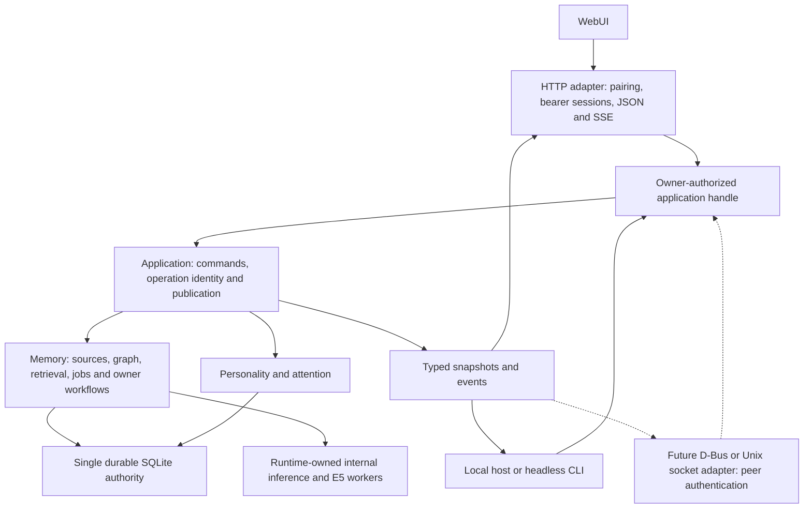
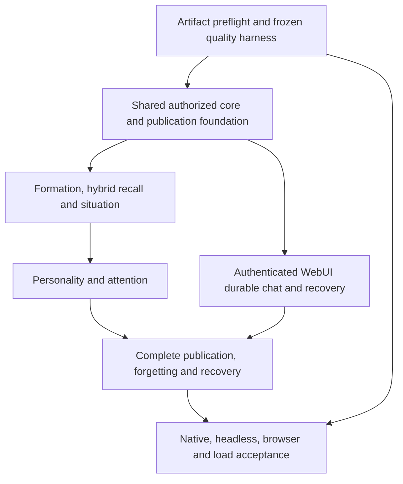

# Memory system: final implementation delivery

Status, 2026-11-06: the universal memory/personality/initiative implementation
is in place. [ADR 0007](decisions/0007-universal-assistant-memory.md) is the
current design authority; [the user guide](assistant-memory.md) describes the
actual APIs, WebUI and limits. The selected chat/E5 models remain unchanged.

Implemented: durable conversations and source links, freeform assistant notes,
semantic entry-point search and paged traversal tools, pinned editable personality,
optional background initiative, durable assistant-only mailbox, revocable core owner
access, direct local WebUI access and the corresponding controls. D-Bus and
socket adapters can reuse the owner API; their transports are future work.

Default deterministic tests and Chromium journeys pass. The final real-model
recheck is recorded in [native integration](memory-native-integration.md).
End-to-end forgetting/publication controls and whole-memory restore are still
not exposed in WebUI. The experimental domain extractor is not a product
prerequisite and is excluded from default builds.

## Historical broader v1 proposal

The remainder preserves the previous research/proposal, including superseded
fixed traits/moods, domain extraction and synthetic-corpus gates. It is not a
current implementation checklist or a reason to block the universal source-graph
experience. Current behavior and remaining limits are described above.

## Final delivery contract

| Experience | Required finished behavior |
| --- | --- |
| Remember | Accepted dialogue and explicit preservation survive restart. Confirmation identifies the committed literal source and distinguishes structuring/indexing coverage. |
| Understand current context | Every authorized product interaction recalls relevant people, preferences, goals, stated reasons, questions and unfinished commitments before its first model turn. Recent referents remain bounded. |
| Connect knowledge | Exact, lexical, semantic and typed graph recall produce complete supporting paths, including inverse navigation, attribution and time. Missing premises lead to qualification or abstention. |
| Update knowledge | Identified corrections take effect synchronously; ambiguous corrections remain visible and unresolved. Old jobs and active answers cannot overwrite or continue publishing invalidated evidence. |
| Have a stable character | Editable personality and expiring disposition compile deterministically; one behavior snapshot is pinned per operation. Voice changes do not change facts or permissions. |
| Take useful initiative | Due commitments and resolved blockers produce durable, deduplicated inbox items. Qualified, owner-enabled live notices obey quiet hours, activity deferral and quotas. |
| Give the owner control | Inspection, correction, preservation, forget preview/progress, export, backup and safe restore work through authorized core commands and the installed adapters. |
| Recover honestly | Lost replies, cancellation, storage failure and restart preserve durable identity and known tool outcomes. Uncertain effects remain uncertain; tools are never automatically replayed. |

Complete v1 retains one Linux owner, one assistant identity, one active product
interaction, SQLite authority, exact vector search and named JSON proposals.
HTTP is optional to the core; the authenticated WebUI is required for this
owner's delivery. Memory/background/inbox behavior must also work without it.
Memory-disabled behavior remains supported. Keep bounded working history for
immediate referents and tool protocol; prove permanent recall with that history
cleared. No graph server, ANN migration, compact language, recurring calendar,
external autonomous action, dynamic plugin loader or unrelated native update is
needed to finish this delivery.

## What the code actually contains

The 2026-11-06 audit reads the actual implementation and existing evidence;
it does not rerun the native suite. The latest recorded workspace result is
649 passed, 16 ignored, with the failing extraction preflight explicitly ignored.
The earlier storage milestone recorded 37 passing Rust 1.88 storage tests.
These are historical regression results, not model or end-to-end qualification.
Untracked native-build work is present and outside this plan's changes.

| Area | Implemented baseline | Remaining integration |
| --- | --- | --- |
| Storage | Migrations 1–4; durable product/tool commands, attributed sources, priority/reservations, suppression/journal/purge, FTS/qualified edges, fenced jobs, consumer cursors, vectors/coverage, terminal details and backup candidates. | New domain/dependency records, richer jobs, generation switching and live restore; reuse the existing writer. |
| Product coordinator | [`Coordinator::admit`](../crates/assistant/src/application/mod.rs) commits input/reservation and uses stable operation IDs in required mode; repeated submissions reconstruct stored outcomes. `run(id)` still reads bounded in-memory records. | Shared owner-authorized facade, responsive owned pending admission, canonical client options, durable lookup/status/history independent of resubmission and session lifetime. |
| Chat/tools | [`MemoryOperation`](../crates/assistant/src/memory/session.rs) recalls before generation, validates effective tool dispatch, owns intent/result tasks and joins them before terminal settlement. | Complete short-circuit/failure matrix, evidence read sets, behavior snapshots and generation-checked publication across every reader. |
| Lifecycle | [`MemoryRuntime`](../crates/assistant/src/memory/service.rs) gates readiness, owns storage/E5/indexing and joins them in order; diagnostic chat is isolated in required mode. | Extend composite ownership/supervision to extraction, personality, attention and restore; keep storage alive for every finalization owner. |
| Internal inference | [`runtime/worker.rs`](../crates/assistant/src/runtime/worker.rs) has rotating active contexts and synchronous preparation, but no execution class or internal structured job API. | Reserved foreground capacity, priority before preparation/prefill, isolated JSON jobs and measured accounting. |
| Knowledge | E5 Q8 CPU worker, source-bound vectors/cursors and exact semantic search work. Recall takes eight semantic hits plus lexical results, at most twelve excerpts; the query is a 384-byte prefix and excerpts are byte-bounded. Graph reads are outgoing only. Formation jobs have no production model consumer. | Token-based query/chunks/evidence packing, rank fusion, index coverage/generations, isolated per-source retries, extraction/semantic validation, correction/read sets, aliases/inverses/proof paths and situation. |
| Personality | No implemented personality/state module. | Versioned repository, compiler/reducer, profile editing and behavior snapshots. |
| Web | Authority/origin/CSP checks; no owner sessions. Memory-enabled activation is rejected. Frontend uses `EventSource`, discards pending identity after restart and limits retries to nine minutes. Existing browser fixtures serve synthetic v1 HTTP/SSE, not a real memory daemon. | Pairing/authentication, v2 contracts, authenticated fetch streams, durable reconciliation/history, evidence/owner UI and real daemon browser acceptance. |
| Daemon | [`cli.rs`](../crates/assistant-daemon/src/cli.rs) and [`app.rs`](../crates/assistant-daemon/src/app.rs) support `--memory-config` and durable prompt/stdin requests; raw/required-tool diagnostics conflict with required memory. | Pairing/status/maintenance commands without model startup, full configuration and shared owner command surfaces. |

Concrete audit anchors: `AssistantHandle::{memory,submit,run}` and
`Coordinator::{admit,run}` in `application/mod.rs`; `MemoryOperation::{prepare,
execute_tool,settle}` in `memory/session.rs`; `MemoryAccess::recall_context` and
`drain_index` in `memory/service.rs`; `Database::semantic_search` in
`memory/store/embeddings.rs`; `BoundWeb::activate` in `assistant-web/src/service.rs`.
The frontend connection constructs `EventSource` in
[`assistant-connection.tsx`](../crates/assistant-web/frontend/src/app/connection/assistant-connection.tsx);
[`submission.ts`](../crates/assistant-web/frontend/src/pages/chat/model/submission.ts)
contains the restart reset and nine-minute retry-window checks. Symbol names are
the audit anchors; line numbers from the earlier storage review are obsolete.

The remaining implementation touches human-owned `assistant`, `assistant-web`
and `assistant-daemon` code. The owner's 2026-11-06 request establishes that scope;
the immediate deliverable of this turn is the researched plan. Subsequent code
changes should carry the entire contract through acceptance.

## Core boundary and WebUI delivery refinement — 2026-11-06

Keep the current crate split. No new database service, UI framework, generic
transport protocol or D-Bus dependency is needed to establish this boundary.
Names below describe proposed Rust contracts, not existing public APIs.

### Shared application contract

- Introduce an owner-authorized application facade over the existing coordinator
  and memory services. It accepts owned typed commands and returns typed receipts,
  views and bounded subscriptions. Keep the store handle an internal service
  boundary for product paths; adapters must not assemble multi-step mutations by
  calling raw storage methods. Low-level binding/storage APIs remain available
  to trusted hosts/tests under their documented contracts.
- Authentication belongs to each adapter; authorization, owner intent, revisions,
  operation identity, evidence eligibility and publication checks belong to the
  core. A private host-issued access grant carries principal and revocation
  generation; it is not deserializable. A web session owns a revocable grant,
  not an unrestricted `MemoryAccess` clone. Revoke blocks new commands and closes
  that grant's readers/subscriptions; it does not replay or roll back admitted
  tools. Explicit cancellation is a separate durable product action.
- Keep web token digests, HTTP headers/status codes, SSE frames and browser tab
  identities out of `memory/`. Future socket peer credentials or D-Bus sender
  credentials map to the same grant. Missing credentials fail closed. Connection
  lifetime is not the lifetime of an admitted operation.
- Stable owner/assistant/store/operation/source/notice identities outlive daemon
  instances. Stream cursors and native working contexts remain disposable. Restore
  advances store generation and invalidates old grants/cursors. Persist or
  deterministically reconstruct the single logical conversation identity so
  history is not tied to a newly generated runtime `chat_id`.
- Durable client identity uses a host-assigned namespace, client ID, request ID
  and a versioned canonical command digest, including explicit options. Session
  tokens, event cursors, instance IDs and re-pairing do not enter that digest.
  Separate adapters use distinct stable namespaces unless the host explicitly
  grants reconciliation of another namespace; all use the same execution rules.
- Add lookup by original key, durable status by operation ID and keyset-paginated
  visible history. Initial snapshots contain a bounded recent window; history
  pages come from eligible durable sources, never hidden reasoning or a raw model
  transcript. A memory-disabled snapshot remains volatile. Lookup must work
  without submitting the input again.
- Keep pending admission in an owned task tracked by the coordinator. The current
  `Command::Submit` awaits storage inside the actor loop; move that wait out so
  status, cancellation, revocation and shutdown remain responsive. There is one
  pending/active product interaction across adapters; duplicate pending keys
  attach to its result and conflicting commands receive typed conflicts/busy.
- Subscribe atomically with snapshot/cursor registration; lag forces resnapshot.
  Events describe run state, visible text, evidence references, memory coverage,
  invalidation, health, personality and notices. Durable rows remain authoritative.
  Central publication leases/generations cover both subscription frames and
  ordinary read responses; each adapter checks again at its final send boundary.

| Shared command family | Core result needed by every adapter |
| --- | --- |
| Submit / lookup / status / cancel | Stable operation identity, commit boundary, provisional/terminal outcome and unknown-effect state |
| Snapshot / history / subscribe | Bounded visible state, history continuation, instance cursor and invalidation generation |
| Search / follow / inspect evidence | Qualified source/claim/path data, revisions, truncation and per-channel coverage |
| Preserve / correct | Existing source retention or identified revision change; literal/structured/indexed receipt |
| Forget preview / execute / status | Principal-bound reviewed selection and durable SQL/journal/publication/purge stages |
| Profile / disposition / attention policy | Expected-revision edits and effective operation boundary |
| Inbox / actions | Stable cause/notice identity, paginated state and seen/dismiss/snooze receipts |
| Health / export / backup / restore | Sanitized component state or tracked maintenance operation; host-selected destinations |

Implement the facade in `assistant::application` with domain DTOs under
`assistant::memory`/`personality`; use narrow modules rather than expanding the
existing coordinator into a storage/job monolith. Rust core errors contain no
`status_url`; the web adapter adds route locations to its wire envelope. Derive
wire schemas from versioned public DTOs where practical, with checked mappings
where HTTP has a different representation. Update OpenAPI, Valibot and fixtures
together. Do not expose the extraction proposal schema as a client authority API.

### WebUI is the first required product client

Preserve the existing chat/composer/Markdown/metrics experience. Add a small
navigation surface for Memory, Inbox and Settings; source inspection is available
from an answer's evidence references. A graph picture is optional polish; a
complete readable supporting path with source/time qualifications is required.

| Owner journey | Required UI behavior and failure state |
| --- | --- |
| Start and pair | Existing daemon startup plus memory config; run `assistant pair` against the already-running daemon without loading another model. Pair screen explains the local command; no personal bootstrap before authentication. |
| Chat and restart | Show saved input separately from provisional answer text. Reload/restart/re-pair recovers durable recent history and a pending operation by its original key; terminal output is never regenerated automatically. |
| See what was remembered | Message/answer actions open source excerpts, claims, full proof paths, corrections and evidence attribution/time. Receipts distinguish saved literal, pending/unresolved structuring and partial/unavailable indexing. |
| Search and preserve | Search stored evidence with bounded paging/filters; preserve an existing accepted source rather than duplicate its text or grant another extraction budget. Empty and unavailable are distinct. |
| Correct | Edit a selected claim using expected revision and replacement evidence. A stale edit reloads current state; an ambiguous natural-language correction stays visibly unresolved. |
| Forget | Preview affected sources/derived content and active work; confirm the reviewed selection, show logical barrier progress and physical purge separately, then invalidate local cached views. |
| Character and initiative | Edit profile/disposition/expiry/quiet hours/owner notice cap; show activation boundary. Inbox supports seen/dismiss/snooze without injecting fake user turns. |
| Inspect and recover | Component health/backlog, export, backup and restore are reachable owner controls. Backup/restore select opaque server-managed backup IDs, never arbitrary browser-supplied filesystem paths. |

Retain the selected in-memory bearer contract: reload requires pairing again;
daemon restart invalidates sessions. Persist only bounded opaque pending namespace,
client/request IDs in tab `sessionStorage` before submission, no credentials or
conversation text. On re-pair, lookup restores accepted work. If lookup is absent
after reload, the original text is unavailable: show that fact and require an
explicit new submission; do not invent text or automatically execute. A committing
or indeterminate result stays pending. Preserve a live draft on ordinary network
failure; logout/revoke clears personal stores, rendered/queued text and credentials
while retaining only opaque pending keys for later authorized reconciliation.

Replace `EventSource` with a bounded fetch stream carrying Authorization. Parse
UTF-8 incrementally, including split codepoints, BOM, LF/CRLF/CR, comments,
multi-line data and incomplete events at EOF. Cap frame bytes and queued events;
overflow disconnects/resnapshots. A 401 stops reconnecting and returns to pairing;
transient failure retries with bounded backoff. Heartbeats and background
subscriptions do not refresh owner-activity or idle-session deadlines. Cancel
old fetch/readers on session change, hidden-tab suspension and invalidation.

Add `GET /api/v2/history` for bounded visible history and explicit v2 backup
create/list/status and restore-preview/execute/status routes to the specification's
endpoint families. Match their typed core commands. A restore revokes the current
session; after re-pairing the owner inspects its durable activation result. The
public `GET /api/discovery` returns only API version and memory-disabled versus
pairing-required mode, with no personal IDs, health details, counts or model paths.
The existing v1 path stays usable only in memory-disabled mode. Do not merely
remove `BoundWeb::activate`'s memory rejection before protected routes exist.

### Concrete implementation order and review units

These are small code-review units within the same delivery, not requests for a
new approval at each row. Finish both adapters' journeys before declaring success.

| Order | Focused change and affected surfaces | Exit evidence |
| --- | --- | --- |
| 1 | Re-establish format/check/test baseline; freeze dev/held-out quality corpus, artifact manifests and reproducible model commands (A). | Recorded current results; extraction failure reproduced without weakening assertions; no assumed model download. |
| 2 | Shared authorized facade/DTOs, canonical options, durable lookup/history, responsive pending admission and publication-generation foundation (`application`, `memory`, daemon; B/F). | Direct Rust commands prove lost-reply/restart/duplicate/revocation behavior and durable history without HTTP. |
| 3 | Pairing CLI/socket, owner sessions, protected v2 mapping, fetch-SSE and first working durable chat/history/evidence UI (`assistant-web`, frontend; E). | Real daemon/browser pair, save, restart, re-pair and reconcile; unauthorized personal routes fail; unqualified channels remain explicit in development. |
| 4 | Internal inference class/priority/reservations, richer fenced jobs, production extractor/validator and E5 retry/coverage/accounting (`runtime`, `memory`; A/B/C). | No primary-chat mutation or tools; poison source does not block later indexing; native development extraction passes and held-out results remain separately scored. |
| 5 | Alias/inverse/proof-path/hybrid retrieval, token packing, synchronous corrections, read-set invalidation and situation state (C/F). | Model-produced graph survives restart and supports qualified chain answers; correction interrupts stale publication in both core and WebUI. |
| 6 | Profile/disposition and deterministic attention/inbox, with full owner editing/actions and notice publication checks (D/E/F). | Same evidence/facts across profiles; fake-clock/restart/dismissal invariants; every visible control works. |
| 7 | Complete cross-exchange forgetting, export, backup/restore activation and recovery UI/CLI (E/F). | Blocked delivery/export/job cannot publish after barrier; old backup cannot resurrect forgotten data; activation crash tests pass. |
| 8 | Native, direct-core, real-daemon browser, load/MSRV/package checks and owner walkthrough (G). | Q1–Q8 results and supported limits; timed live-notice validation remains explicitly separate. |

Work on failed model qualification and independent core/UI plumbing can proceed
without treating a syntactically valid JSON result as a qualified graph writer.
Early WebUI integration is a development path with truthful coverage; it is not
promotion of unqualified semantic memory. Shared invalidation infrastructure is
built in order 2 and extended with each domain, not first considered at order 7.

No D-Bus/socket implementation is required now. Prove extensibility by running
the same command/receipt/forget/recovery scenarios through a direct authorized
Rust client and HTTP adapter, by running `--no-web`, and by verifying that the
core builds without `assistant-web`. No new transport may open another writer
or implement its own extraction/scheduler/retention policy.

## Research findings that change the implementation order

### Qualify the actual model path first

The owner selected and supplied `multilingual-e5-small-q8_0.gguf` from
[cstr/multilingual-e5-small-GGUF](https://huggingface.co/cstr/multilingual-e5-small-GGUF).
Startup pins its bytes by SHA-256
`0a34067a40f25d3149b36885faa62bee0e5284d0f9edc102acfc00e115d953e8`.
It already declares SentencePiece, so no conversion tooling or additional model
is needed. It omits token-type count and noncausal metadata; scoped load overrides
supply those. Native tokenizer exceptions are now contained. The local chat
artifact SHA-256 is
`077f001fa1ba64e49190e4b2a83035e886e3c22f74d0a331843925b1d7fa3a2f`.
Earlier converter findings below are historical preparation risks, not an
instruction to install conversion tools for the selected artifact.

E5-small's published configuration names `BertModel` and
`XLMRobertaTokenizer`. The pinned converter's
[`BertModel.set_vocab`](../crates/llama_cpp_sys/llama.cpp/conversion/bert.py)
emits `tokenizer_model=bert`, which the pinned native vocabulary loader selects
as WordPiece. Separate XLM-Roberta vocabulary helpers exist. This is a concrete
conversion compatibility risk, not proof of a failed conversion experiment:
no E5 conversion was run in this review.
[Published E5 configuration](https://huggingface.co/intfloat/multilingual-e5-small/raw/main/config.json).

Therefore require token-ID, normalization, special-token and position-embedding
parity before vector parity. An adapter must preserve this model's BERT position
semantics; relabeling its architecture as XLM-Roberta is not a qualification.
Keep conversion changes in repository-owned tooling or build-copy patches, never
inside the pinned submodule. Do not silently switch model families to avoid the
problem. The selected E5 contract remains mean pooling, L2 normalization,
384 dimensions, query/passage prefixes and at most 512 total input tokens.
[E5 model card](https://huggingface.co/intfloat/multilingual-e5-small).

The Rust embedding accessors now check output dimensions, pooling, successful
evaluation eligibility and indices; guarded tokenization contains native
exceptions. Real E5 smoke/batch-isolation tests pass. Reference token-ID/vector
parity and held-out retrieval gates remain open; Q8 smoke success does not prove
the matched-FP32 reference gate.

### Close product contracts before connecting callbacks

These choices are required in the final implementation, not future API research:

1. **Authority:** host-issued owner/session scope is required for personal reads,
   writes, subscriptions and tool dispatch. A string such as `web` is a client
   namespace, not authentication. No global recall hook grants private access.
2. **Client identity:** hash a versioned canonical client command, excluding host
   observation time, current default budgets and newly resolved profile state.
   Explicit client options belong in the digest; the originally resolved limits,
   behavior and policy revisions are stored at first admission. Retries after a
   config/profile change return the original operation, not a fresh run/conflict
   caused solely by new defaults. Version the digest format and support legacy
   stored requests explicitly; preserve existing receipt/spent-key semantics.
3. **Lookup:** add authorized lookup by original client key, because a lost
   admission reply leaves the client without an operation ID. Old acceptance
   receipts identify an operation; current status comes from the operation store.
4. **Outcome:** preserve migration 4's terminal reason, truncation/deadline status,
   limit reason and usage availability in durable lookup/history projections.
   Detailed performance/resource samples are still not fully reconstructible;
   unavailable measurements must stay unavailable. Do not invent zero metrics
   or a successful full answer after restart.
5. **Tool ordering:** all confirmed receipt/unknown-outcome writes settle before
   finalization is enqueued. The writer prioritizes finalization over other
   critical work, so cross-queue FIFO must never be assumed.
6. **Actual dispatch:** validate effective arguments after trusted middleware,
   persist intent before the real handler, and persist its bounded result before
   publication/continuation. A middleware short circuit is recorded as such;
   it must not pretend an external handler executed. Apply capture policy before
   serialization, including failure and cancellation paths.
7. **Read sets:** persist operation evidence/source dependencies, predicate-scope
   revisions and derived eligibility epochs. Source-only deletion checks cannot
   protect an answer based on changed blockers or an older conclusion.
8. **Preservation:** preserving an already accepted source is a retention command,
   not another copy of the whole conversation or a new model-work allowance.
   Coalesce source-family evidence and jobs; assistant prose is not independent
   corroboration of a user fact.

## One implementation pass, ordered internally

Every section below belongs to the same final delivery. Small reviewable code
changes are appropriate; a new planning/approval cycle between them is not an
implementation requirement. Keep independent work moving if an empirical gate
fails, but do not report an unqualified channel as complete.

### A. Artifact preflight and executable qualification harness

Touch binding wrappers/shims as necessary, repository-owned model-preparation
and evaluation tooling, memory fixtures and benchmark manifests.

- Read [binding maintenance](bindings-fork.md); preserve the native pin and
  patches. Fix embedding dimension/pooling/rank/index/lifetime contracts, with
  error containment and real embedding tests. No unsafe slice from a guessed
  shape; invalid native indices must not abort the daemon.
- Preserve the already-selected E5 Q8 artifact and its checksum; do not repeat
  conversion or replace it to make a smoke case pass. Complete source-revision,
  license, converter/options, tokenizer and reference-fixture provenance where
  available; record unknowns honestly. Existing reference artifacts/fixtures may
  be used for parity. Missing reference weights or tooling remain an explicit
  qualification dependency, not authorization for downloads/installations. The
  daemon remains native Rust/llama.cpp and never downloads models.
- Check tokenizer parity on English/Ukrainian, punctuation, normalization,
  special tokens, maximum input and mixed batches. Require matched-FP32 vector
  cosine >=0.999, correct dimension/norm, and batch isolation.
- Run real named-JSON extraction with the selected local chat artifact using
  the binding's existing template/parser/schema/grammar path. Inspect complete
  output, termination reason, exact quotation entailment, identity and correction
  behavior. Fix prompt/chunk/handle selection within the selected budgets;
  do not lower semantic validation or count repaired syntax as semantic success.
- Reproduce the current family/occupation failure first. Measure rendered input,
  schema/handle overhead, output termination and thinking configuration before
  tuning. Compare focused instruction/examples and smaller host-selected excerpts
  on development cases only. Keep the v1 semantic output contract; an internal
  schema reduction or staged extraction is an experiment whose additional calls
  must fit the same root budget. Freeze a candidate before held-out evaluation.
  Exact quotes and type checks alone cannot detect every wrong-but-well-typed
  attribution; do not present structural host validation as an entailment oracle.
- Build the complete quality harness now. Freeze development versus held-out
  data before tuning. Seeded graphs, scripted models and actual model-produced
  memory are different test tracks and receive separate results.

This stage uses development cases for early preflight. Full held-out quality is
measured through the integrated implementation in G, not inferred from that
preflight or the converter's supported-architecture registry.

The owner requires the existing selected models; alternative models and model
downloads are out of scope. If Q4 fails, revise the algorithm, host-selected
scope or staged protocol within the resource contracts. An unresolved quality
failure is a release blocker, not permission to omit semantic memory or rename
literal search as the final brain.

### B. Authorized durable runtime and conversation

Touch `application`, `chat`, `tools`, `runtime/{mod,services,worker}`, daemon
assembly and compiled memory/personality plugin glue.

- Select `MemoryMode::Disabled/Required`; exactly one mandatory persistence
  participant lives outside cancellable generation and optional hooks. Keep
  restricted handles inert until the composite factory completes recovery,
  required model/profile validation and consumer activation.
- Add private `OperationContext`, pinned `BehaviorSnapshot`, `EvidenceLease` and
  publication generation to the run. Restrict diagnostic `Chat` to an isolated
  ephemeral context without private history, persona, memory tools or recall;
  it must not alias a product chat containing personal working state.
- Make coordinator admission asynchronous and owned. Track the pending key as
  well as the active run so cancellation/status/health remain responsive.
  Acknowledge/publish acceptance after the atomic storage commit only. Lost
  receivers do not cancel admitted work or generate a new request key.
- Wire `admit_operation`, start, effective tool intent/result and terminal
  settlement. Cover early backend admission failure, lock-wait cancellation,
  middleware short circuits, tool/model errors and shutdown. Await receipt
  settlement before terminal settlement; await terminal commit before durable
  `Finished`. Streamed deltas remain provisional until then.
- Pass bounded visible-output/captured-receipt DTOs to persistence; never serialize
  raw `ChatResponse.messages`, hidden reasoning, system prompts or working context
  as a convenient terminal transcript.
- Introduce typed internal inference with a distinct execution class and owned
  completion. It uses resident model weights and isolated contexts, never the
  primary chat, ordinary tools, product submit or recursive transcript ingestion.
- Give foreground work priority before dispatch, allocation, rendering and every
  native prefill/decode boundary. Reserve an interactive context/permit and one
  query-embedding slot. Count paused context residency. If resources cannot fit,
  expose background unavailability rather than consuming interactive capacity.
- Prepare storage before model startup; release readiness before enabling
  authorized traffic. Supervise required consumers/writers/model users. On
  shutdown close admission/claiming, cancel generation, settle owned work, join
  native users, then close storage. A timeout never abandons finalization owners.

Prove an authorized headless exchange, lost reply, restart reconciliation,
confirmed/unknown tool outcome and unchanged memory-disabled behavior before
building further product surfaces. Continue the same implementation task.

### C. Form, retrieve and maintain the knowledge state

Touch `memory/{extract,retrieve,situation}`, job scheduling, store transactions,
model-worker preparation and typed memory tools.

- Generalize jobs to include kind, next due, attempts, lease heartbeat/hard end,
  attributed source excerpt, absolute spans, coverage cursor, read set and
  dependency/policy versions. Current whole-source/add-only leases are a starting
  point, not the extraction runtime contract.
- Count the actual full rendered input before compute reservation, including
  instructions, handles, schema/template and retry prefill. Keep the selected
  1,024-token excerpt ceiling, 128 overlap, four-claim/512-output bound, one repair,
  four passes/4,096 input/1,024 output per root and daily 60K/10K/300 seconds.
  Shrink excerpts when the full prompt cannot fit. Record model/tokenizer identity
  with usage; embedding work also consumes its declared compute allowance.
- Enforce 60-second leases, 20-second heartbeat, 120-second hard lifetime and two
  transient retries at 5/30 seconds. Expiry/reclaim advances fences. Complete
  source/graph/scope/generation checks and effects in one writer transaction.
  Partial coverage never advances an unlocated prefix; truncation applies no
  proposal. Deferred/unresolved literals remain searchable.
- Implement ambiguity-preserving aliases, source-family deduplication, typed
  inverse navigation and proof paths. Search exact/FTS/E5 candidates, fuse ranks
  using the specified constant 60, and investigate finite patterns under cumulative
  node/edge/depth/token limits. No arbitrary SQL or model-defined graph code.
- Implement versioned vector manifests/generations, finite normalized f32 storage,
  bounded exact scans and authoritative eligibility hydration. Expose index
  coverage/watermarks, building/unavailable/partial states and rebuild/switch
  behavior. Keep full source/span mappings through E5's 384/64-token chunks.
- Replace the indexer's current 640-byte advance/128-byte overlap with measured
  tokenizer chunks, and isolate a failed source with persisted retry/fault state
  so it cannot starve the rest of the backlog. Add total elapsed-time, visited
  vector and byte limits to Rust's similarity loop; a SQLite progress handler
  bounds SQL execution, not arbitrary host-side scoring. Report scanned/eligible
  coverage on bounded scans rather than silently calling a partial top-k exact.
- Run E5 through a dedicated native owner worker with noncausal batch decode and
  pooling, initially on CPU. Give query work priority over document batches and
  copy vectors into owned results before crossing threads. Do not send an
  embedding model through the generative chat-template/`Generate` path.
- Build `EvidenceBundle` and `SituationSnapshot` before each product interaction,
  without a planning-model call for normal recall. Pack through the actual chat
  tokenizer: reserve current input, active tool protocol and minimum output,
  then the persona and 1,024-token evidence allowance. Keep complete premises,
  qualifications and pending corrections; never retain a stale fact alone.
- Offer scoped `memory.search`/`memory.follow` investigation and current-source
  preservation. Host-issued handles/intent control correction and destructive
  actions. Recalled prose cannot grant authority, edit personality or execute code.
- Apply identified corrections synchronously. Keep ambiguous targets unresolved;
  do not confidently present the old value while hiding pending correction words.
  Derive active goals, explicit reasons, blockers, questions and commitments from
  checked premises. Connectivity alone proves neither causality nor transitivity.

All named entities, typed claims and conclusions retain source role, evidence,
valid/recorded time and revisions. Assistant promises can create assistant
commitments, not new purported user facts. Unknown motives stay unknown.

### D. Personality, situation-driven attention and delivery

Touch `personality`, `memory/attention`, revisioned repositories, scheduler and
application events. Use one agent identity/repository and the same writer.

- Implement the specification's bounded profile, integer traits, compiler,
  disposition reducer/expiry and replacement generations. Default automatic
  disposition changes off; profile prose remains within 512 chat tokens.
  Pin revisions at admission. Neutral behavior works without a personality
  plugin; reject incompatible persistence-requiring configuration explicitly.
- Make profile/disposition edit, replacement and activation modes real owner
  commands. `interrupt_active` uses cancellation, mandatory finalization and the
  publication barrier. It never retries completed tool effects or deletes facts.
- Implement only the selected notice rules: due pending one-shot commitment or
  resolved blocker of an active goal. Check every remaining blocker. Civil-time
  resolution uses `chrono`/`chrono-tz`; ambiguous/nonexistent local times require
  clarification. Reject recurrence rather than making an unsupported promise.
- Persist subscriptions, fan-out cursors, cause/occurrence identity, notice state,
  draft versions, expiry, seen/dismiss/snooze and delivery records. Publish the
  notice plus quota/dedup state atomically. Disconnect/restart/redrafting cannot
  create another cause or refill its budget.
- Wake on durable changes/due time/resume; no periodic model inference. Native
  drafting runs only after deterministic eligibility/budget checks. Revalidate
  premise/profile/policy revisions before publication. Template factual inbox
  cards handle drafting failure; unqualified prose never reaches live delivery.
- Deliver typed assistant notices without manufacturing user turns. Preserve
  inbox items while no transport is connected. UI deduplicates stable IDs;
  published, client-acknowledged and owner-dismissed states remain distinct.
- Enforce default live opt-out, owner-capped 0/1/2 per rolling day, two-hour gap,
  quiet hours, five-minute activity deferral, expiry and permanent same-cause
  dismissal. Background telemetry/heartbeats do not count as owner activity.

The feature is fully implemented even while its live promotion gate is closed;
there must be no placeholder timer, fake canned proactive conversation or
unimplemented user action left in this delivery.

### E. Optional authenticated web and durable headless adapters

Touch `assistant-web`, frontend FSD features/contracts, daemon CLI, OpenAPI and
packaging. The core above has no dependency on web types or browser sessions.

- Add opt-in startup memory configuration with explicit data/model manifest,
  budgets, timezone, profile and owner attention policy. Keep existing default
  invocation compatibility. In enabled mode, `--no-web --prompt` and
  `--no-web --interactive` use authorized durable product commands; raw decoder
  diagnostics require memory disabled. Headless resident jobs/inbox keep working.
- Parse `assistant pair` without requiring/loading a model. Install its private
  0600 Unix pairing socket under 0700 runtime storage only with the web adapter;
  check peer UID. General-purpose Unix/D-Bus transport remains outside scope.
  Offline maintenance cannot open a second writer while the daemon owns the store.
- Implement the selected one-use 256-bit/5-minute pairing code and in-memory
  bearer sessions (8-hour absolute, 30-minute idle), one outstanding code and
  five exchange attempts/minute. Never put credentials in URLs, logs or browser
  persistent storage. Expiry/logout/revoke closes subscriptions and queues.
- Implement every v2 endpoint family in the specification, including lookup by
  original key, forget status and bounded export. Authenticate all personal
  reads, bootstrap, submission, status, cancellation and streams. Disable or
  equally protect legacy routes; no memory access through the v1 path.
- Replace `EventSource` with bounded authenticated fetch-SSE. Handle UTF-8/chunk
  boundaries, aborted streams, token expiry, lag and instance changes. Preserve
  atomic snapshot/stream registration and distinguish stream cursors from stable
  operation IDs. SSE heartbeat traffic must not renew idle expiry by itself.
- Replace the frontend's instance/nine-minute retry assumptions with durable
  reconciliation. Preserve opaque pending identity across reload if needed,
  without persisting a bearer or conversation text. After re-pairing, look up
  the original operation; never automatically replay it or mint a new key.
  A committing/indeterminate request is not a definite rejection.
- Add complete owner UI: memory/evidence/path inspection, preserve/correct,
  forget preview/progress, profile/disposition editor, inbox actions, component
  health, export and recovery controls. Keep technical counters in inspection;
  the conversation shows useful context, truthful saved state and source links.
- Update Rust schemas, OpenAPI, TypeScript validators, reducers and browser
  fixtures together. Preserve the current composer/streaming/Markdown behavior.

The browser must feel like the existing working chat with durable context and
owner controls, not a collection of disconnected demonstration pages.

### F. Publication, forgetting, export and restore across all features

Touch application publication, every personal reader/transport, dependency
storage, maintenance, backup/restore and owner recovery commands.

- Add authoritative source/claim dependencies for operation outputs, retained
  receipts, situation, appraisals, notices and exports. The storage baseline's
  own-exchange suppression is insufficient for text derived in later exchanges.
- Revalidate selected revisions before model dispatch and publication. Direct
  facts use their own revisions; derived conclusions also use scope/eligibility
  epochs, including inserts that invalidate absence-based reasoning. Do not
  hold a SQL transaction throughout inference.
- Implement durable forget progress: reviewed selection -> SQL suppression ->
  journal acknowledgment -> publication barrier -> bounded physical purge.
  Acknowledge logical forgetting only after the first three execution barriers
  settle. Invalidate affected prompts/history and conservatively mask derived
  copies until revalidated. Reject late job fences/results.
- Cover model deltas, tool replies, queued SSE, snapshots, evidence/search,
  inbox and export. Tag publications with store/deletion generation and check at
  the final controlled send boundary; drain/close queues that cannot be revoked.
  Already delivered bytes and downloaded external copies cannot be retracted.
- Implement bounded versioned JSONL export, authorized completion/download and
  generation recheck. Backup retention/expiry failures remain visible; journal
  retention covers every retained backup. Explicit preservation is not silently
  evicted to free space.
- Implement restore activation, not merely candidate creation: quiesce admission,
  verify manifests/checksums, reconcile newer deletions, validate integrity,
  rebuild/catch up indexes, revoke sessions/leases, reset working contexts and
  atomically choose the new store. Hold stable daemon ownership across the switch;
  use a durable activation marker/pointer and directory fsync, not a fragile
  in-process handle replacement. Crash recovery determines old/new activation
  without mixing them. Failed restore preserves the old directory.
- Preserve migration 1 and migration 2 byte-for-byte. Add ordered migrations for
  the new records and old-store tests. Never promote a backup that cannot prove
  deletion-history coverage; retain it quarantined for explicit owner reconciliation.

### G. Qualification, packaging and finished owner walkthrough

Build acceptance around the running product, with separate isolated native and
scripted failure fixtures. Add reproducible commands/reports for model quality,
headless/browser journeys and performance. No fabricated benchmark numbers.

| Evidence | Required result |
| --- | --- |
| Q1/Q2 platform/storage | Locked Rust 1.88 build, selected features, distributable Linux startup, v1/v2 upgrades and process-kill/atomicity/fence/quota/reservation tests for all new transactions. |
| Q3 embeddings | Safe shape/index/rank APIs; checksummed artifact/tokenizer parity; matched FP32 cosine >=0.999, normalization, batch isolation and generation-switch/deletion coverage. |
| Q4 extraction/answers | At least 120 held-out cases plus separate development cases; extraction precision >=95%, recall >=90%, zero critical identity/attribution/correction errors; supported answers >=90% and unknown abstention >=95%. |
| Retrieval | Direct/paraphrase evidence Recall@10 >=95%; complete-path recall >=90% for three/six/eight-edge cases, with missing/reversed edges, cycles/hubs and current/historical queries. |
| Q5 resources | Paired cold/warm foreground runs under queued background load; p95/p99, CPU/RSS/VRAM, embedding/prefill time and oldest backlog. Target p95 initial recall <250 ms at 100K records and <10% foreground first-token regression; report supported capacity if a target fails. |
| Q6 personality | Deterministic edit/reducer/rebuild replay and paired fixed-evidence profiles; factual conclusions/permissions unchanged, tone adherence reviewed, in-flight edits safe. |
| Q7 initiative | Fake-clock timezone/DST/quiet/dismissal/restart races; >=90% useful reviewed candidates with missed opportunities reported; opt-in local-use week before live promotion. |
| Q8 security/UI/recovery | Unauthorized/expired/revoked route and stream matrix; injection, lost replies, restart resnapshot, deletion during blocked delivery/export, older-backup restore and atomic activation failures. |

Use six held-out groups of at least 20 cases: personal facts/attribution;
English/Ukrainian paraphrase; corrections/time; chains/missing premises;
goals/reasons/commitments; unknown/injection/trust boundaries. Review/freeze
expected evidence and category counts before tuning. The nineteen development
examples and nine-step narrative are not held-out or executed native results.
Score extraction, retrieval and answer reading separately, with human-reviewed
ambiguous cases; a model judge alone is not the authority.

Default tests use temporary stores, scripted engines/embeddings and injected
time. Dedicated native runs require the declared artifacts and fail if absent.
Use isolated quality fixtures while retaining production budgets in each case;
separate load tests prove the real rolling-day/backlog limits. Inventory 10K,
100K and 1M stores where resource budgets permit; one million 384-float vectors
already require 1.536 GB before metadata, text, WAL and model residency.

The final walkthrough must execute this story through both the headless core
and authenticated WebUI:

1. Preserve Lena/sister/veterinarian/Lviv from ordinary dialogue; restart and
   clear working history. Ask a paraphrased English/Ukrainian question whose
   answer needs the relationship/occupation chain and show its sources.
2. Add an explicit goal, reason and blocker. Continue a different session and
   demonstrate the assistant knows the current unfinished situation.
3. Correct the city while a job/answer is in flight. Reject obsolete work and
   answer with the corrected evidence; distinguish historical questions.
4. Edit personality and an expiring disposition. Keep facts fixed while the
   next operation adopts the selected voice; replacement preserves memory.
5. Resolve the goal's blocker and schedule a concrete one-shot commitment.
   Produce inbox notices, exercise quiet/activity policy and dismiss/snooze;
   restart without duplicate causes or free quota.
6. Forget while a stream/export/job is blocked. Confirm the journal/publication
   barrier, drain purge, restore a pre-forget backup and prove no resurrection.
7. Lose acceptance/terminal replies and kill the process around a tool effect.
   Reconcile the same key, preserve known receipts and leave uncertainty honest.
8. Run memory disabled and web disabled independently; verify regressions and
   zero idle model inference when no eligible work exists.

Run workspace Rust gates, Rust 1.88 storage/integration tests, relevant binding
native tests, frontend check/test/build and browser tests. Update architecture,
LLM/memory/web contracts, model preparation instructions, owner startup/controls,
recovery examples and the documentation map. Report existing lint debt separately
from new warnings; do not edit generated bindings or weaken safety gates.

Browser qualification has two tracks. Extend the existing HTTP fixture tests for
session/stream parsing, races, keyboard/accessibility and rendering behavior, and
add tests against the real Rust daemon and temporary durable store. A synthetic
v2 fixture cannot establish storage, native extraction or restore correctness.
Keep deterministic daemon tests separate from required-artifact native browser
walkthroughs, recording model identities and coverage for each. Run the existing
Chromium/Firefox/WebKit projects; report an unavailable engine explicitly.

Transport conformance must compare authorized direct-core and HTTP runs for the
same authored scenarios: admission/lookup/terminal receipt, revision conflict,
forget barrier, inbox action and restart recovery. Verify web disabled with
background progress and zero listener/pairing tasks; verify core package builds
without the web crate. Future D-Bus/socket support then requires adapter tests,
not a replacement memory engine.

## Completion and timed validation

Implementation completion means every selected capability above exists, is wired
through the actual application/adapters and has executable acceptance coverage.
No required path is a stub, an uncalled service, mock-only inference or another
unimplemented milestone. Deliver the run commands, artifact identities, measured
reports and known limits with the change.

Complete v1 release qualification still requires Q1-Q8, including real model
results and the previously selected opt-in week. Calendar time and human
usefulness review cannot be replaced by passing code tests. The final task must
supply the working reviewed-inbox/live delivery paths and their instrumentation;
live remains disabled until its promotion evidence exists. This is a validation
boundary, not permission to defer implementing initiative.

If an empirical gate fails, fix what can be fixed within this same delivery and
report the exact remaining blocker. Do not declare complete v1 by silently
lowering thresholds, dropping semantic memory/personality/initiative, or presenting
another storage-only result. No further architecture-research phase is planned.

## Primary research checked for this revision

Rechecked on 2026-11-06 for the transport/UI refinement:

- [WHATWG server-sent events](https://html.spec.whatwg.org/multipage/server-sent-events.html):
  `EventSource` exposes URL and credentials mode, not arbitrary authorization
  headers. Its UTF-8, line-ending and dispatch rules are the parser contract for
  the selected bearer-authenticated fetch stream. This supports retaining SSE,
  not introducing WebSockets solely for authentication.
- [Tokio UnixStream peer credentials](https://docs.rs/tokio/latest/tokio/net/struct.UnixStream.html#method.peer_cred)
  and [D-Bus connection credentials](https://dbus.freedesktop.org/doc/dbus-specification.html#bus-messages-get-connection-credentials):
  native caller credentials can be mapped by their adapters to a core access
  grant. Inference: keeping credentials and transport serialization outside the
  memory service permits future adapters without changing memory semantics.
- [E5 model card](https://huggingface.co/intfloat/multilingual-e5-small):
  384-dimensional output, masked mean pooling, normalization, query/passage
  prefixes and 512-token input constrain the native path. The selected Q8 smoke
  result is not reference parity or held-out retrieval evidence. Apply the same
  declared whitespace transformation in reference/native comparison and retain
  original source-byte citations separately.
- [SQLite progress callback](https://www.sqlite.org/c3ref/progress_handler.html)
  and [online backup API](https://www.sqlite.org/backup.html): progress callbacks
  run during SQLite operations; the Rust scoring loop needs its own budget
  checks. Online backup supplies a database copy; it does not implement the
  daemon's grant revocation, publication barrier or atomic live-store activation.

Earlier sources below remain background for the unchanged delivery contract.

- E5's [configuration](https://huggingface.co/intfloat/multilingual-e5-small/raw/main/config.json)
  and [model card](https://huggingface.co/intfloat/multilingual-e5-small) establish
  the mixed architecture/tokenizer and interface contract. Native parity remains
  unmeasured here; converter risk is an inference from those and the pinned code.
- [LongMemEval](https://arxiv.org/abs/2410.10813) separates extraction,
  multi-session/temporal reasoning, updates and abstention. These motivate
  separate evaluation tracks, not a claim that its benchmark was run here.
- [Tokio JoinHandle](https://docs.rs/tokio/latest/tokio/task/struct.JoinHandle.html)
  documents detached tasks on drop and blocking-task cancellation limits;
  [Notify](https://docs.rs/tokio/latest/tokio/sync/struct.Notify.html) carries wake
  signals rather than work data. Owned completion and SQL cursors follow from
  these contracts.
- [SQLite isolation](https://sqlite.org/isolation.html) permits old reader
  snapshots after a writer commits; application publication revalidation is an
  additional requirement, not a guarantee supplied by WAL.
- [OWASP session guidance](https://cheatsheetseries.owasp.org/cheatsheets/Session_Management_Cheat_Sheet.html)
  supports careful credential exchange/lifecycle handling. The selected local
  pairing/bearer design and exact time limits are project choices.

This revision inspected source/artifact availability and primary documentation.
It did not change production code, run a new model benchmark or repeat the
previous milestone's Rust tests.
