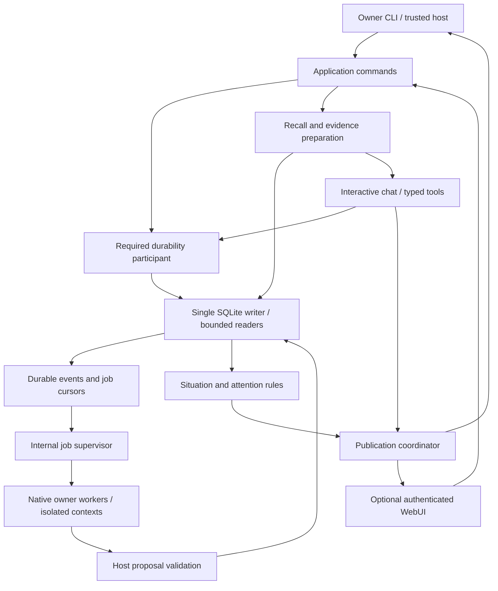

# Memory integration: audited next steps

Status: proposed implementation sequence after source review, 2026-11-05.
Application/runtime wiring below remains planned; the library package is recorded separately.

Progress: change 1's library storage package is implemented, including ordered
migrations, critical/finalization lanes, reservations, operation/tool/source
commands, deferred formation, consumer cursors and explicit history pagination.
The failure tests now execute the quota finding below. See
[the current storage contract](memory-storage.md). Changes 2-7 remain planned;
the source-audit tables record the pre-package baseline, not unresolved defects
where change 1 now supplies the fix.

The next milestone is a durable, authorized conversation that remembers across
restart and can explain where its recalled facts came from. Opening the database
from a plugin does not establish that contract. Admission, tool dispatch,
finalization, evidence delivery and shutdown must participate together.

The [implementation specification](memory-implementation-spec.md) remains the v1
design authority. This document turns its P1-P8 work packages into smaller
integration changes based on the actual code. The
[storage documentation](memory-storage.md) describes what exists; the
[original research](memory-system-plan.md) explains the alternatives and quality
targets. This plan does not relax their qualification gates.

## Outcome and scope

The desired experience has four independently testable properties:

| User expectation | Required behavior |
| --- | --- |
| “Remember this.” | The literal source is committed before confirmation, remains inspectable after restart, and reports whether extraction/indexing is still pending. |
| “You understand my situation.” | Relevant people, preferences, goals, reasons and unfinished commitments are recalled with attribution, corrections and uncertainty. Bounded recent context resolves conversational references. |
| “Connect what you already know.” | Retrieval finds complete supporting paths across sessions; missing premises cause qualification or abstention. Similarity and graph connectivity alone do not establish truth. |
| “Sometimes take the initiative.” | Durable commitments and goal changes can produce useful, deduplicated inbox items, then opt-in live delivery under owner policy. |

Keep bounded working history for immediate conversation and tool protocol. Prove
long-term recall after deliberately clearing that history. Eliminating history
entirely is unnecessary and would make short referents harder to resolve.
“Unlimited memory” is not a capacity promise: storage, indexing, investigation
and background compute remain explicitly bounded.

Memory works through the same application commands in headless and web modes.
HTTP is an optional adapter. Memory-disabled operation remains a supported
configuration. The first integrated milestone is an intermediate release;
personality, qualified semantic recall and initiative remain required for the
complete v1 described in the specification.

## Source audit

This review inspected the storage implementation, application coordinator,
chat/tool execution, runtime service/worker lifecycle, HTTP policy and the
implementation/research contracts. References below name symbols as well as
files because source line numbers will move during integration.

### Must fix before personal chat integration

| Finding and evidence | Failure mode | Smallest credible change |
| --- | --- | --- |
| `Database::suppress_source` calls generic `mutate`, whose quota check rejects when used bytes plus 64 MiB reach quota. See [database.rs](../crates/assistant/src/memory/store/database.rs), `mutate` and `suppress_source`. | A new forget command returns `Capacity` near the ordinary-write threshold before suppression or journal acknowledgment. The emergency margin currently cannot serve this operation. | Give suppression, required receipts and finalization explicit critical capacity/reservation rules; pause optional growth first. Test near-quota forgetting and real write failure separately. |
| `Worker::call` always acquires an ordinary permit; the 64-entry queue has 56 ordinary permits but no critical-command entry point. See [store/mod.rs](../crates/assistant/src/memory/store/mod.rs). | Spare slots do not reserve an admitted run's ability to persist a receipt or terminal outcome. Generic write headroom also does not reserve its bytes. | Add a private, bounded critical path, admission-owned finalization reservation and accounting for outstanding reservations. Mandatory calls must not compete for ordinary permits. |
| `Coordinator::admit` creates a volatile record, publishes `Accepted` and inserts the user message. IDs include the daemon instance; deduplication is in memory. See [application/mod.rs](../crates/assistant/src/application/mod.rs). | An accepted request disappears after restart; a timed-out retry can become another execution. Storage command receipts currently do not describe a product run. | Commit a durable product operation and source before acceptance; reconcile by stable owner/client request identity. Keep the coordinator's display state as a projection. |
| `Request::execute` performs the run inside cancellation/deadline selection; `Pipeline::finished` is an optional, one-second observer. Tool receipts are accumulated in `RunContext`. See [chat/mod.rs](../crates/assistant/src/chat/mod.rs), [runner.rs](../crates/assistant/src/chat/runner.rs) and [pipeline/mod.rs](../crates/assistant/src/pipeline/mod.rs). | Persistence in hooks can be skipped, timed out or bypassed by middleware. A side effect can occur without a durable intent/result. | Add one mandatory persistence participant outside optional middleware and cancellable generation, including owned receipt/finalization work and recovery of unknown effects. |
| `activate_services` starts the application before activating services; shutdown closes runtime services before joining native workers. See [runtime/mod.rs](../crates/assistant/src/runtime/mod.rs). | Registration order can expose a partially ready assistant or close memory before job users finish. Presence in `Services` is not readiness. | Add composite readiness and explicit drain/ownership barriers. Storage closes after mandatory users settle. |
| HTTP `policy` validates authority/origin/client headers, but has no owner authentication. `submit` uses the literal scope `web`. See [http.rs](../crates/assistant-web/src/http.rs). | Another local client can reach personal chat indirectly through ordinary chat/snapshot/SSE routes if recall is enabled there. | Implement the selected owner pairing/session flow and authenticate every personal route before enabling memory on HTTP. No legacy route bypass. |
| Storage suppression cannot revoke copied evidence, chat history, in-flight deltas or queued network responses. See [memory-storage.md](memory-storage.md). | A forgotten source can be published after a misleading product-level “forgotten” receipt. | Coordinate publication generations, active-run invalidation, transport queues and prompt/cache clearing; acknowledge logical forgetting only after the barrier. |

The quota finding originally followed from the reviewed control flow; change 1
now includes its fix and an executed near-quota regression. Other entries distinguish
missing integration contracts from defects in an already integrated product.

### Must fix before automatic formation and semantic recall

| Current boundary | Required extension |
| --- | --- |
| [Production schema](../crates/assistant/src/memory/store/schema.sql) has storage commands, sources and jobs, but no durable product-operation lifecycle, source speaker, extraction cursor or consumer cursor. | Add ordered migrations and typed operation/source/event records. Do not substitute the research SQL sketch for the production schema. |
| `Database::open` accepts schema version 1 only when the entire compiled schema hash matches. | Preserve the initial schema as migration 1; add checksummed upgrade steps, interruption tests and an old-store fixture before changing it. Never require deleting a user's store to upgrade. |
| `claim_extraction_job` offers a whole source and reserves 1,024 input tokens. `finish_extraction_job` accepts add-only changes and host-supplied usage; it checks source/fence/deletion but no graph read set. See [jobs.rs](../crates/assistant/src/memory/store/jobs.rs). | Offer bounded excerpts with absolute spans, measured full-prompt reservations, corrections, read/scope sets, source coverage, heartbeats, hard lifetime and retry timing. A 1,024-token excerpt plus instructions is larger than a 1,024-token total prompt allowance. |
| Every `remember` queues a job; durable pending-job quota, consumer progress and scheduling health are absent. | Enforce the 10,000 pending-job bound, coalesce work and expose backlog/qualification. Preserve admitted literal capture when optional formation cannot be scheduled. |
| `follow` returns qualified outgoing edges, not proof paths or inverse navigation; `claim_history` silently caps at 256 versions. See [graph.rs](../crates/assistant/src/memory/store/graph.rs). | Build typed bidirectional path retrieval, cumulative investigation limits and truthful pagination/truncation. Reuse qualified edges, not generic reachability as an inference engine. |
| Embedding slices use `model.n_embd()` in [context.rs](../crates/llama_cpp/src/context.rs), while the pinned native code distinguishes output embedding dimensions and rank output counts. | Complete the binding length/index/pooling/lifetime audit before any embedding worker is enabled. Wrong slice lengths can be a memory-safety issue on incompatible models. |

### Choices retained

Keep SQLite as the single durable authority, with qualified graph tables and
derived lexical/vector indexes. There is no demonstrated need to add a graph
server, vector service or second authoritative store. Keep exact vector search
as a bounded reference implementation until measurements justify another index.

Use named JSON and the existing constrained-output facilities. The compact
protocol artifact measures tokenizer payloads only; it provides no evidence of
better generation quality or end-to-end latency. Codec experiments remain
optional work after integration.

## Integration architecture

The composite memory/personality runtime factory owns the store and supervised
consumers. It registers inert restricted handles during build, recovers before
traffic, and releases a shared readiness latch only when required participants
are ready. Web binding may reserve a listener early; product access stays closed
until readiness and authentication are established.

Keep generic execution contracts in `application`, `chat` and `runtime`;
implement memory behavior behind them in `memory`. Avoid a second chat runner,
a pipeline reference cycle, or exposing a database/model handle through tools.
The exact Rust signatures should be finalized with each small implementation
change, using these responsibilities:

| Proposed contract | Owner and purpose |
| --- | --- |
| `MemoryMode::Disabled / Required` | Builder-level selection of exactly one mandatory persistence participant. Missing required registration fails build/startup. |
| `AuthorizedOperation` / `OperationContext` | Host-created owner authority, durable operation ID, client identity, pinned behavior revision and reservations. Private fields; no model deserialization. |
| `PersistenceParticipant` | Admission, tool intent/result, terminal outcome and status lookup. Disabled implementation preserves current ephemeral behavior. |
| `EvidenceBundle` / `EvidenceLease` | Owned copied evidence, provenance, selected revisions/scopes/epoch, coverage and finite run budget. No SQL transaction survives into inference. |
| `InternalInferenceHandle` | Owned bounded structured job requests, execution class, cancellation and measured completion. No product submission, ordinary tools or primary working history. |
| `PublicationGuard` | Current session/store generation and evidence eligibility for personal output; coordinates correction, forgetting and restore barriers. |
| `MemoryHealth` | Storage readiness, semantic/extraction coverage, oldest job age, last stable reason codes and component degradation. No private text or paths. |

### Durable operation and source model

Separate the durable operation ID from runtime chat/run IDs and SSE revisions.
Retries use the same owner + client namespace + client ID + request ID tuple,
with a canonical validated-input digest. The transport authenticates the owner;
request fields never select a principal. Encode the tuple unambiguously rather
than concatenating unescaped strings into existing opaque-key limits. A fresh
HTTP session must still resolve an earlier operation owned by the same owner.

The proposed persisted operation states are `accepted`, `running`, `completed`,
`cancelled`, `failed` and `interrupted`. `finalizing` is an observable host state
while terminal persistence settles. A lost response reports `Indeterminate`
with the original request key; lookup resolves the durable state. A cancelled
accepted operation retains its input. Restart marks unfinished operations
interrupted, preserves confirmed tool receipts, and marks unmatched dispatched
tool intents as outcome unknown. It does not restart generation or replay tools.

Admission commits operation, literal user source, eligible search document,
formation work or deferred-formation marker, change event, replay receipt and
finalization reservation together. Source records carry operation/ordinal,
role, attribution, observed time, exact bytes, retention class and extraction
coverage. Explicit preservation is distinct from ordinary accepted dialogue.

Visible assistant output is retained with assistant attribution. It can support
what the assistant said or promised; it is not independent evidence that a user
fact is true. Hidden reasoning never enters this store. Tool registration must
declare capture and effect policy before serialization; ephemeral process data
keeps minimal invocation/effect state without its raw argument/result text.
Prompt-injected source text cannot change retention, capabilities or persona.

### Admission and finalization ownership

Use a short pending reservation in the coordinator while an owned admission
task awaits storage; serialize product admission without blocking the actor's
cancel/status/health loop. The actor must account for pending admissions as
well as the one active run. Publish acceptance only after durable commit.
If a reply receiver disappears, the owned task still reconciles its result;
the caller retries or looks up using the same key.

Acquire bounded critical command capacity and reserve a worst-case receipt /
finalization envelope before committing admission. Derive bytes from validated
run/tool/message limits and measured SQLite/WAL overhead. Reservations survive
crash and release only on persisted terminal settlement. Ordinary commands and
background work cannot consume them. Emergency suppression has its own bounded
allowance and remains usable after ordinary admissions stop.
Dispatch critical commands ahead of queued optional work at writer command
boundaries; spare capacity in a single FIFO alone does not bound their wait.
Keep transactions and maintenance batches bounded, and account for queue wait
separately from the SQL execution deadline.

At typed tool dispatch, validate authority and arguments, persist intent, then
invoke the actual handler. Persist the bounded result or unknown outcome before
publishing `ToolFinished` or feeding that result into the next model turn.
Middleware cannot bypass these boundaries or rewrite correlation/authority.
Reserve invocation ordinals under the durable operation, independent of a
model-generated call ID. Tool-specific idempotency can improve recovery, but
the host cannot promise exactly-once external effects generally.

Finalization is owned work outside request cancellation/deadline selection and
optional observers. It covers early runtime-admission failure, lock wait
cancellation, middleware short circuit, model/tool errors and ordinary completion.
Commit visible terminal output, captured receipts and outcome before publishing
durable `Finished`. Streaming text before that point is provisional; restart
need not recover every partial delta. If persistence cannot settle, stop new
personal admissions, expose indeterminate status and retain recovery identity.

### Evidence, correction and publication

Initial recall uses current input and bounded recent referents, exact aliases,
FTS and qualified graph paths; semantic candidates join after qualification.
No planning-model call is required for ordinary recall. Report missing channels
explicitly. Offer bounded `search` and `follow` tools when the initial bundle
does not answer the question, using per-run cumulative budgets and scoped handles.
Do not expose raw SQL, arbitrary graph code, unrestricted IDs or model-created
owner capabilities. Owner correction/forget commands require host-issued intent;
ordinary recalled prose is not authorization for them.

Copy evidence in a short reader snapshot, pack with the actual chat tokenizer,
then revalidate before dispatch and publication. Keep complete source paths,
polarity, attribution, time and unresolved corrections together. Revalidation
uses selected direct revisions and graph scope/eligibility epochs for derived
claims. A newer minimum commit sequence never means every secondary index has
caught up: expose separate coverage watermarks.

Known-target correction changes versions synchronously. An active run using
invalidated evidence is interrupted before further publication. A restart of
that answer is allowed only when it cannot replay a tool effect. Ambiguous
natural-language correction is durably pending and prompts target clarification.

For forgetting, implement `suppression committed -> journal acknowledged ->
publication barrier complete -> purging -> purged` as inspectable progress.
The final logical-forget receipt requires the first three stages. Register and
drain/invalidate all personal publishers: model deltas, tool responses,
snapshot/history, recall, inbox, SSE queues and export. Tag queued responses
with store/deletion generation and recheck at the final application-controlled
send boundary. A transport that cannot revoke its old queue must close/drain it
before acknowledging the barrier. Bytes already handed to the OS/client are
outside the revocation guarantee.

Clear affected working prompts/history and invalidate derived state, not only
FTS rows. Rehydrate eligible bounded history after restart; do not load the
entire archive into the model or replay historical tool calls. The database is
the authority; display snapshots and working context are replaceable views.

## Ordered implementation changes

Each item is a reviewable change with meaningful failure tests. The sequence
refines P1-P8 rather than defining an alternative reduced v1.

### 1. Close storage readiness gaps — P1, Q1/Q2

Touch `memory/{types,store}` and storage docs only.

1. Introduce immutable ordered migrations with a version-1 upgrade fixture.
2. Add explicit critical-command classification, reserved bytes/permits and
   component storage health. Fix near-quota suppression and bound optional growth.
3. Add product-operation, tool-invocation and attributed-source records;
   transactional admission/receipt/finalization/status commands.
4. Record deferred formation without dropping accepted literals when optional
   job quota is reached. Add durable event consumer cursors before consumers run.
5. Make inspection pagination/truncation explicit; keep spent-key/deletion rules
   applicable to new operation receipts and retained outputs.

Exit: scripted temporary-store tests prove acceptance/replay/restart/unknown tool
outcomes, quota reservations and deletion across these new record types.
No model or HTTP dependency is needed. This is the immediate next implementation
package; do not bundle embeddings or personality into it.

### 2. Integrate the durable headless application — P2, Q2/Q8

Touch `application`, `chat`, `tools`, `runtime/{mod,services}`, daemon assembly
and a narrow compiled memory plugin/composite factory.

1. Freeze `Disabled/Required`, host authority, required persistence participant
   and readiness in the builder. Reject duplicate required participants.
2. Wire asynchronous admission, status reconciliation, typed tool persistence
   and owned finalization; preserve existing disabled-mode behavior.
3. Prepare/recover storage before models, activate consumers behind readiness,
   and add storage/job task supervision to runtime failure propagation.
4. Order shutdown: close admission and job claiming; stop/cancel generation;
   settle admitted work and job completions; join native users; close storage.
   Do not close a shared worker control early if finalization still needs it.
5. Add owner CLI inspection/remember/status and explicit data-directory/config
   selection. Headless operation needs no HTTP session. Keep diagnostics using
   ephemeral `Chat` clearly distinct from authorized product commands.

Exit: a scripted headless conversation survives restart; retrying its accepted
key returns the same operation; cancel/drop/shutdown do not lose terminal or
tool state. Required storage failure never falls back to volatile acceptance.
Personal HTTP access remains unavailable until change 3 passes.

### 3. Authorize adapters and complete the output barrier — P2, Q8

Touch `assistant-web`, daemon pairing entry point, application publication,
typed frontend contracts and `docs/web-api.yaml`.

1. Implement the specified owner-only Unix pairing socket, one-use code,
   rate-limited exchange, in-memory bearer sessions and revocation/expiry.
2. Protect bootstrap, submit, status, snapshot, cancellation, memory and SSE
   access. A v1 route must be disabled or equally authorized in required mode.
3. Add v2 stable operation/receipt/status contracts and authenticated fetch SSE.
   Update Rust, OpenAPI, TypeScript validators and resnapshot behavior together.
4. Implement generation-aware publication, correction interruption and the
   logical-forget barrier across headless and web paths; redact durable view
   records and clear affected working state.
5. Show literal saved / structuring pending / indexed coverage distinctly;
   resolve timeouts by original key. A generated “I remember” sentence is not
   the persistence confirmation. Give owners inspection and forget progress.

Exit: unauthorized requests and old sessions cannot retrieve personal content;
blocked SSE clients cannot publish stale queued data after the forget barrier;
reload/reconnect does not duplicate execution. Explicit remember and lexical
recall work in a real authenticated conversation after restart.

### 4. Isolated internal inference and durable scheduling — P3, Q5

Touch `runtime/jobs`, worker command/preparation contracts and memory job storage.

1. Add structured output mode using the existing template/parser/grammar path;
   isolate job contexts from the primary chat and disable ordinary tools.
2. Enforce foreground priority before dispatch, context allocation, prompt
   rendering and each native prefill/decode boundary. Reserve an interactive
   context and permit; disable background execution visibly if they cannot fit.
3. Persist due times, bounded retries, heartbeat, hard lifetime and fence checks.
   Supervise tasks; wake from durable events/due time with notification as a hint.
4. Prepare/count the full prompt before reserving its evaluated-input maximum;
   include schemas, template and retries. Reconcile measured tokens/native time
   on completion and retain conservative charges after crash.
   Shrink/split the offered excerpt when its full prompt cannot fit the remaining
   root allowance; do not silently increase that allowance to accommodate it.
5. Validate graph read/scope revisions and source/deletion generation atomically
   with completion. Preserve root cause through downstream jobs.

Exit: fake-clock/scripted jobs prove lease expiry, restart, cancellation,
reservation exhaustion and idle sleep; paired native trials measure foreground
first-token latency, resource peaks and backlog under queued background work.
Do not describe token rotation as preemption of a synchronous native call.

### 5. Form and retrieve source-backed knowledge — P4/P5, Q3/Q4/Q5

Use separate changes for binding maintenance, retrieval and extraction.

1. Audit/fix embedding output length, valid indices, pooling/rank behavior and
   lifetime in the maintained Rust API/shims. Read `bindings-fork.md` first;
   leave the pinned upstream submodule unchanged.
2. Qualify a checksummed multilingual-E5-small artifact against matched FP32
   reference vectors. Use the selected prefixes, 384 dimensions, mean pooling,
   normalization and 512-token total input bound. Reject invalid shapes/norms.
3. Implement aliases with ambiguity, typed inverse navigation, path bundles,
   source-family deduplication, continuations and tokenizer-aware packing.
4. Add manifest/versioned vectors, bounded exact search and hybrid ranking;
   revalidate authoritative source eligibility after candidate selection.
   Expose building/unavailable/partial coverage and test generation switches.
5. Add excerpt/cursor extraction with exact absolute source evidence, add/correct
   proposals, attribution/modality checks and one bounded repair. Partial
   coverage never advances an unlocated prefix; truncation commits no proposal.
6. Resolve pronouns/names only from offered bounded evidence. Retain uncertainty
   for ambiguous identity or unsupported motives; never merge by name alone.
7. Derive situation records from checked premises and dependency revisions:
   active goals, explicit reasons/blockers, open questions and commitments.

Exit: source-only, seeded-graph and fully model-produced tests are reported
separately. English/Ukrainian paraphrase, corrected facts and three-/six-/eight-
edge paths pass held-out gates with history cleared. Failed model qualification
keeps literals available and formation explicitly unqualified; it does not
silently promote invalid model output.

### 6. Stable personality and useful initiative — P6/P7, Q6/Q7

1. Implement revisioned personality, pure behavior compilation and disposition
   reducer; pin a behavior snapshot at admission. Neutral profile works without
   a personality plugin. Tone cannot change facts, permissions or retention.
2. Add deterministic due-commitment/resolved-blocker eligibility, cause identity,
   evidence subscriptions, persistent inbox and owner seen/dismiss/snooze actions.
3. Validate timezone ambiguity, quiet hours, expiry, live quota and activity
   deferral with injected time; no periodic model inference.
4. Draft only eligible, current candidates through isolated jobs; revalidate
   before delivery. Deliver typed assistant notices, not fabricated user turns.
5. Start with reviewed inbox candidates. Promote opt-in live delivery after Q7,
   including missed opportunities and a local-use week, not just syntax tests.

Exit: restart cannot redeliver a dismissed cause or refill its budget; stale
evidence/profile drafts are rejected; one remaining blocker prevents a false
“ready now” suggestion. User-authored persona changes voice while fixed evidence
continues producing the same factual conclusions.

### 7. Recovery, capacity and complete acceptance — P8, Q1-Q8

Complete owner export, backup retention and restore activation with an
admission/output barrier, journal reconciliation, new store/session generation
and durable active-store selection. Keep the old directory on failed restore.
The current restore candidate is useful preparation, not an atomic live switch.
If newer deletion history cannot be established, keep the candidate quarantined.

Measure 10K/100K/1M record fixtures where the configured resource budget permits;
report the supported capacity when it does not. Include vector payload, model
residency, WAL, pending work and peak allocation, not database size alone. At
384 FP32 dimensions, one million vectors alone require 1.536 GB before metadata.
Increasing quota and changing the search index are distinct owner/engineering
decisions. Do not advertise a million-record capacity under the default 2 GiB
combined quota without measured evidence.

Exit: complete headless and optional-web journeys, disabled-mode regression,
all required Q gates and reproducible qualification artifacts. Real model gates
must fail explicitly if their selected artifact is unavailable; ordinary tests
remain model-free. Compact protocol Q9 is optional.

## Acceptance and failure matrix

Build these fixtures as each boundary appears, not as a final cleanup phase.
Use temporary stores, scripted engines/tools, injected clock, controlled writer
barriers and actual subprocess death where durability is the claim.

| Scenario | Required observation |
| --- | --- |
| Same request, lost acceptance reply, restart, retry | One durable operation/source, same receipt; changed content conflicts; no second execution. |
| Cancel before and after admission | Before commit there is no acknowledged operation; after commit input remains and terminal outcome settles. |
| Crash before intent / after dispatch / after result commit | No unrecorded permitted dispatch; unmatched intent is unknown; confirmed receipt survives without replay. |
| Near quota / full queue / physical write failure | New ordinary work is refused; admitted finalization and suppression use reservations; external exhaustion gives no false success. |
| Storage worker/required consumer dies | Readiness blocks new personal admission; supervised error reaches daemon; no silent ephemeral fallback. |
| Remember Lena, clear working history, restart | Literal survives; separate qualified run builds person/relationship/occupation/place evidence. |
| Ask who could help with an animal problem, using different language | Relevant sister/veterinarian chain is found with provenance; no invented medical suitability or availability. |
| Add another Lena and a quoted/hypothetical claim | No name-only merge or promotion of quotation/hypothesis into a current fact. |
| Correct Lviv to Kyiv while extraction/answer is running | Old graph/read-set result cannot overwrite or continue publishing stale evidence; correction status is truthful. |
| Three/six/eight-edge chain, reversed relation, missing edge, cycle/hub | Complete supported path or explicit truncation/abstention; no inverse-direction factual invention or infinite work. |
| Forget during blocked SSE, recall snapshot, export and late job | Barrier prevents subsequent controlled publication; journal survives restart; late job is rejected. |
| Restore backup taken before forgetting | Newer tombstones apply before access; sessions/leases invalidate; missing journal history prevents automatic activation. |
| Expired/revoked token, absent Origin, alternate v1 route, reconnect | Owner authentication remains required independent of browser headers and route version. |
| Due commitment / resolved blocker / another blocker remains | Eligible inbox item is correct, useful, deduplicated and respects quiet/activity/owner policy. |
| Personality edit mid-run and dismissed notice after restart | Current operation uses its pinned behavior; edits do not create a fresh notice cause or factual authority. |
| Headless and web run the same command trace | Same durable semantics and scoped permissions; transport differences do not change evidence eligibility. |

For recall quality, separate extraction accuracy, candidate/path retrieval and
final answer support. Retain at least 120 held-out cases separate from the
nineteen authored development examples. Freeze corpus hashes, prompts, native
pin, model/converter/manifests, settings and category counts before promotion.
The existing nine-step acceptance narrative is a fixture specification, not a
passed end-to-end test.

Retain the existing targets: extraction precision >=95% / recall >=90% with zero
critical identity/attribution/correction violations; direct evidence Recall@10
>=95%; complete-path recall >=90%; supported answers >=90%; appropriate unknown
abstention >=95%. Measure paired cold/warm p95/p99, query embedding and backlog;
the original first-device targets are p95 initial recall below 250 ms at 100K
records and foreground first-token regression under 10%. These are qualification
targets, not results established by this review.

## Research conclusions and verification

The source review supports continuing the selected architecture, with integration
correctness as the next priority. The following primary references sharpen the
implementation details:

- SQLite WAL readers retain their old snapshot while writers commit. Therefore
  short SQL snapshots alone cannot prevent stale publication; application-level
  evidence/generation checks are required. This is an integration inference
  from [SQLite isolation](https://sqlite.org/isolation.html).
- A queued send is not a commit receipt; Tokio documents cancellation behavior
  and reservation APIs. Use owned command completion and admission reservations,
  based on [Tokio Sender](https://docs.rs/tokio/latest/tokio/sync/mpsc/struct.Sender.html).
- Dropping a task join handle detaches it, and already running blocking tasks
  cannot be aborted that way. Keep finalization/native users owned and joined;
  a timeout is not an ownership barrier.
  [Tokio JoinHandle](https://docs.rs/tokio/latest/tokio/task/struct.JoinHandle.html).
- Keep the runtime SQLite version guard: the upstream WAL-reset fix is present
  in 3.51.3 and later, with specific earlier backports. The current selection
  uses the fixed version. [SQLite WAL notes](https://sqlite.org/wal.html).
- The selected E5 model card specifies embedding shape, prefixes, pooling and
  normalization; it does not qualify our GGUF conversion or local native path.
  [Multilingual E5](https://huggingface.co/intfloat/multilingual-e5-small).
- Graphiti also reports structured extraction reliability problems with small
  local models. Schema-constrained syntax still needs separate semantic gates;
  changing graph storage does not resolve that risk.
  [Graphiti structured-output guidance](https://github.com/getzep/graphiti#structured-output-and-small-models).
- LongMemEval separates extraction, multi-session/temporal reasoning, updates
  and abstention. Use these categories to avoid judging the whole memory system
  by one successful exact-match retrieval.
  [LongMemEval paper](https://arxiv.org/abs/2410.10813).
- OWASP documents token leakage through URLs and server-side session lifecycle
  controls. The selected loopback bearer/pairing flow is a project decision;
  its exact lifetimes and transport choices are not an OWASP prescription.
  [Session management](https://cheatsheetseries.owasp.org/cheatsheets/Session_Management_Cheat_Sheet.html).

This change adds planning documentation only. It does not requalify Rust code,
model quality, distribution or scale. Previously recorded storage tests remain
evidence for that storage milestone, not for these unimplemented integration
contracts. The first implementation review should contain change 1's commands,
migrations and failure tests, followed by change 2's headless durable journey.
