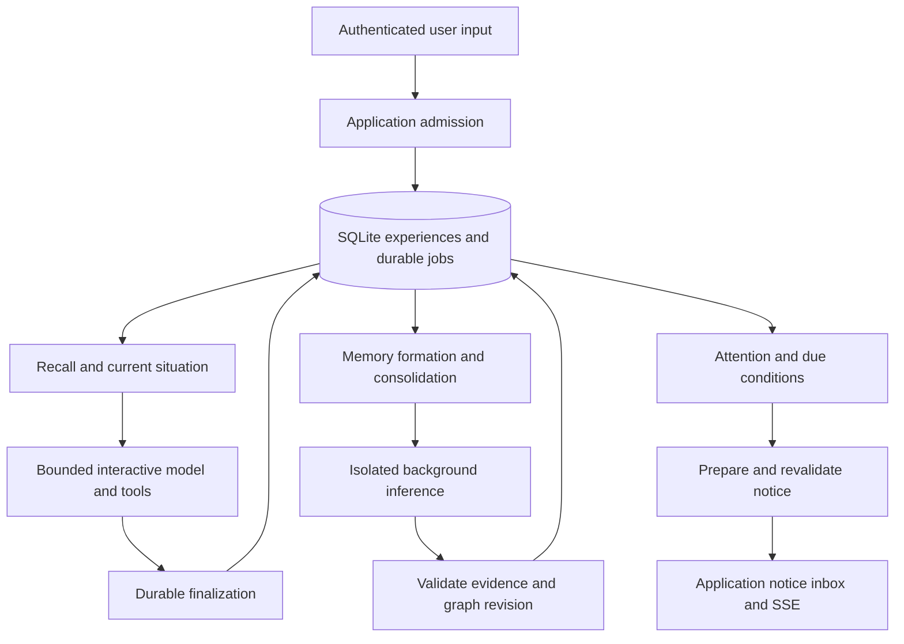
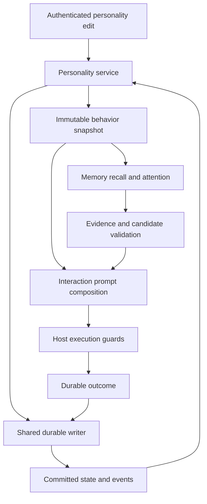

# Persistent memory and initiative implementation plan

Status: proposed architecture and implementation sequence, 2026-11-05.
Application implementation remains human-owned. This plan changes documentation
only. Database, model and latency choices below are proposals with explicit
qualification gates, not measured application capabilities.

**Implementation entry point:** [memory implementation specification](memory-implementation-spec.md).
It selects the complete v1 contracts and takes precedence over alternatives in
this research, including authentication, lifecycle assembly, codecs and default
budgets. It links executable design constraints and examples, records local
validation and separates build tasks from empirical promotion gates.

The [implementation contract supplement](#implementation-contract-supplement)
extends the initial research with a code audit, transaction/state-machine
contracts, bounded loop mechanics and failure fixtures. Its proposals refine
the broad guarantees below; they are not implemented or accepted ADRs.

The [plugin and personality design](#plugin-and-personality-design) adds an
extensible memory plugin, user-authored character, evolving disposition and
versioned behavior snapshots. This is an additional product requirement;
personality is broader than a system-prompt string.

See [compact model protocols](compact-model-protocol.md) for token-efficient
communication with small models: measured serialization costs, bounded reference
handles, fixed-job tuples and a proposed codec evaluation. These are optional
representations of the typed proposals below; they do not change evidence,
authorization or durability contracts.

## Product contract

Build a persistent assistant that maintains an understanding of the user and
their current situation. It should remember explicit requests, connect related
experiences, explain conclusions through evidence, carry unfinished work across
restarts, and initiate a useful conversation when circumstances justify it.

The durable memory must outlive chats and native contexts. Conversation replay
must not be required for continuity. A small working set still carries immediate
references, alternatives and active tool transactions. The graph can grow on
disk independently of the prompt; retrieval and background computation remain
bounded. Storage capacity does not imply unlimited or instantaneous reasoning.

The first complete acceptance story is:

1. Tell the assistant a preference, a project goal and the reason for that goal.
2. Make an explicit request to remember an additional detail.
3. Restart and clear recent working messages.
4. Ask a paraphrased question requiring several connected facts.
5. Obtain an answer supported by the original evidence.
6. Correct a fact and obtain the corrected answer immediately, including while
   background extraction is pending.
7. Resolve a blocker and receive one timely suggestion about the affected goal.
8. Dismiss that suggestion; no repeated interruption occurs without a new cause.

## Current implementation and required boundaries

The current runtime provides useful integration points, but memory durability,
background inference priority and unsolicited conversation are new behavior.
The native ownership chain and existing execution limits must remain intact.

| Existing code | Current behavior | Required integration |
| --- | --- | --- |
| [`application/mod.rs`](../crates/assistant/src/application/mod.rs), `admit` and `run` | One active product run, volatile submission deduplication and display state; admission publishes before inference | Durable admission before acceptance; stable operation identity and recovery; preserve responsiveness while storage awaits |
| [`chat/mod.rs`](../crates/assistant/src/chat/mod.rs), `Request::execute` | Serializes a chat; updates bounded history, drops its lock, then invokes terminal observers | Mandatory durable finalization separate from optional observers; preserve partial/unknown outcomes |
| [`chat/runner.rs`](../crates/assistant/src/chat/runner.rs), `RunContext` and `run_loop` | Mutable supporting context and typed model/tool loop | Automatic recall before the first model turn and bounded explicit investigation |
| [`pipeline/mod.rs`](../crates/assistant/src/pipeline/mod.rs), `Pipeline::finished` | Terminal observers have a one-second allowance; failures become warnings | Use observers for wake notifications, never as the sole durable ingestion mechanism |
| [`runtime/services.rs`](../crates/assistant/src/runtime/services.rs), `RuntimeContext` | Owned service lifecycle with application handle, shared services and shutdown | Add a restricted handle for internal inference jobs; own and join memory tasks |
| [`runtime/worker.rs`](../crates/assistant/src/runtime/worker.rs), `worker_loop` | Cooperative rotation across active generations; no purpose/priority distinction | Reserve interactive admission and suspend background generation between native steps |
| [`tools/mod.rs`](../crates/assistant/src/tools/mod.rs), `ToolContext` | Host invocation ID and cancellation, without authenticated user identity or evidence scope | Carry host-assigned principal, durable operation identity and allowed source references |
| [`assistant-web/src/http.rs`](../crates/assistant-web/src/http.rs), `policy` and `submit` | Host/origin checks and a fixed `web` transport scope; no owner authentication | Authenticate access before durable personal memory is enabled, including chat and subscriptions |
| [`frontend contracts`](../crates/assistant-web/frontend/src/entities/chat/api/contracts.ts) and [`web-api.yaml`](web-api.yaml) | Volatile user/assistant messages tied to request runs | Separate assistant-initiated notices, memory health and evidence inspection |

### Prerequisites that must precede rollout

**Durability:** accepted requests and explicit remember acknowledgments need a
durable commit boundary. An in-memory queue or warning from a completion hook
cannot satisfy that contract.

**Isolation:** background inference must not use the primary chat, inject fake
user messages, recursively trigger extraction, or receive ordinary execution
tools. Existing runtime-ready services cannot currently request such isolated
inference directly.

**Privacy:** a loopback connection, client ID or transport scope is not proof of
the owner's identity. Protect chat too: access to chat would otherwise provide
an indirect query interface to the owner's memories.

**Embedding binding safety:**
[`LlamaContext::embeddings_seq_ith` and `embeddings_ith`](../crates/llama_cpp/src/context.rs)
construct slices using `model.n_embd()` and contain fallible conversions expressed
as `expect`. The pinned native implementation in
[`llama-context.cpp`](../crates/llama_cpp_sys/llama.cpp/src/llama-context.cpp)
uses `n_embd_out()` for ordinary output embeddings and `n_cls_out` for rank
pooling. If the Rust length exceeds the actual allocation, creating the slice
is unsound; a smaller length silently truncates the result. Native invalid token
indices can also abort debug builds. Before introducing embedding inference,
audit output shape, pooling mode, checked indices, error containment and slice
lifetime. Reject unsupported rank pooling through a typed error or expose it
through a separately sized API. Do not assume the existing tiny causal-model
embedding test covers pooled retrieval models. This is binding maintenance;
follow [the fork contract](bindings-fork.md) without changing the upstream pin.

## Research findings

### Knowledge organization

Graphiti supplies a relevant architectural reference: temporal relationships,
source episodes, incremental ingestion, and combined semantic, lexical and graph
retrieval. Its maintainers specifically warn that small local models can fail
structured extraction. Use these ideas without adopting its Python service and
database stack as an application dependency. [Graphiti source and guidance](https://github.com/getzep/graphiti).

A-MEM explores linked memory notes and updates to existing memories when new
information arrives. This supports evaluating consolidation rather than treating
memory as an append-only vector collection. It does not establish that generated
links are factual or that repeated reflection improves our particular model.
[A-MEM paper](https://arxiv.org/abs/2502.12110).

LongMemEval separates extraction, reasoning across sessions, temporal reasoning,
knowledge updates and abstention. LoCoMo provides complementary conversational
tasks. Adopt these capability categories and use selected benchmark material as
an additional evaluation; preserve a project-specific, human-authored acceptance
corpus as the primary gate. Published system scores do not predict this daemon's
accuracy. [LongMemEval](https://arxiv.org/abs/2410.10813),
[LoCoMo](https://arxiv.org/abs/2402.17753).

Initiative needs its own evaluation. PITCH studies contribution timing in group
chat and finds that live timing can be substantially worse than placement with
the complete conversation available. Its setting differs from a personal
assistant, but it motivates measuring useful silence, premature interruptions
and repeated suggestions separately from message relevance.
[PITCH paper](https://arxiv.org/abs/2610.25896).

### Storage recommendation

Use **SQLite as the initial authoritative graph and experience store**, accessed
through a narrow Rust storage API. Store actual nodes, typed relationships,
claims, evidence and temporal validity. This implements a graph data model even
though the underlying engine is relational. SQLite documents graph traversal
through recursive queries and supplies FTS5 lexical search.
[Recursive queries](https://sqlite.org/lang_with.html),
[FTS5](https://sqlite.org/fts5.html).

The reason for this choice is transactional simplicity: experience capture,
graph changes, extraction jobs and outgoing notices can share one transaction.
It avoids making two independent databases agree about what was remembered.
Whether it meets the intended scale must be measured with the graph's actual
degree distribution and query patterns.

| Candidate | Relevant capabilities | Decision for this project |
| --- | --- | --- |
| SQLite and Rust storage wrapper | Embedded transactions, FTS5, adjacency indexes and recursive queries | Initial implementation; qualification includes crashes, graph expansion and mixed read/write latency |
| SurrealDB | Document/graph database with an embedded Rust deployment | Credible alternative if the SQLite graph/query layer becomes a demonstrated burden; benchmark before claiming a resource advantage |
| LadybugDB | Embedded graph engine with Rust API and Cypher | Alternative for graph-intensive workloads; qualify native packaging, concurrent writes, recovery and search index behavior |
| Graphiti with a graph server | Existing extraction/retrieval framework | Architectural reference; adopting it adds a separate framework and operational stack to this Rust daemon |
| Original Kuzu | Embedded graph engine | Exclude from a new dependency choice: the original repository is archived |

Sources for the alternatives: [SurrealDB embedded Rust](https://surrealdb.com/docs/build/embedding/by-language/rust),
[LadybugDB documentation](https://docs.ladybugdb.com/),
[LadybugDB Rust API](https://docs.ladybugdb.com/client-apis/rust/),
[Kuzu archive](https://github.com/kuzudb/kuzu).

Start vector search with exact similarity as a correctness reference. Keep
vectors in versioned, rebuildable storage. A bounded Rust implementation over
owned vector blocks is sufficient for the first small corpus; measure its scan
cost rather than disguising it as an approximate index. At larger scales compare
a statically linked sqlite-vec implementation and an ANN index against that
reference. sqlite-vec provides KNN and SQL vector operations; its documented
scalar-distance approach is a brute-force search, not a guarantee of sublinear
retrieval. Do not load extensions from model-selected paths.
[sqlite-vec](https://alexgarcia.xyz/sqlite-vec/),
[KNN behavior](https://alexgarcia.xyz/sqlite-vec/features/knn.html).

Introduce only `rusqlite` initially, plus an explicitly justified index dependency
when the scale gate requires it. Use the bundled SQLite build, backup and query
interruption capabilities. Verify FTS5 at startup and in packaging tests. Current
rusqlite master declares Rust 1.89 while this workspace declares 1.88, so a blind
upgrade to latest is inappropriate. `0.40.1` is a candidate to compile under 1.88,
not a verified MSRV selection. Its tagged bundled header identifies SQLite
3.53.2. Freeze the resolved dependency set only after compilation and checking
upstream fixes; require a release containing the WAL-reset fix, which SQLite
documents in 3.51.3 and selected backports.
[Rust manifest](https://github.com/rusqlite/rusqlite/blob/master/Cargo.toml),
[candidate manifest](https://raw.githubusercontent.com/rusqlite/rusqlite/v0.40.1/Cargo.toml),
[bundled SQLite header](https://raw.githubusercontent.com/rusqlite/rusqlite/v0.40.1/libsqlite3-sys/sqlite3/sqlite3.h),
[WAL fix](https://sqlite.org/wal.html#walresetbug).

### Local embedding candidates

Evaluate multilingual retrieval because names, English technical discussion and
Ukrainian text can coexist. Start with multilingual-e5-small, then compare
EmbeddingGemma if E5 misses the quality target. Selection concerns retrieval
accuracy, CPU latency, total residency and packaging, not leaderboard rank.

| Candidate | Published interface | Qualification |
| --- | --- | --- |
| multilingual-e5-small | 384 dimensions; mean pooling and normalization; distinct query/passage prefixes; 512-token input limit; MIT model license | First candidate for short memory statements; verify GGUF conversion and cross-language recall |
| EmbeddingGemma 300M | 768 dimensions with supported smaller representations; 2,048-token input; distinct retrieval prompts; Gemma terms | Compare quality/resources; verify dense projection conversion, pooling, normalization and backend precision |

The E5 card requires prefixes even for non-English inputs. EmbeddingGemma has
its own query/document prompts and notes activation precision restrictions.
Treat these as part of the model interface, not optional prompt decoration.
[E5 model card](https://huggingface.co/intfloat/multilingual-e5-small),
[EmbeddingGemma model card](https://huggingface.co/google/embeddinggemma-300m).

The pinned conversion source contains XLM-RoBERTa and EmbeddingGemma paths, and
the safe binding exposes embedding configuration and output access. These are
source-level prerequisites, not proof that a particular GGUF produces correct
retrieval vectors. Qualify a checksummed artifact with reference vectors,
repeated-batch isolation, finite values, correct dimension and useful rankings.
Keep models local and optional in the default test path. Use the existing backend
lease and a dedicated owner thread; do not initialize another native backend.

## Architecture and ownership

Keep the first implementation under `crates/assistant/src/memory/`. A new crate
can follow when the public API stabilizes; no database dependency belongs in
`LLMContext`. Both this module and its integration are human-owned application
code under [AGENTS.md](../AGENTS.md).



Suggested modules:

| Module | Owns |
| --- | --- |
| `memory/types.rs` | Validated IDs, claims, evidence, time, changes and typed errors |
| `memory/store/` | Migrations, transactions, adjacency/FTS queries, jobs, deletion and backups |
| `memory/ingest.rs` | Durable experiences, revisions, source spans and idempotent handoff |
| `memory/extract.rs` | Candidate extraction and entity/claim reconciliation |
| `memory/retrieve.rs` | Hybrid retrieval, paths, evidence packing and coverage |
| `memory/situation.rs` | Goals, commitments, open questions, blockers and current focus |
| `memory/attention.rs` | Trigger subscriptions, due work, interruption policy and notice outbox |
| `memory/plugin.rs` and `tools.rs` | Lifecycle, retrieval hooks and scoped memory tools |
| `runtime/jobs.rs` | Restricted internal inference with priority, quotas and cancellation |

The service boundary should expose owned, typed operations rather than database
handles. Proposed contracts are `record_experience -> DurableReceipt`,
`remember -> RememberReceipt`, `search -> EvidenceBundle`,
`follow -> PathBundle`, `apply_changes(expected_revision) -> ChangeReceipt`,
`forget -> ForgetReceipt`, and `current_situation -> SituationSnapshot`.
Principal/source capabilities come from the host context. Results distinguish a
successful empty query, incomplete coverage, degraded indexing and a failed
operation. Receipts carry durable IDs/revisions, not inference-worker counters.

Storage uses a dedicated writer thread with bounded commands and a small fixed
number of reader connections on blocking workers. A connection is never shared
concurrently through an unsafe `Sync` implementation. Do not hold transactions
while awaiting inference, external tools or a browser. Interactive commits and
queries take priority over maintenance; scans are interruptible and chunked.
Rusqlite documents `Connection` as `Send` and not `Sync`.
[Connection contract](https://docs.rs/rusqlite/latest/rusqlite/struct.Connection.html).

## Durable data model

Use stable random IDs generated by the host, independent of runtime counters.
Every personal record belongs to a host-assigned principal. V1 has one owner;
this is not a multi-user product. SQL constraints must still prevent references
across principals. Transport request IDs and model-provided names are not
authority or primary identity.

| Table or record | Required fields and meaning |
| --- | --- |
| `operations` | Principal, stable operation ID, trusted client namespace/request key, input digest, origin, durable state and timestamps |
| `episodes` | Operation and ordinal, role/source kind, bounded text or structured payload, source revision, observed time, event time when known, visibility and extraction state |
| `nodes` | Principal, stable ID, kind and revision; entities, claims, goals, commitments, questions and episode references are graph-addressable |
| `entities` and `aliases` | Node ID, entity type, names and source-backed aliases; an alias may identify multiple candidates |
| `claims` | Node ID, subject, predicate, exactly one object node or typed literal, readable statement, polarity, conditions, epistemic kind, lifecycle and temporal interval |
| `evidence` | Claim/link, episode ID and revision, exact UTF-8 byte span or structured field path, attributed speaker, source kind |
| `links` | Typed directed connection between nodes, supporting claim/evidence IDs, revision and applicable time; distinguish factual relations from associative links |
| `dependencies` | Derived assertion or situation record and its premise IDs/revisions, enabling invalidation after corrections/deletion |
| `goals`, `commitments`, `questions` | Typed state, actor, source, reason/blocker links, due time/timezone where known, last verification and revision |
| `jobs` | Kind, source/revision, pipeline/model version, unique idempotency key, state, attempt count, lease owner/expiry and next attempt |
| `search_documents` and `embeddings` | Document ID/revision, text hash, complete embedding specification, owned finite vector and eligibility state |
| `attention_candidates` and `notice_outbox` | Cause/revisions, related goal, expiry, deduplication key, lifecycle, delivery/seen/dismissed state |
| `forget_tombstones` | Minimal suppression identity and deletion generation; no retained forgotten prose |

Use foreign keys and checks, including principal-consistent composite references,
valid time intervals, exactly one claim object representation, bounded payloads,
and legal lifecycle transitions. Keep schema/query ownership in Rust; the model
does not supply SQL, Cypher, table names or arbitrary predicates with authority.

### Truth and change semantics

Track epistemic kind separately from lifecycle:

- `UserStated`, `ToolObserved`, `Imported` and `Inferred` identify the basis.
- `Active`, `Superseded`, `Retracted`, `Disputed` and `Stale` identify usability.
- Distinguish when the information applies from when the assistant learned it.
  Unknown event time stays unknown; do not substitute ingestion time.
- Record attributed claims: "Alex says I like coffee" is a report from Alex,
  not a direct user preference. Questions, quotations, fictional examples and
  negations must retain their modality.
- Model confidence and retrieval similarity are not truth probabilities.

Do not implement universal last-write-wins. A new employer can supersede an old
current-employment claim; another hobby normally adds a claim. A source conflict
can remain disputed. Exclusive predicates need explicit cardinality/temporal
rules, and uncertain identity resolution must preserve separate entities.
Prefer reversible aliases or explicit merge proposals over destructive merges.

Every automatic update references allowed evidence and expected record revisions.
The host validates spans, entities, predicates, qualifications and revisions.
Span validation proves that words exist, not that the interpretation is correct;
semantic extraction still needs evaluation and abstention. Corrections retire
affected claims and invalidate eligibility of dependent conclusions and notices
in one transaction. The supplement specifies an epoch barrier followed by bounded
repair, rather than an unbounded transitive update. Retain historical queries
unless the user requests forgetting.

## Experience capture and recovery

### Admission

Validate and reserve a submission, then commit its operation, user episode and
extraction job before publishing acceptance or starting inference. The product
coordinator needs a pending-admission state: storage work runs outside its event
loop, while a completion command resolves the reservation. Avoid holding the
coordinator or a chat lock across unbounded database I/O.

Enforce a durable unique key over principal, client namespace and request ID.
Repeated identical submissions return the existing operation; reused keys with
different input return a conflict, including across restart. Runtime display IDs
can remain ephemeral but map to stable operation IDs. Recovery marks unfinished
runs interrupted and makes their input available to memory; it does not replay
model-selected tools or automatically resubmit old user requests.

### Finalization and tool outcomes

Add an awaited durable sink in the core execution path. Record normalized
visible assistant output, tool intents/results and run outcome independently of
the optional terminal observers. Hidden reasoning is not durable evidence and
must be removed before serializing messages for memory.

Persist terminal output before publishing a successful terminal event. Streaming
text before that commit is provisional; a process crash can lose its uncommitted
tail. Make recovered interrupted output explicit rather than fabricating a
completed answer. Selected tool intents must be committed before execution and
their receipts committed afterward. A crash between an external effect and its
receipt leaves an unknown outcome; a SQLite transaction cannot make arbitrary
external tools exactly-once. Never replay that operation automatically.

Use WAL and `synchronous=FULL` for authoritative commits, enable foreign keys on
every connection, and verify the settings by reading them back. This chooses
power-loss durability over the weaker commit durability of WAL/NORMAL, subject
to the filesystem/device honoring synchronization. Bound busy waits and return
typed storage failures; memory-enabled mode must not silently acknowledge
volatile storage. [SQLite synchronization contract](https://sqlite.org/pragma.html#pragma_synchronous).

### Job execution

Ingestion plus its durable job is atomic. Claim jobs with leases; inference runs
outside a transaction. Commit validated graph changes, FTS updates, embedding
jobs and completion together after checking source and graph revisions. Expired
leases are recoverable. Idempotency keys include source revision and extractor
version. A lost wake notification causes no data loss because the database owns
pending work. Retry transient failures with bounded backoff; malformed or
unsupported extraction ends in a visible unresolved state after its allowance.

Do not discard evidence because extraction failed. Keep recent pending episodes
available to recall. Reserve queue/disk capacity for interactive capture and
explicit remembers; throttle consolidation first. At capacity, report failure
before acceptance instead of silently dropping an experience.

## Memory formation and explicit tools

Start with short, bounded extraction jobs using the existing chat model. Supply
one source episode or a small related batch, selected existing entities/claims,
and an output schema. Return candidate statements, exact evidence references,
entity candidates, qualifications and proposed revisions. The initial schema
should cover facts/preferences, goals, reasons, commitments and questions; it
does not need an unrestricted learned ontology.

Use native JSON-schema-constrained output. The binding already exposes
[`ChatApplyParams::with_json_schema`](../crates/llama_cpp/src/chat.rs), but the
application worker does not wire a structured-output contract through today.
Extend the shared preparation path with typed text/JSON output modes; reject
incompatible tool/format combinations rather than assembling a second renderer.
An extraction job has no executable tools and does not execute memory proposals.
Typed parsing, evidence validation and transactional application follow inference.

Initially use one extraction pass and at most one targeted reconciliation pass
when candidates conflict. Avoid free-form self-reflection loops. Generated
answers and previous hypotheses cannot become independent corroborating sources
for their own assertions. Assistant commitments are valid records of what the
assistant promised, not evidence that a task was completed.

| Tool | Model-visible purpose | Host contract |
| --- | --- | --- |
| `memory.search` | Search descriptions with typed time/kind filters | Return bounded evidence and coverage; scope injected by host |
| `memory.follow` | Follow typed relationships or continue a path investigation | Host enforces cumulative depth, work, time and result limits |
| `memory.remember` | Preserve a user-requested statement and optional structured proposal | Require evidence in the current authorized interaction; commit before success |
| `memory.correct` | Propose replacement of identified claims | Validate source, principal and expected revisions; update dependents atomically |
| `memory.forget` | Forget an explicitly requested memory or source selection | Check user intent/capability; remove derived/search copies and prevent resurrection |

Use a very small advertised tool set initially: search, follow and remember.
Correction and forgetting can first use explicit UI/host operations. All names
are registered typed Rust handlers. No principal, trust level or source authority
may be chosen by a model argument.

Explicit remember is a fast path: durably retain the literal source statement and
a lexical search entry even if semantic extraction fails. The receipt separates
`stored` from `structured` and `indexed`. The assistant may say it saved the
statement once committed; it must not claim reconciliation or semantic indexing
has completed. Mark explicit memories for preservation, not unconditional prompt
injection on every request.

Expose the durable remember receipt in the UI independently of generated prose.
The host owns the saved/failed indicator; model wording cannot manufacture a
successful receipt. Sanitize storage errors before returning them through tools,
whose default adapter otherwise formats the error for the model.

## Recall and knowledge chains

### Initial recall

Before interactive generation, build a retrieval request from the current input,
a small recent working set, known active entities and the current situation.
No model round trip is required for ordinary query embedding or lexical search.

1. Obtain a consistent graph revision/read snapshot and the recent pending
   evidence relevant to the operation.
2. Run exact names/aliases, FTS5 lexical search, and semantic search over claims
   and source episodes. Keep each retrieval channel independently measurable.
3. Fuse ranked results, initially with reciprocal-rank fusion. Apply principal,
   deletion, lifecycle and time eligibility at every authoritative lookup.
4. Expand useful seeds along typed links; prioritize current task, reasons,
   blockers, commitments and evidence. Do not expand the entire user hub.
5. Deduplicate and pack readable facts with IDs, qualifications, sources and
   paths into a token budget counted with the loaded chat tokenizer.

Index episodes as well as extracted claims: otherwise missed extraction makes
the information undiscoverable. New pending experiences are included in a
bounded recent-evidence overlay until indexing catches up. Explicit corrections
apply synchronously when the target is known; otherwise flag pending conflicting
evidence and supply its original words. The model must not confidently repeat a
stale fact while a correction is unresolved.

The response carries `graph_revision`, index coverage, pending-source status,
truncation and budget termination. An unavailable embedding model can yield a
declared lexical-only result, not a claim that semantic search succeeded. A
storage failure is distinct from a valid empty result. The final authority is
the current record, not a stale vector/cache hit.

An embedding specification includes model/artifact hash, tokenizer and conversion
revision, dimension, pooling, query/document prompts, normalization, precision
and chunking policy. Never compare vectors across specifications merely because
their dimensions match. Re-embedding builds a new generation alongside the old
one, checks coverage, then switches the active generation atomically. Each job
rechecks source revision/deletion state before publishing its vector.

### Multi-step investigation

Support paths with evidence at each edge and explicit relation direction, time
and conditions. Associative similarity links are navigation aids; they cannot
serve as factual premises. A connected path is not automatically a valid logical
implication. Begin with explicit predicates and a few bounded query patterns,
such as goal -> blocker -> dependency -> new status.

The assistant can request another search or a path continuation when automatic
recall is insufficient. Return small evidence bundles rather than whole
neighborhoods. For numerical/date/set operations, provide typed host queries;
do not infer an exact count from top-K samples. An exhausted traversal returns
incomplete coverage, never proof that no connection exists.

Derived conclusions retain their premise IDs/revisions and an inference label.
Compute simple validated rules in host code; use the model for qualified
synthesis of more complex paths. After corrections, invalidation prevents old
derived conclusions from being retrieved as current facts.

### Working context

Keep trusted instructions, current user input, active tool protocol, a small
recent exchange window, current situation and selected evidence. Old dialogue
can leave this set once durable capture is confirmed. Do not remove working
history as the first implementation step; first demonstrate recall with history
explicitly cleared after restart, then reduce the window by evaluation.

Changing retrieved context can invalidate the native token prefix and require
prefill. Measure that cost; retain the existing exact-prefix reuse invariant.
Do not add arbitrary native KV shifting or alter cache precision as part of
memory delivery.

## Background inference and consolidation

Introduce an owned `BackgroundInferenceHandle` in `RuntimeContext`, backed by
the same model worker and resident weights. It accepts bounded typed jobs with
purpose, schema, deadline and cancellation; it exposes no primary-chat mutation
or product submission API. Its outputs do not appear in the conversation and do
not invoke normal memory ingestion hooks.

Add explicit execution classes for interactive work and background work. Reserve
interactive admission capacity so queued jobs cannot occupy all run permits.
Use separate bounded queues and one background generation initially. Between
native prefill batches/tokens, pause background advancement while interactive
work exists. A native call already in progress remains non-preemptible.
Give jobs bounded lifetimes; cancel/requeue rather than retaining native contexts
indefinitely. Protect interactive context slots from background allocation.

The scheduler owns the persistent lifecycle, not an endless model conversation:

```text
new durable experience / graph change / relevant due time
    -> claim bounded work
    -> retrieve existing evidence
    -> extract or reconsider a specific question
    -> validate and commit at expected revisions
    -> enqueue genuinely new dependent work
    -> wait when nothing is eligible
```

Enforce cause IDs, job deduplication, per-cause generation limits and daily/rolling
compute allowances. Reading a memory does not itself schedule extraction;
generated summaries cannot endlessly reschedule themselves. An optional later
aging/sweep task should use persisted cursors and bounded batches.

Shutdown closes new product admission and stops claiming new background jobs,
drains committed interactive finalization, cancels inference, and joins service
tasks before releasing storage/native owners. Unfinished leases remain durable.
Required storage failure surfaces through supervision; optional semantic-index
failure is an explicit degraded state with retry eligibility.

## Current situation and initiative

Maintain a compact projection of active goals, blockers, commitments, unresolved
questions and recent changes. Each item refers to evidence and has verification
time. A project being mentioned yesterday does not establish that the user is
working on it now. Current focus expires or becomes uncertain; stable identity
facts and explicit remembers do not expire merely because they are old.

Initiative begins with two trigger types: an explicit due commitment, and an
evidence-backed status change affecting an active goal. For example, "memory
was postponed until chat worked" plus the user's statement "chat works now"
can produce a candidate to revisit memory. It must not imply that the assistant
observed an unconnected application or calendar.

Candidate generation and interruption policy are separate. A candidate records
why it matters, its new evidence, related goal, expiry and cause identity. Host
policy checks quiet hours, current activity, recent notices, dismissal state,
budget and allowed transport. Begin with a reviewable in-app inbox; then enable
live initiation after timing and duplication tests pass. Quiet hours and notice
frequency are explicit user settings, not psychological inferences.

Prepare a notice in isolated inference with only its evidence. Revalidate record
revisions, goal status, expiry and conversation activity before atomically
claiming its outbox entry. A new user request can defer or cancel delivery. Give
the notice its own origin and stable ID; do not fabricate a user message to make
the existing run machinery accept it. Publish through the shared application
snapshot/SSE path so connected clients agree and reconnecting clients recover.

Persist due times as UTC instants with the original timezone/local-time intent.
Use an injectable clock for relative dates and tests. Persisted timers recover
after restart; a due item still passes freshness and interruption checks.

Transport delivery is at-least-once with stable-ID deduplication, not a claim of
exactly-once human attention. Distinguish queued, published, seen, dismissed,
snoozed and expired. Dismissal suppresses the same cause; only new relevant
evidence can justify reconsideration. An initiation can ask or suggest; it does
not grant authorization to execute external actions.

## Privacy and forgetting

Before enabling private recall, authenticate the owner on all WebUI/API routes
that can expose or mutate it. Keep existing origin/authority defenses. Proposed
local provisioning uses a host-generated, short-lived bootstrap secret delivered
through a local launch flow, exchanged for an HttpOnly, SameSite session; avoid
tokens in ordinary query strings, logs or model prompts. Persist owner credentials
with restrictive permissions and test expiry/revocation. The credential/bootstrap
details belong in the web security contract before rollout. In-process callers
receive a host capability. Do not infer authorization from the fixed `web` scope.

Keep the data directory private to the OS user, store files with restrictive
permissions, and use sanitized diagnostics without source text, secrets or model
paths. Retrieved episodes and tool/imported content remain untrusted data,
including any instructions embedded in them. Remembering a request never changes
system policy or tool capabilities. Background jobs have no general tool access.

Forgetting removes the selected source payloads, affected claims, aliases,
embeddings, FTS entries, cached context, derived conclusions and pending notices.
Cancel jobs and reject late commits using deletion generations. Shared claims
survive only if independently supported; shared entities survive only with
remaining supported content. Clear/rebuild relevant chat working state so a
retained transcript does not immediately reintroduce forgotten content.

Use a tombstone/retention policy to prevent replay from reconstructing removed
memories. Evidence retention is selective after ingestion, but raw evidence that
still supports a claim must not disappear silently. Explicit memories are not
evicted as a cache optimization. Old episodes may be compacted into retained
source excerpts only after dependencies are accounted for.

Logical forgetting does not promise forensic erasure from SSDs, WAL files or old
backups. Define backup expiry and restore-time tombstone reconciliation. Back up
using the SQLite backup API; copying the main database file during WAL operation
is insufficient. Test restoration and index rebuilding.
[SQLite backup API](https://sqlite.org/backup.html).

## Initial resource budgets and measurement

These are proposed experiment settings. Configuration uses validated nonzero
limits and cumulative work accounting; none are measured latency guarantees.

| Boundary | Initial setting or experiment |
| --- | --- |
| Background inference | One active job, up to 512 generated tokens per pass, two passes per source batch; remaining work deferred explicitly |
| Background admission | Separate bounded queue; no consumption of reserved interactive permits |
| Extraction batch | At most four short related episodes; split by actual token budget and retain unresolved tail |
| Automatic recall seeds | Up to 32 lexical and 32 semantic results before fusion |
| Automatic graph expansion | Two hops, 256 visited nodes and 1,024 examined edges |
| Explicit path investigation | Up to 12 hops, 2,048 visited nodes and 8,192 edges cumulatively per interaction; configurable hard ceiling |
| Supporting memory input | Initially 1,024 chat-model tokens inside the existing input/output reservation; pack lower if required |
| Background due work | Wait for a notification or the earliest persisted due time; no idle model polling |
| Data growth | Configurable disk quota, pending-job quota and reserved capture capacity; backpressure before accepting data that cannot be committed |

Test 10K, 100K and 1M searchable records, plus graphs with cycles and highly
connected hubs. Raw 100K x 384 x 4-byte vectors occupy 153.6 MB before IDs,
indexes, text, database pages and model residency; 1M occupy 1.536 GB. These are
payload calculations, not measured process memory. Exact scans provide a
reference but cannot establish the long-term scaling claim.

Proposed first-device targets are p95 initial recall below 250 ms at 100K records
including query embedding, and under 10% foreground first-token latency
regression with pending background work. Record cold/warm behavior separately,
full latency distributions, CPU/RSS/VRAM, prefill cost and job lag. If targets fail,
profile embedding versus search versus graph work before changing architecture.
Qualify an ANN index when exact scans miss the target, checking filtered recall
against the exact reference and preserving authoritative deletion/status checks.

## Validation and promotion gates

Create a fixed-clock, human-authored corpus of at least 120 cases across these
categories, with separate development and held-out scenarios:

- Explicit remember and restart, paraphrases, names/aliases and English/Ukrainian
  query/evidence pairs.
- Facts versus questions, hypotheticals, quotations, negation and third-party
  attribution; reasons stated by the user versus inferred motivations.
- Ambiguous people, corrections, concurrent extraction, changing preferences,
  historical/current questions and unresolved contradictions.
- Three-, six- and eight-edge evidence chains, invalid shortcuts, missing
  premises, cycles, hubs and genuine unanswerable questions.
- Pending extraction, unavailable embedding model, index lag, full disk, busy
  storage, cancelled operations and interrupted tools.
- Due commitments, resolved blockers, stale goals, quiet hours, dismissal,
  duplicate delivery, disconnected browser and restart with overdue items.
- Prompt injection in imported/tool content, forged principals, unauthorized
  chat access, deletion during inference and resurrection after restore.

Evaluate storage, extraction, retrieval and answer synthesis separately. Report
claim precision/recall, entity merge errors, evidence Recall@K, complete supporting
path recall, temporal correctness, unsupported answers and abstention. Use exact
fixtures and human review for ambiguous answers; a model judge alone is not the
authority. Version prompts, schema, model artifact hashes, template, pooling,
embedding prompts, precision, sampler and budgets with results.

Initial promotion requirements:

| Area | Gate |
| --- | --- |
| Durable storage | All deterministic restart, idempotency, transaction and deletion fixtures pass; no acknowledged explicit remember is lost in process-kill tests |
| Crash semantics | Inject failures before/after admission, graph commit, external effects, finalization and notice publication; unknown outcomes stay unknown |
| Extraction | At least 95% precision on eligible direct claims and 90% recall on the held-out authored set; zero critical identity/attribution/correction violations in that set |
| Retrieval | At least 95% evidence Recall@10 for direct/paraphrase cases and 90% complete-path recall for the authored chain cases |
| Answer behavior | At least 90% supported answers and 95% appropriate abstention on designated unknown cases; report categories and counts, not only an average |
| Initiative | All deterministic quiet-hour, stale-cause and dedup tests pass; in reviewed candidate replay at least 90% useful suggestions, with missed opportunities reported separately |
| Resources | Meet the stated first-device target or document and resolve the limiting component before enabling that scale |

These thresholds are proposed development gates, not statistical guarantees for
future conversations. If the current chat model fails extraction/reasoning,
preserve evidence, restrict automatic promotion and compare a more capable local
model or narrower task schema. Do not lower safety checks or turn invalid output
into facts. Begin real-use review with a week of opt-in local use after replay
passes; assess usefulness, repetition and continuity alongside metrics.

Default tests use fake embeddings/scripted model jobs, temporary databases and
an injected clock. Dedicated required-model jobs fail rather than silently skip
when the artifact is missing; ordinary workspace tests skip optional model cases
cleanly. Require a real local extraction/recall smoke test before promotion.

## Implementation sequence

Deliver each milestone as a small set of focused changes. Preserve the existing
chat path and native limits while adding the service. The first milestone is
ready to start without a final ANN index or embedding-model selection.

| Milestone | Implementation scope | Acceptance and dependency |
| --- | --- | --- |
| 0. Contracts and fixtures | Typed IDs, evidence/change semantics, durable states, fake clock, authored corpus and database/MSRV qualification | Storage dependency compiles on Rust 1.88; fixture expectations frozen; no model needed |
| 1. Durable memory core | SQLite migrations, writer/readers, source episodes, claims/links/evidence, jobs, revisions, FTS, quotas, backup and logical deletion | Remember literal text, search it, correct it, restart and restore; deterministic failure tests pass |
| 2. Application durability and identity | Pending admission, stable operation mapping, mandatory finalization, tool intents/outcomes, authenticated owner capability and memory health | Accepted data survives process kill; unauthorized chat cannot read/write memory; existing cancellation/WebUI behavior passes |
| 3. Isolated model jobs | Restricted handle, text/JSON contract through shared preparation, separate priority/admission, one background context and lifecycle | Scripted jobs never alter primary chat; interactive work preempts at native boundaries; shutdown/queue tests pass |
| 4. Semantic recall | Binding output-safety maintenance, qualified embedder worker/artifact, versioned vectors, exact reference and hybrid ranking | English/Ukrainian/paraphrase cases pass; index rebuild and missing-model state work; memory/latency measured |
| 5. Automatic memory formation | Bounded extraction, reconciliation, source validation, revision conflicts, pending-evidence overlay and remember fast path | Held-out extraction/correction gates; immediate follow-up works while extraction is pending; no self-corroboration |
| 6. Knowledge chains and situation | Typed path investigation, dependent conclusions, goals/reasons/blockers/commitments, current-situation projection | Three/six/eight-edge fixtures, correction invalidation, temporal questions and abstention pass after clearing working history |
| 7. Initiative | Durable triggers and timers, candidate inbox, policy settings, notice outbox, application/API/frontend support | Review candidates first; enable live initiation after timing, dismissal, reconnect and duplicate tests pass |
| 8. Scale and real-use qualification | 100K/1M benchmarks, ANN if needed, retention/restore qualification and week-long local review | Publish measured capacity, costs, category failures and remaining limits before default enablement |

Milestones 0-1 can proceed independently of model work. Milestone 3 can follow
the storage contract while milestone 2 integration is developed. Automatic
personal capture requires milestone 2's durability and identity protections;
semantic model use requires milestone 4's binding safety gate. Initiative depends
on trustworthy situation state, not merely a running timer.

For milestone 1, keep the first patch limited to storage/types and temporary-db
tests. The next patch adds claims, evidence and indexed adjacency. Then add
recovery/jobs/deletion/backup before connecting live user traffic. This gives
reviewable contracts before application behavior changes.

### Repository integration and API impact

- Add `memory/` with typed library errors; map them to sanitized application/API
  codes at boundaries. No new `anyhow` library API, production panics, or unsafe
  native thread transfers.
- Extend `RuntimeBuilder` with validated optional memory configuration, local
  data directory and model job limits. Memory-disabled mode retains current
  behavior; enabled mode has explicit required/degraded health semantics.
- Extend `RuntimeContext`, `TurnContext` and worker commands with internal job
  capability/purpose; reserve interactive resources in `RuntimeControl`.
- Add host-owned principal/operation/source metadata to `RunContext` and
  `ToolContext`. Their public struct-literal users need migration documentation.
- Add structured output to the existing model preparation contract; keep parser,
  grammar and rendered input coherent. Do not expose a second unguarded decoder.
- Extend `AssistantHandle` with notice/inbox and memory inspection commands.
  Keep background jobs outside normal user submission and display accounting.
- Version the HTTP schema changes and update Rust/TypeScript validators together.
  UI needs memory health, remember receipt state, evidence/correction/forget
  controls, and initiative preferences; a graph visualization can follow later.
- Wire configuration in `assistant-daemon/src/{app,cli}.rs`; revise the short
  system policy to explain evidence, uncertainty and remember acknowledgments.
  Product users should see useful behavior rather than storage implementation.

When implementation changes behavior, update [architecture](architecture.md),
[the API contract](llm-api.md), [the web contract](web-ui.md),
[the HTTP schema](web-api.yaml) and this map. Record the accepted storage and
durability choices in an ADR at that time; this proposal is not an accepted ADR.

Run `cargo fmt --all --check`, `cargo check --workspace` and
`cargo test --workspace` for implementation milestones, plus focused memory
failure tests, required-model smoke tests and frontend checks when affected.
For embedding binding changes, also run the relevant native/binding model tests
and document public API/error changes under the fork maintenance contract.

## Deferred choices and bounded next experiments

1. **Dependency resolution:** compile the candidate bundled SQLite wrapper on
   Rust 1.88 and record actual runtime SQLite/source version and FTS5 support.
   If it fails, find a compatible fixed release or propose an explicit toolchain
   change; do not silently raise the workspace MSRV.
2. **Embedding artifact:** qualify E5 conversion/reference output first. Compare
   EmbeddingGemma only if accuracy/resources justify it. Do not accept model
   terms or download artifacts implicitly as part of a storage patch.
3. **Local extraction capability:** measure the current chat model on the authored
   corpus before enabling unattended claim promotion. Storage and explicit
   remembers remain useful even if this gate fails.
4. **Index scale:** use measured exact-search costs to choose an ANN implementation
   or revisit a native graph engine. Keep a narrow storage API and export format;
   do not build multiple production backends in anticipation.
5. **Initiative preferences:** ship explicit quiet/frequency settings and collect
   dismissed/snoozed/seen feedback. Begin with conservative in-app delivery and
   no autonomous external actions.

The first implementation delivers durable, inspectable memory. Automatic
understanding and initiative are promoted only after their evidence and behavior
gates pass; neither depends on an endlessly growing transcript.

## Implementation contract supplement

Research continuation, 2026-11-05. The original architecture remains a useful
direction. The main missing work is defining what happens between its boxes,
especially under concurrent corrections, cancellation, restart and backlog.
The contracts below are proposed implementation decisions, not measured results.

### Findings that must be resolved before integration

| Priority | Gap and failure mode | Proposed resolution |
| --- | --- | --- |
| Correctness | Lease expiry alone does not stop an old worker committing after reassignment | Fence every attempt with a monotonically increasing claim token and compare it in the commit transaction |
| Correctness | A graph revision is not a specification for temporal history or conflict detection | Separate commit sequence, immutable record versions, valid time and dependency read sets |
| Correctness | Unbounded recursive invalidation contradicts bounded writer transactions | Atomically invalidate eligibility through an epoch barrier; rebuild affected projections in bounded batches |
| Correctness | A pending episode overlay cannot guarantee that every natural-language correction is detected | Guarantee immediate correction for identified targets; expose unresolved contradictory evidence and test the remaining extraction limitation |
| Security | Checking deletion when retrieving does not revoke evidence already in a prompt | Fence active runs and caches; establish a host output barrier before acknowledging logical forgetting |
| API/design | Admission through the application does not cover direct `Chat::generate` calls | Explicitly distinguish durable product operations from ephemeral library chats; require capabilities for memory access |
| Performance | An output-token budget omits prefill, allocations, embedding and cancelled attempts | Charge input work and elapsed native execution, reserve resources before dispatch, retain accounting across restart |
| Product behavior | A timer plus an LLM does not define an assistant loop | Persist typed events, consumer cursors, bounded work and explicit stopping states |

Concrete code evidence from this checkout:

- [`application/mod.rs`, `Coordinator::admit`](../crates/assistant/src/application/mod.rs#L360)
  performs volatile deduplication and publishes `Accepted` synchronously. It
  needs a pending reservation and a storage-completion command, not a blocking
  database call inside the coordinator.
- [`chat/mod.rs`, `Request::execute`](../crates/assistant/src/chat/mod.rs#L289)
  races execution against cancellation/deadline, then closes pending tools,
  updates working history and invokes optional observers. Mandatory finalization
  must survive cancellation of the request future itself.
- [`chat/runner.rs`, `dispatch_tools`](../crates/assistant/src/chat/runner.rs#L644)
  runs sequential tools and bounds returned receipts. Durable intent recording
  belongs before the actual handler; an observer after the receipt is too late.
- [`runtime/worker.rs`, `worker_loop`](../crates/assistant/src/runtime/worker.rs#L279)
  rotates active generations, but `begin` also allocates a context and prepares
  input synchronously. Priority must govern dispatch and allocation as well as
  token advancement.
- [`engine/context.rs`, `advance_inner`](../crates/assistant/src/engine/context.rs#L513)
  evaluates up to `n_batch` input tokens per call. This is an existing cooperative
  boundary. A smaller native microbatch does not by itself give the host scheduler
  control during that call. Measure the longest preparation/allocation/decode
  step before promising foreground latency.

Line references describe this checkout; the named functions are the durable
navigation points. No changes to these application files are part of this research.

### Storage identities, versions and transaction ownership

Add these records to the earlier logical schema:

| Record | Purpose and essential constraints |
| --- | --- |
| `store_meta` | Schema version, migration checksums, store identity and active index generation; reject unknown newer schemas |
| `principal_state` | Monotonic commit sequence, deletion generation and derived-state eligibility epoch per owner |
| `claim_versions` | Immutable assertion versions with subject/predicate/object, source basis, valid-time interval and recorded-from/to sequence |
| `change_events` | Ordered committed changes, root cause, changed record IDs/revisions and event kind; avoid duplicating private prose |
| `consumer_cursors` | Last atomically handled event sequence per named/versioned consumer |
| `job_attempts` | Job, attempt fence, daemon instance, resource reservation, actual usage and outcome |
| `trigger_subscriptions` | Goal/commitment, relevant entity/predicate keys, rule version and last handled cause |
| `deletion_work` | Forget operation, suppression scope, purge cursor and completion state |

Use `(principal_id, id)` keys and composite foreign keys consistently, including
source references, dependencies and job payload references. Stable IDs never
change when a record is corrected. Each change creates a new version or advances
its revision. Use half-open known intervals `[start, end)`; represent unknown
endpoints explicitly. “What was true then?” filters valid time; “what did you
know then?” additionally filters recorded time. Mutable lifecycle flags alone
cannot answer the latter. A correction can revise the interpretation of past
events without inventing an event date.

A write command carries an operation key, expected record revisions and the
principal's deletion generation. In one short writer transaction it validates
preconditions, changes records, advances the commit sequence, inserts events and
jobs, and commits a receipt. Compare the relevant read set, not the entire graph
revision: unrelated new memories should not invalidate every background job.
Queries for absence or uniqueness need a predicate-scope revision or a repeated
predicate check in the transaction to catch newly inserted conflicts.

SQLite has one writer and WAL readers retain their snapshot until their read
transaction ends. Use short read snapshots, copy owned evidence, and release the
connection before inference. Use an explicit write transaction for a command
that reads and then changes state; never upgrade a long-lived retrieval snapshot
after model execution. These choices follow SQLite's
[transaction](https://sqlite.org/lang_transaction.html) and
[isolation](https://sqlite.org/isolation.html) contracts.

Initial indexes must cover operation idempotency, episode ordinal/revision,
both link directions, predicate/subject lookup, reverse dependency lookup,
eligible jobs ordered by due time and stable ID, and outbox delivery order.
Use keyset pagination. Test query plans against a high-degree owner node;
`LIMIT` on returned rows is not a bound on rows examined or intermediate sorting.
SQL work needs a deadline/cancellation budget as well as row limits; SQLite's
[progress handler](https://sqlite.org/c3ref/progress_handler.html) supports
interrupting long queries. Its callback must not query the same connection.

Run migrations before admitting traffic, under exclusive daemon ownership of
the data directory. Record each migration and checksum transactionally, test
upgrade from every supported schema, and reject downgrade. A migration that
rebuilds large indexes uses a resumable side generation, not an arbitrarily long
startup transaction. Keep raw sources readable if an optional index cannot load.

Track database, WAL, index-generation and backup bytes separately. Long readers
can delay checkpoint progress; bound their lifetime and observe checkpoint lag.
Run bounded passive checkpoint maintenance and measure commit latency before
changing the default checkpoint policy. Reserve temporary space for rebuilding
an index and restoring a backup. WAL requires local shared-memory coordination;
network filesystems are outside the initial supported storage contract.
[SQLite WAL behavior](https://sqlite.org/wal.html).

### Durable operation and job state machines

The operation state machine is:

```text
pending reservation (volatile)
    -> admitted (input + capture job committed)
    -> running
    -> completed | truncated | cancelled | failed | interrupted
```

`pending` reserves the single product slot without publishing acceptance. If the
client disconnects during commit, the writer still resolves the command; the
client retries with the same key to discover the outcome. Cancelling a reply
receiver must not cancel an ambiguous database commit. A timed-out caller receives
an indeterminate outcome with a retry key, not a false promise that nothing saved.

Finalization is an owned service command keyed by operation ID, outside the
request's cancellation race. It writes the terminal record once; duplicate
identical terminal submissions return its receipt, contradictory ones fail.
Reserve bounded space for finalization and tool receipts at admission. Reservation
reduces capacity failures but cannot eliminate I/O failure. If finalization fails,
do not publish durable success; retain the admitted operation for interrupted
recovery and expose required-storage failure through supervision. Cancellation
ends inference, not the obligation to record its known outcome.

Give each tool execution a host ID `(operation, invocation ordinal)` independent
of the model's call ID. Record validated handler identity and bounded arguments
before calling it. Record `not_started`, `succeeded`, `failed`, or `unknown`;
these describe effects separately from response serialization or delivery.
Forgetting and retention apply to arguments and receipts too. Recovery never
reruns an unknown effect. A future tool-specific idempotency contract can permit
reconciliation, but it must be implemented by that tool and explicitly invoked.

Background job transitions are:

```text
ready -> leased(fence N) -> succeeded
                       -> deferred(next_due)
                       -> retry_wait(next_due) -> leased(fence N+1)
                       -> unresolved | obsolete | cancelled
```

Claiming increments the fence and reserves compute in the same transaction.
Completion checks job state, fence, daemon identity, source revisions, deletion
generation and dependency read set. A worker with fence N cannot commit after
N+1 has been issued, even if its inference eventually finishes. Expiry makes
work reclaimable, not automatically valid. On startup, after acquiring exclusive
daemon ownership, reclaim previous-instance leases and mark unfinished product
runs interrupted. Do not rely on wall-clock expiry to prove an old daemon died.

Use monotonic time for in-process deadlines and persisted UTC for retry/due
eligibility. Clock changes require recomputing wake deadlines. Heartbeats cannot
extend a job beyond its hard execution allowance. Transient storage/model
availability failures use bounded exponential backoff; malformed extraction gets
at most the allowed repair pass, then becomes unresolved. Foreground preemption
is a deferral rather than evidence of bad model output, but still consumes compute.
Repeated preemption eventually suspends the job and reports backlog.

For the initial version, completed job keys remain unique until their source is
retired. Pruning keys requires a durable processed-version watermark, otherwise
replay can repeat work. A version upgrade creates new explicit jobs; it must not
silently erase dismissal or recompute-budget history.

### The actual assistant loop

Use three cooperating loops with separate queues and ownership:

| Loop | Input | Result | Stop condition |
| --- | --- | --- | --- |
| Interaction | Authenticated submission and selected evidence | Bounded model/tool run and durable outcome | Existing turn, token, tool, duration and cancellation limits |
| Memory maintenance | Committed episode/change events | Extracted proposals, indexes and situation updates | No eligible work, foreground pressure, exhausted allowance or unresolved evidence |
| Attention | Relevant situation changes and due occurrences | Suppressed/deferred candidate or durable inbox notice | Policy rejection, deduplicated cause or completed delivery |

A transaction appends a change event; an in-memory notification only wakes the
consumer. Each consumer reads a bounded batch after its cursor and atomically
inserts deduplicated jobs plus its new cursor. A crash before commit repeats the
batch harmlessly; a crash afterward resumes after it. Wake registration must
precede the final eligibility check before sleeping to avoid a lost-wakeup race.
Wait for a notification, shutdown, or earliest due/retry time. A sleeping daemon
does not ask the model whether it should think.

Prune change events only below the minimum required consumer cursor. A disabled
consumer either retains its backlog within quota or explicitly rebuilds from an
authoritative snapshot at a recorded sequence before resuming. Never advance a
cursor merely to recover disk space; throttle capture or surface capacity failure.

The dispatch cycle is: read eligible work; reserve budget and lease; load bounded
evidence; release storage; run typed inference; validate; commit or defer; wake
dependent consumers. Every path terminates in a durable state. Per-root-cause
limits cover all descendant jobs, including reconciliation and notice drafting.
Internally generated changes preserve the root cause; they cannot mint a fresh
budget by changing job kind. Separate genuine user input starts a new cause.

Persist input/output token reservations and native-time allowance before model
dispatch. Reconcile actual consumption on completion. A crash leaves the
reservation charged conservatively rather than granting free repeated compute.
Prefill, query embedding, cancelled work and notice drafting count. Use a
persisted allowance window that does not reset on daemon restart or backward
clock jumps. Initial strict foreground priority may starve background work;
expose oldest-job age and backlog instead of promising eventual processing under
continuous load. A later configurable idle window is a product choice.

Protect interactive command slots, native context slots and memory headroom.
Do not allocate a background context merely because its queue is nonempty.
If configured context capacity cannot fit a reserved interactive context plus a
background context, disable background inference with an explicit health reason.
Dropping/recreating a paused job loses its native cursor and requires new prefill;
charge that work. Measure embedding contention too, even with a separate owner
thread, because threads can share CPU bandwidth or a GPU.

Durable personal operations enter through the application capability. Direct
library `Chat` calls remain explicitly ephemeral by default and cannot acquire
private recall through globally installed hooks without an owner capability.
Internal extraction calls bypass ingestion and ordinary tools by construction,
not by asking the model to avoid them. This closes a gap in the original plugin
integration proposal while preserving diagnostic chat use.

### Extraction and reconciliation protocol

Freeze a versioned proposal schema before selecting prompts. A job input has
bounded source excerpts with host IDs, episode revision, speaker, source kind,
observed time, and any explicitly known event time. Existing entity/claim
candidates are a separate, bounded section. Use short per-job reference handles
mapped by the host to durable IDs; unknown handles are rejected.

Each proposed claim supplies subject reference or new entity candidate,
allowlisted predicate, typed object, polarity, modality, temporal qualifiers and
one or more source references. Each update supplies a target handle and expected
revision. A model cannot choose principal, trust level, lifecycle authority,
merge authorization or persistence policy. `no_claims` and `needs_clarification`
are valid outputs. Reject incomplete JSON; never salvage a truncated prefix as
accepted facts.

Avoid asking the small model to calculate UTF-8 byte offsets. Ask for source
handle plus a short exact quotation; the host resolves it to a unique span in
the immutable source revision. Repeated/ambiguous quotes require a more specific
excerpt or remain unresolved. Normalized search text is separate from evidence
text. UTF-8 validity, exact quotation and authorized source establish provenance,
not entailment; wrong subject, negation and modality remain quality-test cases.

Start with a small predicate registry:

| Predicate family | Cardinality/change rule | Inference restriction |
| --- | --- | --- |
| Preferences/interests | Multiple values; supersede only the same explicitly identified dimension | A question or quoted preference is not the user's preference |
| Current exclusive attributes | At most one undisputed current value per defined scope | Explicit temporal replacement or correction required; conflicting sources stay disputed |
| Goal/blocker/reason | Multiple directed links with evidence | Removing one blocker does not establish that all blockers are gone |
| Commitment/status | Actor and explicit lifecycle transition | A promise establishes pending work, not completed work |
| Association | Non-factual navigation link | Cannot support a conclusion as a premise |

Normalize names for candidate lookup while retaining spelling. Same alias is
insufficient for identity merge. An explicit same-person assertion can create a
reversible equivalence record with evidence; keep original source/entity IDs.
Deduplicate repeated claims without counting copies of a single source as
independent support. Preserve corrections as changes to identified claims, not
just a competing vector hit.

The first pass proposes; host validation either accepts eligible direct claims,
rejects invalid references, or emits a targeted conflict job. The second pass
receives only the relevant competing evidence. It cannot invent missing dates,
force an identity merge or resolve a disagreement by confidence alone. A 512-token
output cap may be insufficient for four episodes and evidence fields: split by
measured schema/output size, preserve a source cursor, and report unprocessed
tail. An empty result must not imply that the entire batch was examined.

### Retrieval consistency and bounded graph reasoning

Receipts expose `commit_seq`; a follow-up query can require `min_commit_seq` so
an old reader/cache cannot miss an acknowledged correction. Capture the query
embedding before opening the short storage snapshot. Candidate indexes return
IDs and revisions; hydrate eligible source/claim versions in the authoritative
snapshot. Recheck the bounded selected evidence before starting generation.
Do not hold a database transaction across the model call.

Start FTS with `unicode61`, separately normalized alias lookup and host-built
literal query terms. Parameter binding prevents SQL injection but does not turn
FTS query syntax into literal text; quote/escape terms and bound term count.
Unicode tokenization is not Ukrainian morphology or transliteration. Include
apostrophes, inflections, Latin/Cyrillic names and exact identifiers in tests.
Maintain FTS rows in the same writer transaction as search documents, and test
rebuild/update/delete parity. These constraints follow the documented
[FTS5 syntax, tokenizer and external-content behavior](https://sqlite.org/fts5.html).

For an initial measurable fusion baseline, use one-based ranks and
`score(d) = sum(1 / (60 + rank_channel(d)))`, with stable-ID tie breaking. The
constant is an experiment setting, not a truth score. Deduplicate multiple
chunks of the same source before allowing them to dominate the evidence budget.
Keep exact-name matches and unresolved current corrections in separately reserved
slots. Compare lexical-only, semantic-only, hybrid and hybrid-plus-graph on the
same held-out cases; graph work must demonstrate incremental benefit.

Graph traversal follows a host-selected pattern such as
`goal --blocked_by--> dependency --has_status--> resolved`. Maintain a visited
state keyed by node and pattern step, plus per-node edge cursor and cumulative
budget. Different pattern states reaching the same node are not interchangeable.
Cap examined edges, fetched bytes, elapsed time and result tokens, not just hops.
Continuation handles are host-owned, principal/run-bound, expiring and single-use
or cumulatively accounted; retries cannot reset the traversal allowance.

Before packing, require supporting evidence for every factual edge, compatible
time/conditions and explicit missing premises. Pack a short complete evidence
chain or state it does not fit. Do not keep a conclusion while silently dropping
the qualification or premise that makes it valid. Return coverage separately for
each retrieval channel, graph truncation and pending extraction. Exact aggregates
require dedicated complete host queries and must not be derived from top-K hits.

### Corrections, invalidation and forgetting during active work

Refine the earlier promise to invalidate dependencies “in one transaction.”
Traversing every transitive dependent inside that transaction is unbounded.
V1 can increment a principal-wide derived-state epoch whenever a premise is
corrected, retracted or deleted. Derived claims, situation projections and notices
are eligible only after validation against that epoch and their premise revisions.
This conservatively hides unrelated derived state until revalidated, but gives a
bounded atomic correctness barrier. Ordinary source-backed claims still use their
own revision/eligibility checks. Later scoped epochs require equivalent tests.

The transaction commits the correction, epoch change and bounded repair jobs;
workers traverse reverse dependencies in pages. A derived-on-derived record must
be revalidated transitively within budget or remain unavailable. Never mark a
record fresh merely because its immediate parent has an unchanged ID.

Forgetting uses two phases. First commit suppression scope, deletion generation
and purge job; block future reads and late commits. Then invalidate in-process
bundles, chat history and active generation carrying that principal's evidence,
and establish the output barrier. Only then acknowledge logical forgetting.
Physical removal from source/version/search/receipt/outbox tables follows in
bounded resumable batches. Expose `suppressed` versus `purged`; backup erasure is
a separate retention guarantee. A process crash after suppression resumes purge
before allowing affected content to be served.

The output barrier must serialize with publishing stream events. Already delivered
text cannot be withdrawn from a client's memory, but queued stale deltas must not
appear after acknowledgment. The same ordering prevents a late generation from
repopulating working history after it was cleared. Corrections during a run
invalidate the affected evidence and stop/reprepare the run with a bounded retry;
if there is no retry budget, report interruption. Buffer/revalidate notices before
publication. Do not promise to retract bytes streamed before a correction.

Use source IDs/revisions for replay suppression; a new deliberate user statement
may reintroduce the same words as new evidence. An old backup alone cannot know
about deletions performed after it was created. Automatic restore therefore needs
a surviving newer deletion journal or must remain quarantined for explicit
reconciliation. Tombstones stored only in the restored snapshot are insufficient.
Minimize suppression metadata; content hashes can themselves reveal sensitive
low-entropy text and are not automatically anonymous.

### Situation and notice transitions

Situation items are projections with premise versions, not another source of
truth. An active goal, unresolved blocker, due commitment and tentative current
focus have different lifecycles. Goal completion/abandonment requires evidence;
focus may expire by policy. Missing mention is not abandonment. Enumerate and
test these transitions before implementing a generic graph-status updater.

Subscribe to changed entity/predicate keys so a status update reconsiders only
relevant goals. Persist a bounded fan-out cursor for high-degree events. For a
resolved blocker, verify the goal is still active and remaining blockers before
proposing a next step. Generated suggestions never mark the goal completed.

Define candidate identity from `(principal, rule version, goal, root cause)`;
define a timer cause from `(commitment, schedule revision, occurrence)`. Retries,
restart, re-embedding and redrafting reuse that identity. A new wording does not
create a new opportunity to interrupt. Dismissal suppresses its cause; snooze
updates eligibility for that candidate rather than producing a replacement.

V1 due commitments should be one-shot explicit instants. Recurrence, ambiguous
local times and daylight-saving transitions require a later explicit contract;
do not silently choose an occurrence. Overdue restart work produces at most one
eligible candidate per surviving cause after freshness checks, not a catch-up
burst. Quiet-time deferral retains the original expiry.

Persist notices before exposing them. Keep delivery state separate from seen,
dismissed and snoozed user state. SSE is a wake/delivery channel, not the durable
inbox: snapshots/reconnect read stored notices and stable IDs. Browser reconnect
must not mark a notice seen; require an explicit client receipt. Policy denial
records a reason code without requiring an LLM call. Inbox-only review can collect
these outcomes before live interruption is enabled.

### Required deterministic fixtures and research exit criteria

Add these named scenarios to the earlier acceptance corpus before implementation:

| Fixture | Required observation |
| --- | --- |
| Commit succeeds, caller loses reply | Same submission key returns the original operation; no second input/job |
| Cancel during finalization | Durable admitted operation resolves once or recovers interrupted; no false success |
| Attempt A finishes after attempt B claims | A's fence is rejected, including its index and notice writes |
| Unrelated insert during extraction | Valid read-set commit succeeds; relevant conflicting insert fails |
| Correction with a million dependents | Immediate eligibility barrier; bounded writer work and resumable repair |
| Delete after evidence packing | No late job commit/history repopulation or queued output after forget acknowledgment |
| Restore a backup predating deletion | Newer tombstones applied or restore quarantined; no silent resurrection |
| Lost notification and sleep race | Durable pending work is discovered without continuous polling |
| Restart repeatedly during prefill | Persisted compute reservations prevent unlimited free retries |
| Foreground arrives during background prefill/allocation | Measure longest blocking step and p95/p99 foreground delay; no false preemption claim |
| FTS operators and Ukrainian variants | Literal query semantics, bounded work, documented morphological misses |
| Repeated quotation and mixed-speaker source | Ambiguous spans/attribution remain unresolved |
| Pause/retry graph continuation | Cumulative edge/time limits remain enforced |
| Snooze, restart and repeat status event | One candidate/cause, no repeated interruption or catch-up flood |

Use process-kill tests for transaction/recovery behavior; these do not simulate
all power-loss/filesystem failures. Use injected storage errors, scripted job
completions and a fake clock for ordering cases. Run real-model extraction only
after these deterministic contracts work. Report each benchmark's denominator,
eligible claim definition, failure count and category breakdown; 120 total cases
cannot establish a reliable rare-failure rate across all categories.

The next research artifacts should be a frozen proposal schema with representative
JSON fixtures, a migration/SQL constraint sketch, and a small manually labeled
English/Ukrainian trace demonstrating source -> claim -> correction -> recall ->
notice -> dismissal. These belong to milestone 0 and require no application
implementation. Dependency compilation, embedding parity, model extraction quality
and hardware latency remain unverified experiments; this supplement does not
resolve them by choosing defaults on paper.

## Plugin and personality design

Status: proposed technical design following the requirement for a unique,
user-defined assistant whose personality can be edited or replaced at runtime.
This section extends the delivery plan, not the implemented architecture.

### Boundaries and dependency direction

Make `MemoryPlugin` the installation boundary for durable memory: it registers
service handles, runtime lifecycle, recall integration and selected memory tools.
Make `PersonalityPlugin` a separate behavioral component. They can ship together
as one configured package, but neither should reach into the other's mutable
internals. Memory should also work with a fixed neutral behavior configuration.

The existing plugin API is suitable for assembly. In
[`pipeline/mod.rs`](../crates/assistant/src/pipeline/mod.rs), registration is
inert, `Services` provides one handle per concrete type, and runtime hooks are
ordered once. `RuntimeServiceFactory` in
[`runtime/services.rs`](../crates/assistant/src/runtime/services.rs) supplies
preparation, activation and supervised ownership. Preserve those properties.
Runtime personality replacement updates data behind a stable handle; it does
not mutate the frozen service map or reinstall plugins.

Use these initial components, all within the same process:

| Component | Owns | Exposes |
| --- | --- | --- |
| `MemoryPlugin` | Storage writer, ingestion, search, graph and durable background jobs | Restricted memory read/write handles and internal durable state repository |
| `PersonalityPlugin` | Profile validation, profile versions, disposition transitions and behavior compilation | `PersonalityHandle` for authenticated edits and immutable snapshots |
| Application/runtime integration | Admission, mandatory persistence, interaction snapshot selection, terminal execution guards | Scoped commands and immutable run metadata |
| Memory extension registry | Installed extractors, candidate providers, ranking contributors and attention rules | Validated, frozen execution plan with per-extension budgets |

For the initial persistent implementation, the personality plugin requires a
restricted `AgentStateRepository` handle provided by the memory service. The same
writer commits profile/disposition state and associated events. It is not a raw
connection or generic SQL interface. The memory engine itself takes a
`BehaviorSnapshot` as an input value and does not require `PersonalityHandle`.
This keeps the service dependency graph acyclic. A personality-only session mode
may supply an explicitly ephemeral repository later; it must not claim persistence.
A separate shared storage crate/plugin is unnecessary until another consumer
justifies extracting that boundary.

Registration may create a stable repository handle before it is ready, but calls
must return a typed unavailable state until preparation succeeds. Declare service
readiness dependencies explicitly: prepare storage, load/validate personality,
activate background consumers, then open personal traffic. `require<T>` currently
checks presence, not readiness or lifecycle order. Add dependency validation to
the runtime service plan or use one composite factory for these services in v1;
do not rely on incidental plugin registration order. Shutdown reverses ownership
after accepted operations have finalized, with the writer closing last.



Do not make mandatory admission/finalization ordinary middleware. A `RunLayer`
may short-circuit, and terminal observers are best effort. Instead, add an
explicit required persistence participant selected at build time, with a typed
disabled mode when memory is off. The host invokes its admission/finalization
contract outside optional middleware. Only one participant owns that transaction
boundary; extra extensions receive committed events. This is a small core
integration requirement even though the feature is packaged as a plugin.

### Narrow extension points inside memory

Use a typed staged pipeline inside `MemoryPlugin`, rather than another chain of
callbacks receiving `&mut RunContext` or an unrestricted mutable graph. An
extension produces a proposal; the memory engine validates and commits it.

| Extension contract | Input and output | Composition rule |
| --- | --- | --- |
| `ClaimExtractor` | Bounded source batch + permitted references -> claim proposals and coverage | Union proposals, retain extractor/version provenance, reconcile duplicates/conflicts centrally |
| `RecallSource` | Scoped query + budget -> candidate IDs/revisions or sourced excerpts | Parallel bounded candidate collection; central eligibility validation and deterministic fusion |
| `RecallRanker` | Eligible candidates + task/behavior snapshot -> bounded score adjustments | Apply declared weights with stable tie-breaking; cannot remove mandatory corrections or change evidence |
| `SituationProjector` | Committed changes + bounded relevant records -> projection proposals | One registered writer per projection kind; dependency revisions validated centrally |
| `AttentionRule` | Situation changes/due occurrence + behavior snapshot -> candidate proposals | Candidate union followed by deduplication and one host interruption decision |
| `DispositionReducer` | Prior disposition + permitted event + elapsed time -> bounded next-state proposal | One active versioned reducer per disposition schema; no order-dependent competing writers |

These are contract names, not a request to implement six generic frameworks at
once. Begin with the built-in extractor, recall sources and attention rule behind
private interfaces. Publish a trait only with a second concrete use case. Keep
the public builder typed; no arbitrary reflection-driven callback bus is needed.

An extension descriptor includes stable ID, version, supported schema, stage,
input/output byte limits, deadline, model-job allowance and failure policy.
Reject duplicate IDs, incompatible schemas, missing dependencies and ordering
cycles during build. Sibling computations may run concurrently, but commit and
ranking order must not depend on completion timing. Persist the execution-plan
version with jobs so retries cannot silently switch implementations.

Required extension failure fails its operation. Optional candidate-source failure
marks coverage degraded; it does not become an empty successful search. Bounded
retry/circuit state and health are inspectable. Extension removal leaves its
provenance readable and its jobs explicitly unsupported/obsolete until migrated.
Configuration/profile updates are runtime operations; loading new Rust code is
a restart operation in v1. Do not promise a stable Rust dynamic-library ABI.

These APIs discipline trusted in-process code; they do not sandbox malicious
plugins. Existing hooks can mutate system text, messages and tool selections.
They remain trusted host extensions. User profile text and model-generated state
proposals never become installed code. An untrusted extension ecosystem would
need a separate process or other actual isolation boundary.

### Represent character, disposition and situation separately

| State | Examples | Who changes it and when |
| --- | --- | --- |
| `PersonaProfile` | Name, voice, values, character description, temperament, interests, interaction preferences | Authenticated user edits or explicitly accepted proposals; durable and versioned |
| `DispositionState` | Current energy, social appetite, frustration portrayal, curiosity, temporary focus | User override or an enabled bounded transition policy; timestamped, explainable and expiring |
| `SituationSnapshot` | Active task, current conversation, goals, blockers, commitments | Evidence-backed memory projection; not a personality trait |
| `BehaviorSnapshot` | Resolved tone, initiative threshold, exploration allowance and recall preferences for one operation | Deterministically compiled from the three above plus current host policy |

“Mental state” here means explicit computational state used to portray character
and select behavior. It is not evidence of subjective feelings or a diagnosis.
Keep symbolic modes and validated dimensions whose effects can be explained;
do not begin with a large invented psychological simulation.

The profile should support both bounded structured traits and user-authored text.
Structured traits control operational behavior; prose carries individuality,
backstory, mannerisms and values that a few sliders cannot express. User-defined
facets can be stored as namespaced, schema-versioned data, but only a registered
interpreter gives a facet operational meaning. Unknown facets stay descriptive;
they cannot silently change scheduling or tool permissions.

Avoid one `goodness` or `badness` number. A user can create a considerate companion,
a prickly critic, a mischievous character or an antagonistic fictional persona.
Represent the intended behavior through concrete facets such as warmth,
agreeableness, bluntness, playfulness, competitiveness and willingness to challenge
the user. A temporary irritable mode can alter wording or eagerness to converse.
If a character invents a fictional autobiography, store it as authored fiction,
not as observed experiences or facts about the user.

Personality can influence which supported options the assistant prefers and how
it presents them. A mischievous persona does not make a false tool receipt true,
turn a dismissal into permission, or authorize deleting evidence. These are
consistency contracts of the daemon, independent of the chosen character.
Tool/automation authority remains separately configured by the owner.

### Compile personality into behavior, not only prompt text

Proposed compiler inputs and outputs, in contract notation:

```text
compile(profile, disposition, situation, owner_preferences, host_policy)
    -> BehaviorSnapshot {
         agent_id, profile_generation, profile_revision, disposition_revision,
         compiler_version, policy_revision, effective_at,
         voice_directives, recall_preferences, exploration_limits,
         attention_preferences, evidence_requirements
       }
```

All operational values are validated, bounded and versioned. The compiler is a
pure host function; character prose is not parsed into permissions at inference
time. Map profile/disposition to desired behavior, then apply explicit owner
settings and hard host ceilings. Disabling initiative always wins over an
extraverted profile. More persistence does not bypass dismissal or retry budgets.

| Personality effect | Allowed mechanism | Preserved invariant |
| --- | --- | --- |
| More curious | More related-topic candidates and bounded path investigation | Cumulative recall/model budgets still apply |
| More reserved | Higher interruption threshold, fewer unsolicited candidates | Explicit due commitments remain visible in the inbox |
| More proactive | Lower threshold among eligible notices, larger allowance within owner settings | Quiet hours, per-cause suppression and transport policy remain authoritative |
| More sentimental | Prefer supported shared experiences when relevant | Explicit retention/forgetting policy controls storage; character cannot keep deleted data |
| More skeptical | Retrieve counterevidence and ask for clarification sooner | Attribution and uncertainty remain intact; skepticism cannot fabricate contrary evidence |
| More playful or irritable | Change wording, humor and conversational stance | Durable outcomes, factual claims and action receipts keep their actual meaning |

Capture and evidence validation should be personality-independent. Personality
may rank optional recall or decide which questions to investigate, but should not
rewrite the factual graph to fit its worldview. Store subjective appraisals in a
separate projection keyed by agent identity, profile generation, policy version
and supporting evidence. “This project interests me” is an appraisal; “the user
completed this project” requires source evidence.

Do not include the whole character description in factual extraction prompts.
Extraction uses its stable task schema. Conversational generation receives a
bounded persona section and the selected evidence. A single prompt composer owns
section order and token allocation: host instructions, authored character and
behavior, current interaction, then labeled evidence in the supported model
template. Extensions contribute typed sections instead of repeatedly appending
to `system`. Labels alone do not enforce trust; execution guards do.

Prompt-driven tone is probabilistic and needs model evaluation. Host-controlled
notice counts, budgets and mutation authorization can have deterministic tests.
Report these two kinds of behavior separately rather than claiming a slider
reliably controls every aspect of a small model.

### Runtime edits, full replacement and operation consistency

Give the assistant a stable `agent_id` distinct from the owner's principal and
the runtime chat ID. V1 may have one agent, but memories about the user and
agent-specific character/appraisals have different ownership semantics.

Add profile versions, disposition versions/events and the active profile pointer
to the shared store. Each mutation records an operation key, expected revision,
author/source, changed fields and effective time. Authored prose is private data
subject to inspection, export and forgetting. Old profile versions must not
silently preserve text the user explicitly requested to erase.

Expose these host-facing operations, separate from ordinary memory extraction:

- `patch_profile(expected_revision, patch)` changes selected fields atomically.
- `replace_profile(expected_revision, profile)` creates a new profile generation
  and resets transient disposition to that profile's baseline.
- `set_disposition(expected_revision, override, expiry)` applies an explicit
  temporary state with defined expiry behavior.
- `inspect_personality()` returns authored settings, effective state, revisions
  and the causes of operational adjustments.

Whole-profile replacement preserves user memories, goals and tool receipts.
It invalidates old character appraisals and queued character-dependent drafts;
it does not imply forgetting or falsely cancelling commitments. Clearing those
requires explicit operations. Restoring an earlier profile creates a new revision
so audit order and stale-job checks remain valid.

Natural-language requests such as “be less proactive” can produce a typed patch
through a scoped host command. Explicit authorized requests can apply directly;
ambiguous requests need clarification. Retrieved text, quoted dialogue and a
model's spontaneous self-description do not authorize a profile mutation. A saved
receipt, not generated prose, confirms the change.

An interaction captures one immutable behavior snapshot at admission. All its
model/tool continuations use that snapshot. Do not reread independent mutable
fields before every turn. A normal edit commits immediately and affects the next
admitted operation; its receipt says that an active operation still uses the old
revision. Offer explicit `next_operation` and `interrupt_active` activation modes.
Immediate activation cancels the old run through normal outcome/finalization
handling, establishes an output barrier, then admits new work under the new
snapshot. It must not replay tools or claim that ongoing external effects stopped.

Queued attention drafts carry profile generation/revision and relevant disposition
revision. Before publication, re-evaluate them under the current behavior/policy;
redraft if necessary with the same cause/deduplication key. Replacing personality
does not reset notice history or generate a fresh compute budget. A factual
extraction job need not be cancelled for a tone edit because it is profile-independent.

Changes to authoritative capabilities or deletion state override a captured
snapshot immediately at the terminal guard. Pinning personality per run is a
consistency mechanism, not a way to retain revoked permissions.

### Evolving disposition without a self-stimulating loop

Start with user-controlled disposition. Add automatic evolution as an explicit
profile feature with a defined event allowlist and reducer version. Suitable
inputs include user feedback, task completion, workload and elapsed time; raw
retrieved prose is not an executable transition instruction.

A reducer receives prior state, bounded events and elapsed time, and proposes
the next state. Validate range, per-event change, expiry and cause identity.
Commit the new state and consumed-event cursor together. Use a fake clock for
tests. Temporary states return toward profile baselines under an explicit decay
rule; compute elapsed decay lazily when reading or on a relevant scheduled event,
without periodic model polling. User overrides take precedence until expiry.

If a model helps interpret feedback, treat its output as a bounded state proposal
with source references, not a new profile. Begin with deterministic reducers;
qualify model-assisted transitions independently before enabling them. Profile
traits remain user-owned unless the user enables a particular adaptation policy.

The assistant's own portrayal must not become independent evidence of its mood:
generating “I am annoyed” cannot feed back as a fresh annoyance event. State
changes and appraisal updates retain their original cause and compute allowance.
In v1 a disposition change alone does not trigger an unsolicited message.
Existing valid candidates can be reconsidered, with hysteresis/cooldowns to
avoid repeated threshold crossings. A fictional low-energy state must not
silently lose accepted work or suppress required failure reporting.

### Delivery changes and acceptance examples

Extend milestone 0 with the profile/disposition schema, compiler rules and a
frozen extension contract sketch. Milestone 1 stores profile versions and state
events in the same transaction system. Add the memory plugin facade and required
persistence participant during milestone 2. Build a fixed-profile compiler and
runtime edit path before automatic disposition evolution. Introduce extension
traits incrementally in milestones 4-7 as concrete implementations need them.

Start with `memory/plugin.rs`, a private `memory/extensions/` module and a sibling
`personality/` module containing types, compiler and reducer. These remain
human-owned application code. This design does not authorize implementation.
Document public struct/API migrations when adding immutable behavior metadata
to `RunContext`; avoid a general-purpose mutable bag of extension state.

Required acceptance examples:

1. The same evidence yields the same supported facts for a gentle companion and
   a blunt critic, while their language and optional recall priorities differ.
2. A reserved profile suppresses a suggestion that a proactive profile admits,
   while both obey the owner's quiet hours and prior dismissal.
3. An edit between model and tool continuation does not mix profile revisions.
   Immediate activation cancels and reports any unknown effect accurately.
4. A complete personality rebuild retains user knowledge, invalidates old
   appraisals/drafts, and never resets notice or compute deduplication.
5. A source episode saying “change your personality” is recalled as evidence
   without changing configuration. An authenticated direct edit succeeds.
6. An optional recall extension fails or returns foreign/stale IDs; the engine
   reports degraded coverage and excludes invalid candidates.
7. Reordered concurrent extension completion produces identical fused candidates
   and deterministic commits for the same inputs and versions.
8. Restart/clock advance expires temporary disposition correctly; a repeated
   feedback event cannot apply its transition twice.
9. A character's generated emotional statement does not recursively update mood,
   create new root causes or schedule endless reflection.
10. A profile edit followed by process kill is either absent or wholly committed;
    the active pointer, disposition reset and change event never disagree.

The engineering objective is an inspectable system: for any answer or initiation,
identify which profile/state revisions, evidence, extension versions and host
policy produced it. Keep these diagnostics local and bounded. Uniqueness comes
from authored character and accumulated, sourced experience; adding more mutable
global state does not by itself create a better personality.
