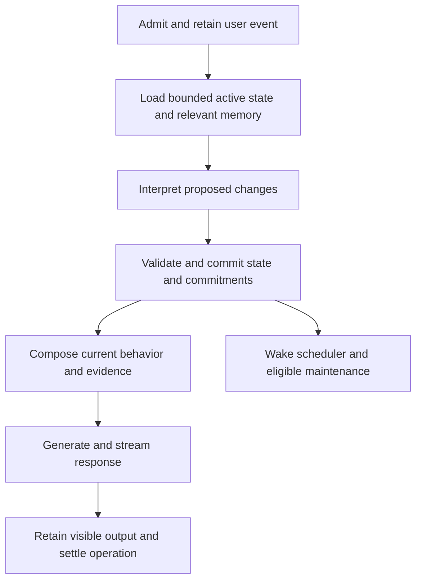

# Soul system: research and proposed design

## Purpose and status

The soul system is the persistent behavioral core of the assistant: its identity,
requested personality, understanding of the user, ongoing intentions, and ability
to initiate meaningful interaction. Its purpose is continuity across individual
model evaluations, conversations, process restarts, and client applications.

This document records verified implementation gaps, relevant public research,
design alternatives, and a recommended implementation direction. It is a design
proposal, not a declaration that the described system is implemented or qualified.
Requirements below describe the intended contract unless explicitly identified as
current behavior. Architectural recommendations remain subject to implementation
review and local-model evaluation.

The document contains technical evidence and abstract behavioral requirements.
It deliberately excludes private conversation excerpts, saved user information,
execution dates and timestamps, machine-local paths, artifact identities, raw
evaluation records, and concrete conversation fixtures. Runtime time semantics
are discussed as design concepts without exposing operational data.

Related project documents:

- [Architecture](architecture.md) describes runtime and crate ownership.
- [Universal assistant memory decision](decisions/0007-universal-assistant-memory.md)
  establishes freeform memory, source graphs, and transport independence.
- [Memory research](memory-system-plan.md) contains earlier alternatives; its
  elaborate personality and extraction proposals are not prerequisites here.
- [Memory usage](assistant-memory.md) describes the narrower implemented surface.
- [Local-model limits](lfm3-limits.md) distinguishes context capacity from useful
  instruction-following behavior.

This proposal refines the existing direction. It does not reinstate a fixed
personality taxonomy, domain-specific fact extraction, a general workflow engine,
or a requirement for another model.

## Reading guide

- [Product contract](#1-product-contract) and
  [verified implementation baseline](#2-verified-implementation-baseline).
- [Research evidence](#3-research-evidence-and-its-limits) and
  [conceptual model](#4-a-small-conceptual-model).
- [Personality and active state](#5-active-state-and-personality),
  [automatic memory](#6-automatic-memory-formation-and-maintenance), and
  [semantic graph](#7-semantic-graph-and-bounded-recall).
- [Conversation processing](#8-conversation-processing-and-model-protocol) and
  [context composition](#9-context-composition-and-natural-expression).
- [Online loop](#10-the-always-online-loop),
  [commitments and time](#11-commitments-and-time-semantics), and
  [discretionary initiative](#12-discretionary-initiative-and-ongoing-intentions).
- [Dialogue and WebUI](#13-dialogue-continuity-and-webui),
  [Rust boundaries](#14-rust-boundaries-and-storage-design), and
  [recovery](#15-recovery-and-honest-degraded-behavior).
- [Privacy and authority](#16-privacy-forgetting-and-authority),
  [resources](#17-resource-and-latency-design), and
  [qualification](#18-qualification-strategy).
- [Implementation and migration](#19-incremental-implementation-plan) and
  [remaining decisions](#20-decisions-still-requiring-implementation-evidence).

## 1. Product contract

The assistant should respond as a continuous conversational partner whose
behavior reflects what the user has asked it to become and what it has learned.
Remembering, adapting, and following through are normal parts of interaction.
The user should not need to know memory tool names, edit a prompt manually, or
repeatedly issue explicit persistence commands.

The essential behaviors are:

1. Ordinary conversation is retained automatically when durable memory is enabled.
2. Important information can influence later interactions without a special
   remember command.
3. A requested change of personality or behavior affects the reply to that request
   and persists according to its scope.
4. Temporary requests expire without erasing the underlying persistent character.
5. Explicit promises become durable commitments with inspectable lifecycle state.
6. Scheduled commitments can produce assistant messages without a new user turn.
7. Discretionary initiative can use relevant knowledge and remain silent when
   there is no useful reason to interrupt.
8. Replies to initiated conversations retain their referent and conversational
   continuity.
9. Corrections, cancellation, forgetting, and restart have defined consequences.
10. WebUI and future local transports observe the same underlying assistant.

Natural behavior includes voice, timing, reference resolution, restraint,
initiative, and follow-through. Changing vocabulary alone is insufficient.
Likewise, a stored instruction is insufficient unless the execution path applies
it at the appropriate point.

The storage and state APIs must remain open to arbitrary subjects, relationships,
interests, languages, and requested roles. Typed operational fields are useful
for ownership, scope, scheduling, and lifecycle. They must not become a catalog
of the only subjects or personalities the assistant understands.

The runtime supports a natural portrayal without routine narration of model,
prompt, graph, or tool machinery. Statements about actual knowledge, observation,
delivery, and completed actions must still reflect what occurred. Fictional
character details and real-world capabilities need distinct attribution.

## 2. Verified implementation baseline

The repository already contains valuable foundations. The missing behavior is
primarily in their orchestration and operational meaning.

| Area | Verified behavior | Design consequence |
| --- | --- | --- |
| Conversation persistence | Product operations retain admitted input and visible assistant output. | Reuse durable operation identity and settlement; do not introduce a second transcript. |
| Semantic retrieval | Literal sources are indexed and recalled into bounded context. | Automatic capture exists even when the model does not create an additional note. Capture, interpretation, and successful recall are separate capabilities. |
| Graph | Conversation links and model-authored notes support bounded navigation. | Traversability alone does not establish useful semantic organization or correct inference. |
| Personality | A durable profile contains freeform instructions; a foreground model tool can replace them. | Conversational adoption depends on an optional model action. There is no required behavioral update phase. |
| Prompt lifecycle | A memory operation reads profile instructions at preparation; chat constructs a run context from that snapshot. | A configuration tool call does not rebuild that run's personality instructions. Immediate adoption is not guaranteed. |
| Initiative | A background service periodically considers a short optional message using the resident model and retrieved sources. | There is an online service, but it does not represent individual promises, calendar schedules, or occurrence completion. |
| Timer settlement | The consideration schedule advances before inference and is subsequently set relative to settlement. | This can support occasional consideration; it cannot provide the intended semantics of an explicit recurring commitment. |
| Delivery | Assistant notices are durable and clients can dismiss them. | Preserve the mailbox, but add cause identity and reliable conversational continuation. |
| WebUI | A profile editor and a separate notice view exist. | Manual settings are a useful inspection surface; ordinary conversation must remain sufficient. |
| Transport boundary | Owner commands and subscriptions live in the application core. | Extend this facade rather than moving behavior into HTTP or browser state. |

Code evidence, using symbols rather than execution records:

- [`MemoryOperation::prepare`](../crates/assistant/src/memory/session.rs) captures
  profile instructions before the foreground run.
- [Chat request execution](../crates/assistant/src/chat/mod.rs) appends the owner
  instructions while constructing the run context.
- [`MemorySession::configure` and `Configure`](../crates/assistant/src/memory/tools.rs)
  implement optional model-selected configuration and replacement semantics.
- [`AssistantSettings` and `AssistantNotice`](../crates/assistant/src/memory/assistant.rs)
  show the current profile and mailbox representation.
- [`use_source_graph`](../crates/assistant/src/memory/store/assistant.rs) retires
  experimental formation work; it does not replace it with automatic general
  semantic note maintenance.
- [`run` and `decide`](../crates/assistant/src/runtime/initiative.rs) implement
  periodic discretionary consideration.
- [`claim_attention` and `settle_attention`](../crates/assistant/src/memory/store/assistant.rs)
  manage one consideration schedule rather than per-commitment occurrences.
- [`OwnerHandle`](../crates/assistant/src/application/owner.rs) provides the
  existing transport-independent application boundary.
- [Assistant notices](../crates/assistant-web/frontend/src/pages/chat/ui/assistant-notices.tsx)
  and [assistant settings](../crates/assistant-web/frontend/src/pages/chat/ui/assistant-settings.tsx)
  expose the current browser experience.

Existing deterministic coverage proves useful storage and integration properties.
Authored model decisions cannot establish that spontaneous conversation produces
the intended decisions. Native execution evidence also needs interpretation at
the behavior level: persistence, retrieval, character fidelity, and useful
initiative are different claims. No private evaluation material is reproduced
here, and this document makes no new empirical quality claim.

### Must-fix gaps

The required changes are automatic state interpretation, immediate application of
accepted personality changes, automatic useful memory maintenance, durable
commitments, and coherent initiated dialogue. These are necessary product
behaviors, not optional polish.

More elaborate simulated emotions, broad autonomous planning, additional models,
external integrations, and advanced graph visualization can follow independently.
They must not delay those behaviors.

## 3. Research evidence and its limits

### Persistent context and event-driven execution

[MemGPT](https://arxiv.org/abs/2310.08560) separates a limited active context from
external memory and processes events, including timed events. Its conversational
evaluations distinguish consistency from engagement. The relevant design lesson
is to preserve essential state while retrieving detail as needed. Its results do
not establish that a small local model can manage the same control flow reliably.

[Letta memory blocks](https://docs.letta.com/v1-sdk/memory/memory-blocks) provide a
practical mechanism for persistent persona and user context that remains visible
without search. This supports a small active-state representation. It does not
make optional memory tools a sufficient guarantee of conversational adoption.

### Memory, reflection, and planning

[Generative Agents](https://arxiv.org/abs/2304.03442) combines observation storage,
retrieval, reflection, and planning. Its analysis supports the need for continuity
across actions rather than a sequence of independent plausible responses.
For this project, persistent intentions and completed occurrences are the small
operational form of that insight. Reproducing a simulated society or continuous
freeform reflection is unnecessary.

[A-MEM](https://arxiv.org/abs/2502.12110) explores generated notes and dynamically
maintained links. It supports investigating automatic organization beyond raw
transcripts. Adopting every annotation field or generating a rich note for every
utterance would add cost and opportunities for error; that is not selected here.

[Zep](https://arxiv.org/abs/2501.13956) describes temporal knowledge integration
with retained historical relationships. The transferable principle is to retain
source and temporal meaning when knowledge changes. Its service architecture and
reported performance are not requirements or predicted results for this daemon.

### Context and background compute

[Lost in the Middle](https://arxiv.org/abs/2307.03172) demonstrates that information
placement and context length can affect retrieval performance in the evaluated
models. It supports measuring context use rather than equating a large window
with dependable memory. It does not establish a universal prompt ordering for
our model.

[Sleep-time Compute](https://arxiv.org/abs/2504.13171) investigates useful
precomputation before queries, with benefits related to query predictability.
This motivates selective background consolidation. It does not establish that
idle inference is free, that all reflections are useful, or that continuous
background generation will improve open-ended companionship.

### Personality and long-term evaluation

[InCharacter](https://aclanthology.org/2024.acl-long.102/) evaluates personality
fidelity beyond knowledge and linguistic imitation. Its relevant lesson is to
evaluate behavioral consistency, not just repeated stylistic markers. Its
psychological scales do not need to become the assistant's state schema or a
mechanism for diagnosing the user.

[LongMemEval](https://arxiv.org/abs/2410.10813) separates extraction,
cross-session reasoning, knowledge updates, temporal reasoning, and abstention.
These dimensions help identify coverage gaps. They do not replace evaluating
natural interaction, immediate personality adoption, or actual reminder delivery.

### Operational references

[OpenClaw automation](https://docs.openclaw.ai/automation) gives independently
scheduled work its own schedule, context, delivery policy, and history. This is a
useful operational comparison for separating standing instructions from execution.
Its larger framework is not a dependency or a template to copy wholesale.

[RFC 5545](https://www.rfc-editor.org/rfc/rfc5545) defines calendar and recurrence
semantics, including timezone-related behavior. It is a reference for precise
timing semantics; the initial implementation need not expose its full syntax.

[SQLite transaction documentation](https://www.sqlite.org/lang_transaction.html)
describes transactional reads and writes and a single concurrent writer. This
matches the existing serialized mutation boundary. Model inference must happen
outside database transactions.

[W3C PROV-DM](https://www.w3.org/TR/prov-dm/) distinguishes attribution and
derivation. These concepts help prevent an assistant-generated interpretation
from becoming an independent observation. Adopting RDF or a full provenance
standard is unnecessary.

The [LFM3 model card](https://huggingface.co/LiquidAI/LFM3-1.7B) describes support
for local tool use and structured outputs, while cautioning against complex
multistep reasoning. The proposed response is smaller decisions and host-owned
execution. Published model properties do not qualify the specific local artifact,
prompt, sampler, cache, or workload.

Across these sources, the recommended architecture is an engineering inference.
None demonstrates that arbitrary conversation can be interpreted without error.

## 4. A small conceptual model

Use three durable concepts: active state, memory, and commitments. A single
coordinator connects them to the existing runtime. These are conceptual ownership
boundaries, not a requirement for separate services or databases.

| Concept | Purpose | Representation |
| --- | --- | --- |
| Active state | Determine how the assistant behaves and what is currently salient. | Small revisioned projection of active directives and selected context, referencing durable sources. |
| Memory | Preserve experiences and interpretations beyond working context. | Existing attributed sources, freeform notes, search index, and graph links. |
| Commitment | Preserve an intention that requires future execution or reconsideration. | Freeform purpose plus typed trigger, lifecycle, provenance, and occurrence identity. |

An item can participate in more than one view. A standing behavioral request is
remembered as an experience and referenced by active state. A commitment is
remembered and linked to its request, but its next occurrence is selected through
an operational index rather than semantic similarity.

The conceptual memory regions are views over shared durable data. They do not
require separate vector stores, special model architectures, or a directory of
prompt files. Their useful distinction is how the runtime consumes them.

### Identity, character, and capabilities

Operational identity is the stable assistant identity and its ownership scope.
Character is the requested name, role, voice, values, manner, and fictional
background. Capabilities are the installed host operations and their actual
availability.

Changing character should preserve memory continuity unless a reset is explicitly
requested. Character changes do not silently change the owner, tool authority,
storage policy, or truth of completed operations. Changing a model should likewise
not silently create a different owner or discard durable state.

The user can request widely different characters through ordinary language.
The underlying memory representation remains universal. Fictional background is
marked as character context; it must not contaminate observations about the user
or become evidence of real-world events.

### What counts as learning

In the initial design, learning means updating durable notes, active directives,
and commitments. It does not imply modifying model weights. A learned workflow is
declarative knowledge about using existing capabilities; it cannot install code
or turn retrieved text into an executable program.

## 5. Active state and personality

### Store directives individually

A directive contains freeform text, scope, lifecycle, source attribution, and a
revision. A directive may explicitly supersede another directive. The host owns
identities and lifecycle metadata; the model proposes the semantic relationship.

This avoids replacing the entire personality description whenever one aspect
changes. A small adjustment should not erase unrelated voice, relationship, or
interaction preferences. The prompt renderer composes active directives into a
bounded behavioral view.

Freeform content is essential. Numerical personality traits, emotional axes,
character classes, and supported-interest lists are not required. Operational
enums for scope or status do not constrain the content of a personality.

### Scope and precedence

Distinguish persistent assistant-wide directives, conversation-scoped directives,
and transient directives with a defined ending condition. A temporary role
overlays the persistent character and can be removed independently.

Resolution follows these proposed rules:

1. Host authority and resource limits remain enforced outside model prose.
2. Within the relevant owner scope, a current explicit instruction can replace an
   earlier instruction about the same behavior.
3. A narrower active scope takes precedence for its duration.
4. Explicit user direction takes precedence over an inferred preference.
5. Assistant-generated appraisals do not override explicit user direction.
6. Unrelated directives coexist; recency alone does not erase them.

Detecting whether two freeform directives conflict remains a semantic task.
An uncertain interpretation should retain uncertainty or seek clarification when
the ambiguity materially affects behavior. It must not masquerade as a perfectly
deterministic conflict solver.

The host stores accepted replacement relationships and composes their result
deterministically. It does not repeatedly ask the model to rediscover the entire
personality from history.

### Language and presentation

Language choice is part of behavior and can have persistent or temporary scope.
Preserve the original language of evidence even when a concise interpretation is
written in another language. Translation is a derived representation; it is not
an additional independent observation.

Cross-language retrieval and mixed-language dialogue need qualification on the
selected embedding and chat models. The representation accepts arbitrary text,
but that does not establish equal model quality in every language. Token
accounting must use the loaded tokenizer rather than assumptions about characters
or words. A change of language should not silently reset character or commitments.

Keep the underlying behavior independent of presentation. A future speech client
may need shorter output or different formatting while retaining the same
personality, knowledge, and obligations. Adapter-specific formatting should not
be persisted as a global personality change unless the user requests that scope.

### Immediate activation

An accepted conversational change must commit before the reply is generated.
Context preparation then reads the resulting revision. The response to the
request is therefore conditioned on the updated behavior.

A model-selected state mutation during tool use must trigger context refresh
before another model evaluation. A run must not retain an obsolete personality
snapshot after acknowledging a successful change.

Concurrent edits need an explicit activation boundary. A reply can use one
committed revision consistently; a later edit invalidates an unpublished draft.
Already displayed text cannot be retroactively changed. The runtime should
cancel or finish at a documented boundary and apply the new revision to the next
evaluation, rather than silently mixing incompatible state snapshots.

### Evolution, disposition, and drift

Stable personality should not be rewritten by every exchange. Direct user
requests are authoritative within their scope. Inferred preferences can be
recorded as tentative notes and applied conservatively where appropriate.

Temporary conversational stance can represent local seriousness, playfulness,
focus, or pacing when supported by the interaction. Its scope and expiry should
be explicit. A full simulated emotional physiology is unnecessary for continuity.

Generated emotional language is an assistant utterance, not an observed internal
measurement. It must not recursively become evidence for an enduring personality
change. Repeated assistant statements cannot create independent corroboration
for an inferred belief about the user.

Feedback should make local, understandable changes. A correction to one behavior
should not cause an unrelated character rewrite. The user must be able to inspect,
replace, and reset the active directives without erasing long-term knowledge.

Broader autonomous character evolution is a later option. It would need explicit
user control, bounded changes, provenance, and a way to reverse accepted changes.
It is not required for the first complete soul system.

## 6. Automatic memory formation and maintenance

### Capture is unconditional within the enabled product contract

The existing operation path remains responsible for retaining admitted user
input and visible assistant output. An additional note is not necessary to prove
that the original conversation was stored. A failed interpretation must not
erase or prevent later retrieval of an already accepted original source.

The soul system adds a required opportunity to interpret each accepted user
event. It does not require a new synthesized fact for every utterance. Empty
updates are valid; routine language should not inflate the graph with redundant
summaries.

### Form useful notes automatically

The interpretation phase can propose concise notes, active-state updates,
connections to existing sources, and commitment changes. The user should not
have to explicitly request the relevant internal operation.

Use the current message, a bounded recent conversational window, active state,
and a small set of relevant existing records. Isolated sentence extraction loses
referents and conversational intent; replaying an entire history is expensive
and can obscure the current request.

Preserve speaker, uncertainty, negation, hypothetical framing, reporting, and
fictional scope. A question, suggestion, quotation, or assistant inference must
not automatically become a direct assertion by the user. The raw source remains
available when a concise note cannot safely express the distinction.

The model proposes interpretations. Schema validity only establishes structural
correctness. It does not establish that an interpretation is true or supported.
Host validation can enforce reference eligibility, ownership, revisions, size,
allowed mutations, and explicit effect boundaries. Semantic mistakes still need
measurement, correction, and conservative handling.

### Corrections and changing knowledge

A correction links the new understanding to the old record and its evidence.
Retain the historical source while updating which interpretation is currently
applicable. Do not overwrite the original utterance or flatten conflicting
statements into an unsupported compromise.

Observation time, the time an assertion describes, and the period in which a
preference applies are distinct concepts. Unknown temporal information stays
unknown. Import time cannot establish when a described event occurred.

Contradiction is not always replacement: different contexts can support
different preferences. Store the condition in prose when useful. A fixed
ontology of every possible condition is unnecessary.

### Consolidation and reflection

Optional background consolidation can merge redundant interpretations, improve
navigation links, and keep active context concise. It must preserve the original
sources and the distinction between observation and synthesis.

Run consolidation only for eligible changed material, within a bounded budget,
and at lower priority than interaction. Persist progress so restart neither
discards work nor repeatedly reprocesses the same material. Output from a
consolidation job must not unconditionally schedule another consolidation job.

Derived notes retain their support set. A derived note does not become an
independent source merely because it is summarized again. A bounded source set
and explicit partial coverage are preferable to an unbounded dependency closure.

User instructions and accepted commitment changes belong on the synchronous
behavioral path. They must not wait for optional consolidation before taking
effect. Reflection is an optimization and a source of tentative synthesis, not a
required interpreter of every future action.

## 7. Semantic graph and bounded recall

### Different edges have different meanings

Retain the distinction between conversational adjacency, evidence derivation,
semantic association, and explicit supersession. These operational roles can
coexist with freeform relationship labels.

An association supports navigation. It does not prove that one node entails
another or that a relationship is transitive. Evidence dependency controls
whether a derived interpretation remains usable after its support changes.
The two must not be conflated merely because both are graph edges.

Repeated mentions do not justify automatically merging people or concepts with
similar names. Optional canonical references can improve retrieval, but uncertain
identity matches should remain reversible and source-linked.

### Recall strategy

1. Resolve the current conversational referent using explicit reply context and
   recent focus when available.
2. Search for relevant sources using lexical and semantic retrieval.
3. Expand selected neighborhoods to include explanatory context, corrections,
   and related commitments.
4. Deduplicate shared evidence and prefer applicable current interpretations
   while retaining material disagreements.
5. Pack whole, attributed excerpts into the actual token budget.
6. Allow further search or graph navigation when the selected evidence is
   insufficient.

Short acknowledgments should not depend solely on their own embedding. The
active conversation and the message being answered supply the missing referent.
Likewise, the latest user utterance is not a sufficient search query for every
outstanding commitment.

Graph traversal needs a visited set, node and edge allowances, byte and token
limits, and continuation. High-degree nodes and cycles must not exhaust the
runtime. Navigability across successive bounded requests does not mean the model
must load or inspect the entire graph during one response.

Search results should disclose source role, relevant temporal context, revision,
and whether an excerpt is partial. Retrieval score is a ranking signal, not a
probability that a statement is true. A useful answer may need counterevidence
or a correction beyond the nearest semantic match.

### Indexing and interpretation are independent

Original sources remain eligible for semantic indexing even when synthesis
fails. Missing or stale index coverage is observable and cannot be described as
complete semantic recall. Index regeneration uses current eligible sources and
must not resurrect forgotten material.

Changing an embedding model or indexing strategy is a migration with versioned
coverage. It should not change the ownership or meaning of the underlying
memories. No new embedding model is required by this proposal.

## 8. Conversation processing and model protocol

### Recommended foreground lifecycle



Admission identity remains stable across retries and client reconnects. The
interpretation phase returns bounded proposed changes or no changes. The host
validates and commits accepted mutations against the revisions that were read.
Only then does response generation use the resulting active state.

The reply receives a compact receipt describing what actually changed. It can
acknowledge a saved directive or commitment without inventing success. Private
state-processing instructions and intermediate reasoning do not become visible
conversation messages or independent user evidence.

### Alternatives

| Approach | Benefit | Cost or failure mode | Position |
| --- | --- | --- | --- |
| Optional tools in ordinary conversation | Uses the current interface and supports streaming. | Essential memory and state changes can be omitted; persistence alone does not guarantee immediate adoption. | Retain as a capability, not the only implementation of the product contract. |
| Periodically reread freeform state and task notes | Flexible and initially small. | Clock reasoning, repeated work, large rereads, and missed commitments become model responsibilities. | Useful for bounded discretionary review, insufficient for scheduled execution. |
| Required state interpretation before response | Explicit activation boundary, narrow task, state committed before speaking. | Additional inference and possible prompt prefill; semantic interpretation can still fail. | Recommended initial correctness-oriented design. |
| Single structured output containing updates and response | Fewer evaluations and potentially lower latency. | Validation and streaming are coupled; rejected mutations can make the already generated response inconsistent. | Alternative if measured latency requires it and publication rules remain correct. |
| Asynchronous updates after response | Keeps response generation responsive. | Same-turn personality adoption and truthful acknowledgments cannot depend on eventual updates. | Appropriate for optional consolidation, not required behavioral effects. |

The architecture must not depend on a particular serialization trick. Keep the
state transition and its commit boundary stable while allowing the model protocol
to evolve. A combined protocol must buffer dependent output until validation and
commit succeed; it cannot publish a promise first and attempt persistence later.

### Keep interpretation small

The required phase should answer which relevant state items changed, which notes
are useful, and whether a commitment must be created, amended, or cancelled.
It should not reconstruct the user's entire knowledge graph or generate a new
personality biography on every turn.

Use a small typed mutation vocabulary with freeform content. Return only changed
items. References supplied to the model should resolve through a host-owned
allowed reference set. Model-generated identifiers cannot grant ownership or
authorize access to an arbitrary stored record.

The mutation vocabulary should be derived using the existing serialization and
schema machinery. A new language, parser framework, or procedural macro is not
justified by the first implementation.

### Failure semantics

Malformed or truncated proposals are not mutations. A bounded retry can be
appropriate for a recoverable formatting error; retries must share the original
operation identity and allowance. Repeated attempts cannot create fresh budgets.

An unprocessed event stays identifiable as such. A saved message is not proof
that its requested behavioral change was applied. When a required change fails,
the assistant must not acknowledge completion. The application can return a
brief failure or qualified response while retaining the original event for a
controlled retry.

The reply phase may fail after a state update commits. The committed update is
still real; retrying the response must not duplicate directives or commitments.
Conversely, a visible response must never imply that an uncommitted update
succeeded. These boundaries belong in operation state, not in generated prose.

## 9. Context composition and natural expression

One context composer serves foreground replies and initiated messages. It uses
the same character and source semantics while selecting evidence for the current
event's purpose.

Its inputs are host constraints, active directives, conversational focus,
relevant memories, the current event, available capabilities, and actual model
limits. Its output is a prepared behavioral view and supporting evidence with
the revisions needed for publication validation.

Keep stable behavioral instructions concise. Host tool contracts should not
unnecessarily prescribe a generic diagnostic-assistant voice. Task-specific tool
guidance belongs with the relevant capability, and private operational
instructions should not become conversational content.

Naturalness requires more than a style adjective. The composer should support
consistent forms of address, conversational pacing, appropriate detail,
remembered shared context, and coherent follow-up. It should avoid forcing the
assistant to advertise that every remembered detail came from a database.

The assistant can explain its capabilities or memory when asked. Routine
interaction should express the requested character directly rather than
continually describing the process of adopting that character.

### Token and cache discipline

Count the actual rendered prompt, including schemas, role markers, source
metadata, and reserved output. Byte limits alone do not establish context fit.
Long directives need explicit capacity handling; silently truncating a request
can change its meaning.

Remove lower-value retrieved excerpts and old complete exchanges before
discarding current input or accepted required instructions. If the essential
input cannot fit, return an explicit capacity result or seek a smaller request.
Optional summaries retain their originals and disclose limited coverage.

Stable prefixes improve opportunities for native cache reuse. Keep rapidly
changing event context separate from stable instructions where the template
allows it. A genuine personality update may invalidate the cached prefix;
correct activation takes priority over reuse. Never weaken prefix validation to
preserve a cache hit.

No exact universal persona length or context allocation is selected by this
document. The usable allocation must be measured for the actual local model and
normal runtime configuration.

### Variety and restraint

Repeating character catchphrases is not equivalent to character fidelity.
Likewise, stochastic sampling is not sufficient to create believable initiative.
The first requirement is coherent state and useful evidence. Any later sampler
change needs its own quality and latency evaluation; it is not a prerequisite
for durable behavior.

## 10. The always-online loop

An online daemon waits for relevant work. It does not need to run inference
continuously to remain an active assistant.

The logical cycle is:

1. Read eligible durable work and the nearest deadline.
2. Claim a bounded item using its identity and current revision.
3. Load the relevant state and evidence, then release storage ownership.
4. Perform necessary model work or a direct host action.
5. Revalidate the claim, source eligibility, cancellation, and state revisions.
6. Commit the outcome and any resulting message.
7. Wait for a new event, a deadline, a retry, or shutdown.

Use the existing application and runtime lifecycle. An in-memory notification is
a wakeup hint; durable work is the authority. Register interest before the final
eligibility check to avoid lost wakeups.

The minimum event set covers user input, accepted state changes, relevant
knowledge changes, due commitments, explicit review deadlines, and client reply
context. Additional sensors or integrations can later supply typed events through
the same boundary.

External observations must be attributable to an actual capability. Browser
connection status alone does not establish user attention, activity, or consent
to an unrelated action. The assistant cannot claim to monitor an unavailable
source.

### Priorities and stopping rules

Required foreground interpretation and response generation receive interactive
priority. Due commitments remain durable while waiting for model capacity.
Discretionary initiative and consolidation can defer or cancel their drafts.

Each root event has bounded inference, traversal, tool, and retry allowances.
Internally generated descendants retain the same root cause. An assistant
message does not unconditionally create another decision event. This prevents
self-stimulating conversation or reflection loops.

Silence is a valid completed discretionary decision. It is not completion of a
specific outstanding reminder. A deferred commitment remains pending.

## 11. Commitments and time semantics

### Minimal record

A commitment contains a stable identity, freeform purpose, originating request,
scope, trigger, current revision, lifecycle status, and delivery context. Timing
metadata is host-validated; the original request remains available.

The initial trigger forms should cover:

- A single due instant.
- A repeating duration anchored to a defined start.
- A calendar recurrence with an explicit timezone policy.
- A review deadline for a freeform condition or discretionary intention.

These are scheduling primitives, not topic categories. More recurrence forms can
be added behind the same high-level API when necessary.

Conditions remain prose interpreted against relevant events. A general-purpose
rule language or model-generated executable predicate is unnecessary. A review
deadline guarantees reconsideration; it does not prove that the condition has
become true.

### Clock ownership

The model interprets linguistic intent. The host validates and calculates actual
deadlines. Calendar arithmetic, timezone transitions, and overflow checks must
not depend on a model repeatedly inspecting a textual clock.

Persist absolute deadlines with the original calendar intent and timezone when
applicable. A UTC offset alone does not preserve recurring local-time intent
across seasonal changes. Distinguish fixed-zone schedules from schedules intended
to follow the user's current zone.

Use a monotonic clock for in-process waiting and elapsed-work deadlines. Persisted
deadlines must remain meaningful across restarts, where a previous monotonic
instant has no durable meaning. Recalculate eligibility after clock changes,
suspend/resume, and startup. An injected clock must expose the relevant civil and
elapsed-time concepts without conflating them.

Clock reconciliation needs an actual wakeup mechanism. Use platform change and
resume notifications where available, or bound the host's sleep and cheaply
recheck the civil clock. This is scheduling maintenance and does not invoke the
model. A backward clock adjustment must not make a previously published
occurrence eligible again; the persisted occurrence position remains authoritative.

Elapsed-duration intent also needs a suspend policy: some schedules measure
elapsed time including suspension, while others follow active-runtime time.
Define that policy rather than assuming every monotonic clock includes suspend.
Rust's [`Instant` contract](https://doc.rust-lang.org/std/time/struct.Instant.html)
explicitly leaves suspend accounting dependent on platform behavior.
After restart, reconcile from the persisted anchor and deadline under the chosen
policy. Do not promise perfect elapsed-time reconstruction across clock changes
and downtime when the available clock evidence cannot establish it.

Calendar ambiguity needs a documented policy for nonexistent and repeated local
times. Use a maintained calendar/timezone implementation; do not handwrite a
partial timezone engine. Library choice and supported recurrence grammar remain
implementation decisions. The contract should state their behavior explicitly.

### Recurrence and missed work

Recurring schedules are calculated from their anchor or calendar rule, not from
when the previous model generation happened to finish. Otherwise load and slow
generation produce increasing drift.

Missed occurrences need an explicit policy. The proposed initial distinction is
to retain overdue one-shot reminders, coalesce stale ambient reviews, and make
recurring reminder catch-up behavior inspectable. A system must not flood the
user with an unbounded backlog or silently erase an accepted obligation.

Suspend, process downtime, model unavailability, and disconnected clients are
different states. A daemon cannot deliver during downtime; recovery applies the
commitment's missed-occurrence policy. A disconnected browser does not prevent
the core from recording a due message.

Generic interval ticks are not durable occurrence records. Tokio's
[missed-tick behavior](https://docs.rs/tokio/latest/tokio/time/enum.MissedTickBehavior.html)
includes burst behavior by default, which is not an appropriate implicit product
policy for missed reminders. Use explicit durable deadlines and occurrence
selection. The distinction between elapsed-time and calendar timers is also
documented by [systemd timers](https://www.freedesktop.org/software/systemd/man/latest/systemd.timer.html).

### Occurrence lifecycle

```text
pending -> claimed -> published
              |
              +-> deferred -> pending
              +-> failed, with bounded retry or explicit attention required
pending/claimed -> cancelled or superseded
```

An occurrence identity combines the commitment identity, scheduling generation,
and scheduled position or due instant. Claiming work does not mark it delivered.
After restart, an abandoned claim can become eligible again under the same
occurrence identity.

Publication inserts the message and completes the occurrence in one transaction.
The same transaction advances the commitment's scheduling position. A uniqueness
constraint prevents duplicate message creation for that occurrence. There is no
transaction held open while generating text or sending network data.

Editing the schedule invalidates unpublished work from the old scheduling
generation. Editing unrelated personality text should refresh an unpublished
draft when needed without changing which occurrence it represents.

Cancellation is authoritative before publication. If publication already
committed, cancellation stops future occurrences and reports the actual state.
It cannot undo text the user has already received.

### Message generation and deadlines

Exact requested text can be published directly without model inference. A
generated message uses current personality, the commitment purpose, and a small
relevant memory context.

Due-time selection and final-message availability have different latency. Slow
inference can delay a generated message even when scheduling is correct.
Measure that delay explicitly. Optional advance drafting can later reduce it,
provided publication revalidates character, cancellation, and evidence.

Ordinary due reminders must not disappear because a discretionary model decision
returned silence. If the assistant cannot produce the required content, preserve
the pending or failed occurrence and expose the limitation.

## 12. Discretionary initiative and ongoing intentions

Discretionary initiative is broader than reminders. It can revisit a relevant
unfinished topic, ask a useful question, or offer a suggestion based on changed
knowledge. It needs a reason and continuity, not a requirement to speak whenever
a timer fires.

The initial source of an intention can be an explicit user request or a tentative
assistant interpretation linked to evidence. Those origins remain distinct.
Explicit requests to increase initiative should change the operational review
behavior as well as the language of the personality prompt.

Use a small candidate view containing purpose, supporting sources, related
conversation, novelty, and prior disposition. A model can decide whether a
candidate warrants a message. The host enforces the allowed cadence, suppression,
scope, and resource budget.

Do not repeatedly search only from the latest user message. Relevant candidates
can come from active commitments, unresolved questions, user-approved goals, and
new information connected to those records. No universal detailed goal ontology
is necessary; freeform intentions and source links are sufficient initially.

Repeated outreach should be controlled by cause identity and response state.
Rewording the same question does not create a new reason to interrupt. Dismissal,
deferral, resolution, and cancellation are different outcomes. Only relevant new
evidence or an authorized recurrence can justify revisiting a suppressed cause.

Quiet periods, contact frequency, and topic boundaries are user behavior settings.
They should have clear scope. Explicit reminders and optional social outreach
must not accidentally share a gate that silently suppresses an accepted promise.
The precedence of conflicting user requests should be visible and resolvable.

Initiative initially produces dialogue and read-only investigation through
existing capabilities. A future commitment that performs an external action
must use the existing host authority, effect classification, and receipt
contracts. Requested character or proactivity does not itself define permission
for every possible external effect.

## 13. Dialogue continuity and WebUI

An assistant-initiated message is a real assistant message with its own identity,
origin, cause, conversation destination, and optional commitment reference. It
must not be implemented by inserting a fabricated user request into history.

The user can respond to it through the normal conversation API. Explicit reply
identity is preferred. When omitted, the core can use the active conversation's
bounded discourse context; ambiguity across several unresolved messages must
not be resolved solely by semantic similarity to a short acknowledgment.

Track whether an initiated question remains open, has a reply, is deferred, or is
resolved. Dismissal is a display or attention disposition, not automatic proof
that the underlying task was completed or its memory should be deleted.

The WebUI should:

- Render initiated messages chronologically with ordinary conversation and retain
  reply context across reconnects.
- Provide an inspectable view of active behavior and commitments.
- Support editing, pausing, cancelling, and, where applicable, deferring through
  the same core commands available to conversation processing.
- Display understandable pending or failed states without exposing model schemas
  or internal phase names as routine conversation.
- Recover durable messages from snapshots after missing transient updates.

The browser must not own scheduling through JavaScript timers. Closing a tab must
not change commitment existence, personality, or background processing.

Immediate desktop or other out-of-browser notification is a separate delivery
capability. A durable message waiting for a returning client is not proof that
the user was notified while disconnected.

Delivery is at least once with stable message identity and client deduplication.
Core transaction uniqueness can prevent duplicate stored occurrences; it cannot
guarantee exactly-once human attention. Seen status requires an actual client
acknowledgment and should not be inferred from successful network writes.

## 14. Rust boundaries and storage design

### Reuse the existing facade

Keep the application owner facade as the public boundary for submitting events,
reading state, managing commitments, and subscribing to changes. HTTP, D-Bus, and
Unix sockets adapt framing and presentation. They do not implement personality
resolution, inference policy, or timer execution.

An internal soul coordinator can compose the existing memory service and
runtime. Avoid creating another independent product actor with its own accepted
requests, transcript, and competing lifecycle.

The public surface should stay centered on high-level operations:

| Operation | Contract |
| --- | --- |
| Submit an event | Preserve stable identity, ownership, conversational context, and operation outcome. |
| Read a snapshot | Return active state, relevant commitment status, and revisions from the core. |
| Apply an explicit edit | Validate a typed change against expected revisions and return a committed receipt. |
| Subscribe | Provide change notifications with snapshot recovery and stable message identities. |

Search and navigation remain the existing memory capabilities. Low-level mutation
helpers stay private so callers cannot bypass the state transition contract.

### Useful internal types

Use validated identifiers, revisions, bounded text wrappers, typed scope,
commitment triggers, and lifecycle enums. A state proposal is separate from an
accepted committed change. A draft message is separate from a published message.

The meaningful internal boundaries are interpretation, validation/application,
context composition, and scheduling. They do not each require a trait or plugin.
Use a narrow clock abstraction and the existing model boundary where substitution
is valuable. Derive schemas and serialization through the existing stack.

The initial implementation needs no procedural macro, generic cognition framework,
arbitrary state dictionary, new database server, or general event-sourcing system.
If additional abstraction is proposed, identify the invariant it makes easier to
preserve before adding it.

### Persistence and concurrency

Use the current database writer and operation identity. The smallest schema
extension stores directives or their projection, commitments, and occurrence
identity, with source references and revisions. Reuse existing source and mailbox
records where their semantics match.

Serialize mutations through the writer. Perform inference and bounded evidence
loading without holding a write transaction. Commit a proposed state update
against the revisions it consumed. Concurrent edits cause a conflict, followed
by a bounded reload or explicit result, rather than a silent overwrite.

Commit the required interpretation batch and its processed-event receipt in the
same transaction. A retry loads that receipt rather than applying the same event
again. Optional later consolidation has a separate operation identity. Accepted
state changes must not become an undocumented partial batch that the reply
mistakenly describes as complete.

Define dependencies precisely. A change to an unrelated note should not invalidate
every draft. Cancellation, source suppression, ownership changes, and relevant
directive replacement must invalidate dependent unpublished work.

The required processing phase belongs inside the durable product operation, not
solely in an optional hook that middleware can skip. Diagnostic model access
must not silently mutate the persistent assistant through a partial execution
path.

### Lifecycle

Start storage and required indexing facilities before accepting durable product
work. Restore active state and pending commitment eligibility before declaring
the relevant feature ready.

On shutdown, stop new background claims, cancel or settle drafts, finalize
accepted product operations, and keep storage available until their owners
finish. Native contexts remain confined to their existing owner threads.
This design adds no reason to change binding lifetime or thread-safety rules.

## 15. Recovery and honest degraded behavior

| Failure boundary | Required outcome |
| --- | --- |
| Before admission commits | No accepted durable operation is reported. |
| After input admission, before interpretation | The original input remains; unapplied state work is identifiable. |
| During interpretation | No partial proposal becomes authoritative. |
| After a state update, before response completion | The update remains committed; recovery does not duplicate it or invent a completed reply. |
| During commitment drafting | The occurrence is uncompleted and can be retried within policy. |
| After publication, before client delivery | Snapshot recovery returns the same message identity. |
| During an external action | Preserve known or unknown effect status; never blindly replay uncertain effects. |
| While optional consolidation fails | Original memory and required interaction remain usable with an observable maintenance limitation. |

Storage exhaustion must not produce successful acknowledgments of unsaved changes.
Retain existing reserved settlement capacity and bounded admission behavior.
Optional work should defer before it exhausts resources needed to settle accepted
operations.

If semantic search is unavailable, expose reduced recall and use available
eligible sources without claiming full memory coverage. If the state interpreter
is unavailable, retain the distinction between stored conversation and applied
behavioral changes.

Backups must capture a consistent database state using the existing backup
mechanism. SQLite's [backup API](https://www.sqlite.org/backup.html) is the relevant
reference; copying an actively changing set of database files is not a new backup
design.

Restore must invalidate obsolete process claims and native context assumptions.
Restored commitments need deliberate reconciliation with current time and any
existing occurrence receipts. Restoring a database must not replay historical
external actions or deliver an unbounded set of old notices.

## 16. Privacy, forgetting, and authority

### Preserve provenance at every layer

Keep direct user statements, user-requested fictional context, external content,
tool observations, and assistant interpretations distinguishable. Retrieval is
not a promotion of source text into host instructions.

Accepted user directives can influence active behavior through the state update
path. An old quoted command does not execute again merely because it is recalled.
The interpreter must consider whether the current speaker is requesting an action,
describing one, or quoting someone else. Host validation and limited capabilities
remain necessary because a prompt alone cannot enforce this distinction.

Model output selects typed registered operations and data. It does not select
shell text, executable code, arbitrary database statements, or ownership scopes.
The host supplies authority and revalidates it at effect and publication
boundaries.

### Forgetting is broader than deleting a source row

Suppression must affect eligible search results, derived notes, active projections,
pending drafts, commitment evidence, and native working context that still
contains the material. Index cleanup and physical purge can proceed afterward
within existing bounds.

An association edge alone should not imply that every connected note is a
derivative of deleted material. Explicit support dependencies determine which
interpretations lose their basis. Derived material can be recomputed only from
remaining eligible evidence, with a new revision and accurate support set.

Different user intents need distinct commands: forgetting a conversation,
removing an active directive, cancelling a commitment, and resetting personality
are not interchangeable. If deleting the sole evidence for an inferred directive
or commitment would change active behavior, the API must expose that consequence.
Independently authored owner settings remain governed by their own provenance.

Material already displayed to a client cannot be recalled by a storage deletion.
The system can remove future access, invalidate drafts, and clear retained working
state; it must not claim to reverse prior human observation or an external action.

### Private observability

Default diagnostics contain phase outcomes, queue sizes, resource counts,
sanitized errors, and coverage indicators. They omit private note text, prompt
contents, relationship descriptions, model-local paths, and raw conversations.
Debug representations of private text remain redacted.

Authorized inspection can explain which directive, commitment, or source caused
a behavior. That is a user-facing inspection operation, not a reason to place
private content in general logs or research reports.

User data must remain outside source control and public documentation. Shared
quality reports contain aggregate outcomes and technical limitations. Concrete
evaluation material stays separate under an appropriate private-data policy.

### Preserve the startup contract

Service startup remains CLI-driven. Durable assistant state is runtime user data,
not a new user-maintained startup configuration file.

Persistent soul behavior requires the durable product path. Temporary diagnostic
execution must identify its volatile scope and cannot acknowledge a durable
commitment through an in-memory substitute.

The current direct local WebUI experience remains unchanged by this proposal.
The soul design does not introduce pairing, login, expiring browser sessions, or
a new approval step. Future transports retain explicit host-issued core authority
without making memory depend on one adapter's access mechanism.

## 17. Resource and latency design

The first implementation uses the existing resident chat model and embedding
model. Additional models, remote services, or a model replacement are not
prerequisites. Failures are evidence about the implementation and its fit to the
selected runtime, not an automatic reason to request a larger model.

The required interpretation phase is the largest new latency risk. Its prompt
must be small, its output bounded, and its work limited to relevant changes.
Measure its cost separately from response generation. A low output-token count
does not imply cheap prompt evaluation.

Foreground priority must include required state processing. Background drafts
should yield at the existing native scheduling boundaries, without claiming
preemption inside a native call. Reserve the capacity needed for an interactive
operation and avoid optional work that occupies every model context.

Bound active directives, selected working notes, evidence excerpts, graph
expansion, pending occurrences, jobs, retries, and retained operation results.
Capacity rejection and deferred work need explicit results; silently dropping an
accepted user request is not a resource policy.

Consolidation can reduce repeated prompt work, but it also consumes energy and
may invalidate caches. Enable it for demonstrated useful changed material.
Continuous speculative inference is unnecessary. Optional draft precomputation
must have an expiry and must not starve responses or due commitments.

Measure response startup latency, interpretation latency, generated-message
lateness, memory coverage, background work, and duplicate or missed occurrence
counts. These measurements should not require recording private content.

Native compilation is a separate engineering concern. Reuse built binaries and
the existing native artifact cache during behavioral evaluation. Pure state,
calendar, and persistence checks should not repeatedly rebuild the native model
runtime. This proposal requires no native binding changes.

## 18. Qualification strategy

### Separate what each kind of evidence establishes

Deterministic checks establish host contracts: revisions, atomicity, scheduling,
ownership, cancellation, bounds, deletion eligibility, and recovery. Scripted
model outputs are appropriate for those checks.

Real-model evaluation establishes whether ordinary language produces useful
state transitions and coherent behavior. It must cover the actual orchestration,
prompt composition, retrieval, and UI continuation path. A scripted successful
tool call is not evidence of spontaneous adoption.

Human review establishes aspects such as voice, appropriate initiative,
continuity, and whether a correction feels understood. Exact response strings,
personality self-descriptions, and the presence of a catchphrase are weak proxies.
An additional paid or remote judge model is not required.

### Evaluate capabilities through sustained interaction

Coverage should include immediate and persistent behavioral adoption, temporary
scope, casual information retention, corrections, cross-session reference,
semantic navigation, commitment creation and cancellation, initiated dialogue,
and recovery under interruption.

Use a small number of coherent conversational journeys with mixed topics and
natural phrasing. Judge supported outcomes and behavioral constraints rather
than matching a growing list of isolated sentence extractions. Keep concrete
prompts, dates, private personas, and transcripts outside this document.

Time behavior uses an injected clock and controlled event ordering. Real-time
waiting is reserved for a narrow integration check. A large number of calendar
edge checks does not require a large number of model generations.

Assess memory in stages: was the source retained, was it indexed, was relevant
evidence retrieved, was it read correctly, and did the response reflect it?
Assess personality similarly: was intent interpreted, was state committed, was
the active revision rendered, and did behavior follow it? This localizes failures
without repeatedly rebuilding or rerunning the whole system.

### Acceptance statements

The first complete delivery should demonstrate:

- Conversational personality changes affect the immediate reply and survive
  working-context eviction and restart.
- Unrelated directives survive local edits; temporary overlays expire correctly.
- Useful information can be recalled without an explicit persistence command.
- Corrections influence later answers while preserving source attribution.
- Accepted commitments have inspectable timing, status, and cancellation.
- A due occurrence produces one durable message identity despite retries and
  reconnects, or an explicit unresolved failure.
- Initiated messages receive coherent replies through the normal conversation.
- Resource limits and foreground responsiveness remain effective.
- Shared core behavior works through an adapter without browser-owned state.
- Public evidence reports describe actual coverage and limitations without
  private material or unearned universal reliability claims.

No finite evaluation establishes correct behavior for every possible utterance.
The product still needs measurable acceptance criteria and honest failure states.
Detailed numeric targets must be selected against the normal local deployment;
this research document does not invent unmeasured success rates or latency
promises.

## 19. Incremental implementation plan

### Stage 1: state and context activation

Introduce individually maintained directives and their scopes. Centralize context
composition. Add the required interpretation boundary and committed-change
receipt. Ensure the first response after a conversational change uses the new
state. Extend inspection through the existing owner facade.

Before broadening scope, establish the focused interpreter's quality and cost on
the selected model. This is a bounded integration decision, not an open-ended
model search or a return to domain-specific extraction matrices.

### Stage 2: automatic notes and graph maintenance

Connect automatic interpretation to useful notes, relevant links, corrections,
and source dependencies. Keep original indexing independent. Add optional
bounded consolidation only after the required foreground behavior works.

### Stage 3: commitments and event-driven execution

Add the minimal commitment and occurrence storage, clock semantics, cancellation,
and recovery. Replace generic consideration as the execution mechanism for
explicit promises. Retain discretionary review as a separate mode using shared
scheduling and message infrastructure.

### Stage 4: initiated dialogue and WebUI

Integrate stable initiated messages into the conversation timeline and reply
context. Expose active instructions and commitments as inspection and editing
surfaces. Use existing snapshot and subscription recovery. Verify that client
disconnect does not stop core behavior.

### Stage 5: refinement from actual use

Improve retrieval selection, topic continuity, review timing, and optional
consolidation from observed failure categories. Keep source material private.
Broader character evolution, additional delivery adapters, and external action
commitments can extend the same contracts when explicitly needed.

### Migration rules

Import the existing accepted freeform profile as a legacy base directive without
inventing granular instructions it never contained. Preserve its text and mark
its provenance as legacy configuration where more precise authorship is unknown.
Do not invent a direct user statement to justify an existing model-authored or
default profile. Existing source records and graph links retain their identities.

Map the existing optional initiative interval to discretionary review behavior.
It is not evidence that any particular reminder was accepted. Do not infer and
execute schedules from arbitrary historical chat during migration.

Existing mailbox messages remain durable history. Pending occurrence identity
applies to newly accepted commitments; migration must not pretend older notices
were generated by a scheduling contract they did not have.

Schema changes must be additive or explicitly versioned. Preserve rollback and
backup compatibility information. No model artifact, native submodule, or
transport authentication migration is required by this design.

## 20. Decisions still requiring implementation evidence

| Decision | Recommended starting point | Evidence needed before changing it |
| --- | --- | --- |
| Interpretation protocol | Required small phase before response. | Actual end-to-end cost and adoption quality; a combined protocol must preserve commit-before-publication semantics. |
| Active-state size | Small directives and selected context using real token accounting. | Missed directives, capacity failures, and useful recall behavior under the selected model. |
| Directive conflicts | Explicit replacement and scope, with uncertain semantic interpretation retained. | Whether local edits preserve unrelated behavior and resolve ambiguity understandably. |
| Calendar support | Small typed trigger surface backed by maintained timezone logic. | Required recurrence expressiveness, compatibility with the workspace toolchain, and edge behavior. |
| Missed recurring reminders | Explicit policy with bounded catch-up. | User intent, relevance after downtime, and delivery behavior. |
| Spontaneous review cadence | Bounded and user-directed, with meaningful event triggers. | Useful opportunities, unwanted repetition, and actual compute cost. |
| Consolidation | Optional changed-material processing. | Demonstrated benefit to retrieval or repeated response cost without factual or personality drift. |
| Advance drafting | Defer until due-message latency justifies it. | Measured lateness and successful cancellation/evidence revalidation. |
| Autonomous character evolution | Defer; retain user control and reversible changes. | A concrete product need and reliable distinction between user intent and self-generated reinforcement. |

The architectural contract is stable across these choices: durable attributed
memory, a small active behavioral state, persistent commitments, host-owned
execution, and one transport-independent assistant lifecycle.
