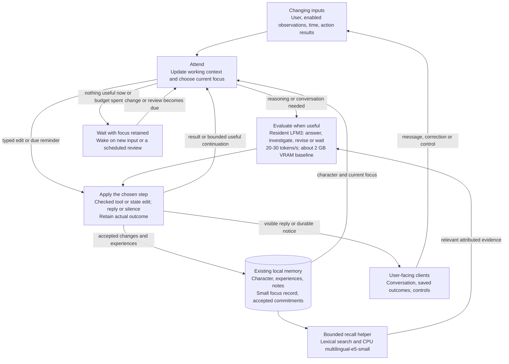

# Soul system: research and proposed design

## Total architecture

**Selected direction: one continuing attention loop, using the existing application
coordinator and model/tool runner.** Personality, recollection, reflection, and
initiative are ways that the same loop uses its state. They do not need independent
decision pipelines. This revises the earlier diagram and its mandatory
interpretation-before-every-answer proposal.

The earlier design made each correctness concern into a separate processing phase,
then introduced more records and coordination to connect those phases. Calling
the boxes “logical responsibilities” did not remove that complexity. It also made
an unqualified classifier a dependency of ordinary conversation. The simpler
direction follows the repository's accepted
[small assistant loop decision](decisions/0007-universal-assistant-memory.md).



The cycle runs in the host; it is not one endless LLM generation. Native inference,
embedding, and database I/O keep their existing execution owners so the coordinator
can still receive input and cancellation while they work. There is one owner of
attention and semantic action selection, one active evaluation at a time, and one
shared path for applying effects. The arrows do not imply a service for each box.

### What persists between steps

| State | Purpose and smallest representation |
| --- | --- |
| Character | Existing editable freeform profile, with a revision. Apply it in every evaluation; do not rediscover it from history. Local instructions can overlay it without rewriting the base. |
| Experience | Existing attributed user/assistant/tool sources, notes, links and search. Original inputs remain available even if no note is generated. |
| Focus | A short current question or intention, source references, next useful step or waiting condition, and revision. Keep one active focus and a small bounded parked list; start with at most eight total. No ontology of human interests or emotions. |
| Commitments | Accepted obligations with due time and occurrence identity when scheduling is implemented. These are enforceable host work, distinct from an assistant's tentative question. |

A focus is a working summary, not a transcript of private reasoning and not a new
instruction from the user. It can survive a context reset or restart. Changing
wording alone is not progress. Completing an investigation, obtaining a result,
resolving a question, or identifying a concrete next observation can be progress.
The host bounds continuation even when the model claims to have made progress.

### How the continuing loop behaves

1. **Notice changes.** Retain admitted conversation and read bounded changes from
   enabled sources. Coalesce replaceable observations by source/key; preserve
   commands and action results with their identities. Keep attribution. An external
   observation supplies data, not new permissions or personality instructions.
2. **Attend to one thing.** Handle controls and due host work promptly. User input
   takes model priority; otherwise resume a relevant focus, review changed sources,
   or consider a due question. Initially use FIFO among eligible parked items,
   with user-directed focus first. No LLM router or embedding-based importance
   system is required to select the next item.
3. **Take a useful step.** Compose character, focus, recent changes and bounded
   evidence. Use the normal model/tool loop for a response, lookup, note, question,
   or state-edit proposal. A typed edit or basic due reminder needs no generation.
   Routine conversation has no separate compulsory classification pass.
4. **Apply and observe the result.** The host checks the selected operation's
   authority, arguments, revisions and limits. Persist an accepted effect and its
   receipt together. Refresh changed state before the next evaluation. Actual tool
   results and changed focus return to the same loop; they do not start another
   agent with a fresh allowance.
5. **Continue or wait.** A useful internal next step may run without new external
   input, within the current activation's limits. Otherwise retain the question
   and wait for an observation, user response or appropriate review time. Silence
   is a valid decision. An unchanged focus cannot repeatedly wake itself merely
   because the last generation finished.

This captures the useful part of the human analogy: continuity comes from what
remains relevant while inputs change. The assistant may reconsider an unresolved
question as time passes, or connect new information to it. It need not simulate
a person's entire internal monologue. This is a functional design, not a claim
about consciousness or a scientific model of human personality.

### What is removed, and what still costs work

| Earlier proposal | Revised direction |
| --- | --- |
| Required interpreter, then reply on every user turn | Normal response/tool loop; extra evaluations only for actual actions or useful continuation. No mandatory no-change classifier or repair pass. |
| Separate reflection, maintenance and initiative decision paths | Different causes for selecting work in the same loop, using one context composer and action boundary. |
| A table and lifecycle for every conceptual concern | Reuse profile, sources, notes, commands and notices. Add a bounded focus record first; add scheduling records only with scheduling. Section 24 replaces the previous mandatory table inventory. |
| Personality reconstruction and semantic routing | Pin accepted character; use simple host attention order and bounded recall. |
| A large isolated classification corpus as the entry gate | Shared host-boundary tests and a few complete user journeys. Preserve failed model experiments as evidence, not as a reason to build more pipelines. |

One loop does not mean one model call can safely do every task. An action may need
a tool result before the assistant can describe its success. Conversely, making
tool use optional leaves a real omission risk: LFM3 may answer without saving a
requested change. The previous mandatory classifier also made semantic errors.
Neither architecture proves understanding. Qualification must check natural
adoption and persistent effects through the chosen loop; authoritative saved
status comes from the host receipt, never from fluent prose alone.

Private focus updates and optional deliberation must stay out of the ordinary
visible event sink. The current runner can publish text before dispatching tools;
the implementation must not treat pre-tool text as proof of a saved effect.
These are small but necessary integration changes, not capabilities already
established by this drawing. Section 21 identifies the actual code boundaries.

### Debugging and minimum evidence

Explain every step with one bounded diagnostic record: activation/cycle identity,
cause, input and state revisions, selected focus, action/result identity, and
continue/wait reason. Content is private by default. Reproduce host behavior with
a fake clock and recorded boundary results; do not expect rerunning a nondeterministic
model to reproduce identical text. This needs no production event-sourcing engine.

The first vertical slice is: a user introduces a topic, the assistant retains a
question, a later permitted input changes its understanding, it updates or answers
through the same loop, and it then waits. Include interruption and restart. Add
one receipt/retry test, one stale-or-forgotten-result test, and one exhausted-budget
test at shared boundaries. Add calendar tests when scheduling is implemented.
Section 30 separates these host checks from actual-model behavioral evidence.

The remaining sections preserve research findings and feature-specific details.
Sections 8, 10, 20, 23, 24 and 29 define the revised implementation direction.
Detailed recurrence, granular directive history and bulk-control contracts are
references for those capabilities, not prerequisites for the first working loop.
No application code is changed by this research revision.

## Purpose and status

The soul system is the persistent behavioral core of the assistant: its identity,
requested personality, understanding of the user, ongoing intentions, and ability
to initiate meaningful interaction. Its purpose is continuity across individual
model evaluations, conversations, process restarts, and client applications.

This document records verified implementation gaps, relevant public research,
design alternatives, and a recommended implementation direction. It is a design
proposal, not a declaration that the described system is implemented or qualified.
Requirements below describe the intended contract unless explicitly identified as
current behavior. Architectural recommendations remain subject to implementation
review and local-model evaluation.

The deployment constraint is fixed: the existing small resident LFM3 chat model and
one multilingual-e5-small embedding model, fully local operation, and useful
behavior on weak consumer computers. A larger model, hosted evaluator, additional
reranker, compression model, fine-tuning pipeline, or permanent second chat-model
copy cannot be used to rescue the design. Faster hardware may increase throughput;
it must not be required for correct persistence or reminder delivery.

The accepted current performance baseline, reported by the owner from multiple
prompts, is 20–30 generated tokens/second and approximately 2 GB VRAM. Use this
baseline for design estimates rather than treating current throughput as unknown.
Section 27 derives its consequences; semantic qualification and added workflow
latency remain separate questions.

Sections 20–31 retain implementation guidance and feature references: selected contracts, code integration, user journeys, processing and
storage protocols, retrieval, scheduling, budgets, privacy, migration, and
acceptance. A selected design is not a measured capability. The readiness ledger
distinguishes questions answered by source inspection from experiments that must
pass on the fixed models and target hardware before claiming product reliability.

The document contains technical evidence and abstract behavioral requirements.
It deliberately excludes private conversation excerpts, saved user information,
execution dates and timestamps, machine-local paths, artifact identities, raw
evaluation records, and concrete conversation fixtures. Runtime time semantics
are discussed as design concepts without exposing operational data.

Related project documents:

- [Architecture](architecture.md) describes runtime and crate ownership.
- [Universal assistant memory decision](decisions/0007-universal-assistant-memory.md)
  establishes freeform memory, source graphs, and transport independence.
- [Memory research](memory-system-plan.md) contains earlier alternatives; its
  elaborate personality and extraction proposals are not prerequisites here.
- [Memory usage](assistant-memory.md) describes the narrower implemented surface.
- [Local-model limits](lfm3-limits.md) distinguishes context capacity from useful
  instruction-following behavior.

This proposal refines the existing direction. It does not reinstate a fixed
personality taxonomy, domain-specific fact extraction, a general workflow engine,
or a requirement for another model.

## Reading guide

- [Total architecture](#total-architecture): components, execution paths, authority,
  persistent state, and current implementation boundaries in one diagram.
- [Product contract](#1-product-contract) and
  [verified implementation baseline](#2-verified-implementation-baseline).
- [Research evidence](#3-research-evidence-and-its-limits) and
  [conceptual model](#4-a-small-conceptual-model).
- [Personality and active state](#5-active-state-and-personality),
  [automatic memory](#6-automatic-memory-formation-and-maintenance), and
  [semantic graph](#7-semantic-graph-and-bounded-recall).
- [Conversation processing](#8-conversation-processing-and-model-protocol) and
  [context composition](#9-context-composition-and-natural-expression).
- [Online loop](#10-the-always-online-loop),
  [commitments and time](#11-commitments-and-time-semantics), and
  [discretionary initiative](#12-discretionary-initiative-and-ongoing-intentions).
- [Dialogue and WebUI](#13-dialogue-continuity-and-webui),
  [Rust boundaries](#14-rust-boundaries-and-storage-design), and
  [recovery](#15-recovery-and-honest-degraded-behavior).
- [Privacy and authority](#16-privacy-forgetting-and-authority),
  [resources](#17-resource-and-latency-design), and
  [qualification](#18-qualification-strategy).
- [Implementation and migration](#19-incremental-implementation-plan) and
  [selected implementation contracts](#20-selected-implementation-contracts).
- [Code integration](#21-code-integration-and-verified-hazards) and
  [end-user journeys](#22-end-user-flows-and-observable-outcomes).
- [Interpretation protocol](#23-interpretation-and-operation-protocol),
  [storage contracts](#24-storage-and-concurrency-contracts), and
  [retrieval implementation](#25-retrieval-and-memory-maintenance-contracts).
- [Scheduling details](#26-time-scheduling-and-initiative-contracts),
  [weak-hardware operation](#27-resource-contract-for-consumer-hardware), and
  [privacy boundaries](#28-authority-forgetting-and-private-observability).
- [Implementation sequence](#29-implementation-and-migration-sequence),
  [acceptance protocol](#30-validation-and-release-decisions), and
  [readiness ledger](#31-research-readiness-and-remaining-evidence).

## 1. Product contract

The assistant should respond as a continuous conversational partner whose
behavior reflects what the user has asked it to become and what it has learned.
Remembering, adapting, and following through are normal parts of interaction.
The user should not need to know memory tool names, edit a prompt manually, or
repeatedly issue explicit persistence commands.

The essential behaviors are:

1. Ordinary conversation is retained automatically when durable memory is enabled.
2. Important information can influence later interactions without a special
   remember command.
3. A requested change of personality or behavior affects the reply to that request
   and persists according to its scope.
4. Temporary requests expire without erasing the underlying persistent character.
5. Explicit promises become durable commitments with inspectable lifecycle state.
6. Scheduled commitments can produce assistant messages without a new user turn.
7. Discretionary initiative can use relevant knowledge and remain silent when
   there is no useful reason to interrupt.
8. Replies to initiated conversations retain their referent and conversational
   continuity.
9. Corrections, cancellation, forgetting, and restart have defined consequences.
10. WebUI and future local transports observe the same underlying assistant.

Natural behavior includes voice, timing, reference resolution, restraint,
initiative, and follow-through. Changing vocabulary alone is insufficient.
Likewise, a stored instruction is insufficient unless the execution path applies
it at the appropriate point.

The storage and state APIs must remain open to arbitrary subjects, relationships,
interests, languages, and requested roles. Typed operational fields are useful
for ownership, scope, scheduling, and lifecycle. They must not become a catalog
of the only subjects or personalities the assistant understands.

The runtime supports a natural portrayal without routine narration of model,
prompt, graph, or tool machinery. Statements about actual knowledge, observation,
delivery, and completed actions must still reflect what occurred. Fictional
character details and real-world capabilities need distinct attribution.

## 2. Verified implementation baseline

The repository already contains valuable foundations. The missing behavior is
primarily in their orchestration and operational meaning.

| Area | Verified behavior | Design consequence |
| --- | --- | --- |
| Conversation persistence | Product operations retain admitted input and visible assistant output. | Reuse durable operation identity and settlement; do not introduce a second transcript. |
| Semantic retrieval | Literal sources are indexed and recalled into bounded context. | Automatic capture exists even when the model does not create an additional note. Capture, interpretation, and successful recall are separate capabilities. |
| Graph | Conversation links and model-authored notes support bounded navigation. | Traversability alone does not establish useful semantic organization or correct inference. |
| Personality | A durable profile contains freeform instructions; a foreground model tool can replace them. | Conversational adoption depends on an optional model action. There is no required behavioral update phase. |
| Prompt lifecycle | A memory operation reads profile instructions at preparation; chat constructs a run context from that snapshot. | A configuration tool call does not rebuild that run's personality instructions. Immediate adoption is not guaranteed. |
| Initiative | A background service periodically considers a short optional message using the resident model and retrieved sources. | There is an online service, but it does not represent individual promises, calendar schedules, or occurrence completion. |
| Timer settlement | The consideration schedule advances before inference and is subsequently set relative to settlement. | This can support occasional consideration; it cannot provide the intended semantics of an explicit recurring commitment. |
| Delivery | Assistant notices are durable and clients can dismiss them. | Preserve the mailbox, but add cause identity and reliable conversational continuation. |
| WebUI | A profile editor and a separate notice view exist. | Manual settings are a useful inspection surface; ordinary conversation must remain sufficient. |
| Transport boundary | Owner commands and subscriptions live in the application core. | Extend this facade rather than moving behavior into HTTP or browser state. |

Code evidence, using symbols rather than execution records:

- [`MemoryOperation::prepare`](../crates/assistant/src/memory/session.rs) captures
  profile instructions before the foreground run.
- [Chat request execution](../crates/assistant/src/chat/mod.rs) appends the owner
  instructions while constructing the run context.
- [`MemorySession::configure` and `Configure`](../crates/assistant/src/memory/tools.rs)
  implement optional model-selected configuration and replacement semantics.
- [`AssistantSettings` and `AssistantNotice`](../crates/assistant/src/memory/assistant.rs)
  show the current profile and mailbox representation.
- [`use_source_graph`](../crates/assistant/src/memory/store/assistant.rs) retires
  experimental formation work; it does not replace it with automatic general
  semantic note maintenance.
- [`run` and `decide`](../crates/assistant/src/runtime/initiative.rs) implement
  periodic discretionary consideration.
- [`claim_attention` and `settle_attention`](../crates/assistant/src/memory/store/assistant.rs)
  manage one consideration schedule rather than per-commitment occurrences.
- [`OwnerHandle`](../crates/assistant/src/application/owner.rs) provides the
  existing transport-independent application boundary.
- [Assistant notices](../crates/assistant-web/frontend/src/pages/chat/ui/assistant-notices.tsx)
  and [assistant settings](../crates/assistant-web/frontend/src/pages/chat/ui/assistant-settings.tsx)
  expose the current browser experience.

Existing deterministic coverage proves useful storage and integration properties.
Authored model decisions cannot establish that spontaneous conversation produces
the intended decisions. Native execution evidence also needs interpretation at
the behavior level: persistence, retrieval, character fidelity, and useful
initiative are different claims. No private evaluation material is reproduced
here. The limited native feasibility observations in section 30 are not a product
quality claim.

### Must-fix gaps

The gaps are reliable conversational state changes, immediate activation of
accepted edits, useful recall, retained focus and coherent initiated dialogue.
Durable commitments add a scheduling capability. These are behavioral outcomes;
they do not prescribe a separate interpreter or maintenance service. Optional
note formation should earn its cost through better downstream recall.

More elaborate simulated emotions, broad autonomous planning, additional models,
external integrations, and advanced graph visualization can follow independently.
They must not delay those behaviors.

## 3. Research evidence and its limits

### Persistent context and event-driven execution

[MemGPT](https://arxiv.org/abs/2310.08560) separates a limited active context from
external memory and processes events, including timed events. Its conversational
evaluations distinguish consistency from engagement. The relevant design lesson
is to preserve essential state while retrieving detail as needed. Its results do
not establish that a small local model can manage the same control flow reliably.

[Letta memory blocks](https://docs.letta.com/v1-sdk/memory/memory-blocks) provide a
practical mechanism for persistent persona and user context that remains visible
without search. This supports a small active-state representation. It does not
make optional memory tools a sufficient guarantee of conversational adoption.

### Memory, reflection, and planning

[Generative Agents](https://arxiv.org/abs/2304.03442) combines observation storage,
retrieval, reflection, and planning. Its analysis supports the need for continuity
across actions rather than a sequence of independent plausible responses.
For this project, persistent intentions and completed occurrences are the small
operational form of that insight. Reproducing a simulated society or continuous
freeform reflection is unnecessary.

[A-MEM](https://arxiv.org/abs/2502.12110) explores generated notes and dynamically
maintained links. It supports investigating automatic organization beyond raw
transcripts. Adopting every annotation field or generating a rich note for every
utterance would add cost and opportunities for error; that is not selected here.

[Zep](https://arxiv.org/abs/2501.13956) describes temporal knowledge integration
with retained historical relationships. The transferable principle is to retain
source and temporal meaning when knowledge changes. Its service architecture and
reported performance are not requirements or predicted results for this daemon.

### Context and background compute

[Lost in the Middle](https://arxiv.org/abs/2307.03172) demonstrates that information
placement and context length can affect retrieval performance in the evaluated
models. It supports measuring context use rather than equating a large window
with dependable memory. It does not establish a universal prompt ordering for
our model.

[Sleep-time Compute](https://arxiv.org/abs/2504.13171) investigates useful
precomputation before queries, with benefits related to query predictability.
This motivates selective background consolidation. It does not establish that
idle inference is free, that all reflections are useful, or that continuous
background generation will improve open-ended companionship.

### Personality and long-term evaluation

[InCharacter](https://aclanthology.org/2024.acl-long.102/) evaluates personality
fidelity beyond knowledge and linguistic imitation. Its relevant lesson is to
evaluate behavioral consistency, not just repeated stylistic markers. Its
psychological scales do not need to become the assistant's state schema or a
mechanism for diagnosing the user.

[LongMemEval](https://arxiv.org/abs/2410.10813) separates extraction,
cross-session reasoning, knowledge updates, temporal reasoning, and abstention.
These dimensions help identify coverage gaps. They do not replace evaluating
natural interaction, immediate personality adoption, or actual reminder delivery.

### Operational references

[OpenClaw automation](https://docs.openclaw.ai/automation) gives independently
scheduled work its own schedule, context, delivery policy, and history. This is a
useful operational comparison for separating standing instructions from execution.
Its larger framework is not a dependency or a template to copy wholesale.

[RFC 5545](https://www.rfc-editor.org/rfc/rfc5545) defines calendar and recurrence
semantics, including timezone-related behavior. It is a reference for precise
timing semantics; the initial implementation need not expose its full syntax.

[SQLite transaction documentation](https://www.sqlite.org/lang_transaction.html)
describes transactional reads and writes and a single concurrent writer. This
matches the existing serialized mutation boundary. Model inference must happen
outside database transactions.

[W3C PROV-DM](https://www.w3.org/TR/prov-dm/) distinguishes attribution and
derivation. These concepts help prevent an assistant-generated interpretation
from becoming an independent observation. Adopting RDF or a full provenance
standard is unnecessary.

The [LFM3 model card](https://huggingface.co/LiquidAI/LFM3-1.7B) describes support
for local tool use and structured outputs, while cautioning against complex
multistep reasoning. The proposed response is smaller decisions and host-owned
execution. Published model properties do not qualify the specific local artifact,
prompt, sampler, cache, or workload.

Across these sources, the recommended architecture is an engineering inference.
None demonstrates that arbitrary conversation can be interpreted without error.

## 4. A small conceptual model

Use character, retained focus and experience in one continuing loop. Accepted
commitments extend it with enforceable future work. The existing coordinator owns
attention; these state distinctions do not require separate services or databases.

| Concept | Purpose | Representation |
| --- | --- | --- |
| Character and focus | Determine how the assistant behaves and what it is considering. | Existing profile plus a bounded revisioned focus record and applicable local instructions. |
| Memory | Preserve experiences and interpretations beyond working context. | Existing attributed sources, freeform notes, search index, and graph links. |
| Commitment | Preserve an accepted obligation requiring future execution. | Freeform purpose plus typed trigger, lifecycle, provenance, and occurrence identity. |

An item can participate in more than one view. A standing behavioral request is
remembered as an experience and referenced by active state. A commitment is
remembered and linked to its request, but its next occurrence is selected through
an operational index rather than semantic similarity.

The conceptual memory regions are views over shared durable data. They do not
require separate vector stores, special model architectures, or a directory of
prompt files. Their useful distinction is how the runtime consumes them.

### Identity, character, and capabilities

Operational identity is the stable assistant identity and its ownership scope.
Character is the requested name, role, voice, values, manner, and fictional
background. Capabilities are the installed host operations and their actual
availability.

Changing character should preserve memory continuity unless a reset is explicitly
requested. Character changes do not silently change the owner, tool authority,
storage policy, or truth of completed operations. Changing a model should likewise
not silently create a different owner or discard durable state.

The user can request widely different characters through ordinary language.
The underlying memory representation remains universal. Fictional background is
marked as character context; it must not contaminate observations about the user
or become evidence of real-world events.

### What counts as learning

In the initial design, learning means revising focus, notes and accepted behavior
from experience, and maintaining accepted commitments. It does not imply modifying model weights. A learned workflow is
declarative knowledge about using existing capabilities; it cannot install code
or turn retrieved text into an executable program.

## 5. Active state and personality

### Preserve a small freeform character

Start with the existing revisioned profile. A focused edit must preserve unrelated
instructions; a temporary turn/segment overlay must leave the base intact. Use
expected revisions and explicit edit intent. Do not split legacy prose into
invented individual user commands merely to fit a proposed schema.

Freeform content is essential. Numerical personality traits, emotional axes,
character classes, and supported-interest lists are not required. Operational
scope and expiry metadata can constrain lifecycle without constraining personality.
Individually editable directives become useful if inspection/undo needs them;
they are a representation option, not a prerequisite for the continuing loop.

### Scope and precedence

Host authority and resource limits remain outside model prose. A current direct
request can change the relevant behavior; explicit user direction outranks an
assistant inference. Narrower temporary instructions apply only for their lifetime.
Unrelated instructions survive local edits. Detecting conflicts in freeform text
is still a semantic task; a deterministic renderer is not a semantic conflict solver.

Render the accepted base plus applicable overlays in a stable order. A turn
overlay lasts through its tool continuations; a segment overlay ends with that
segment. Expiry reveals the currently accepted base, including any intervening
persistent edit. Undo is a conditional compensating edit, not a rewind of all
later changes. Arbitrary scoped replacement graphs and granular revision history
are deferred until an actual editing need justifies them. Section 24 preserves
their conditional contract for that later extension.

### Language and presentation

Language choice is part of behavior and can have persistent or temporary scope.
Preserve the original language of evidence even when a concise interpretation is
written in another language. Translation is a derived representation; it is not
an additional independent observation.

Cross-language retrieval and mixed-language dialogue need qualification on the
selected embedding and chat models. The representation accepts arbitrary text,
but that does not establish equal model quality in every language. Token
accounting must use the loaded tokenizer rather than assumptions about characters
or words. A change of language should not silently reset character or commitments.

The [LFM3 card](https://huggingface.co/LiquidAI/LFM3-1.7B/blob/main/README.md) lists
16 languages; Ukrainian is not among them. E5's broader language coverage does
not enlarge the chat model's verified interpretation envelope. This is a reason
to test languages separately, not evidence that an unlisted language never works.
Keep direct typed controls, Unicode storage, and localized host reminder rendering
available independently of language-model qualification. A localized interface
does not itself qualify automatic understanding in that language.

Keep the underlying behavior independent of presentation. A future speech client
may need shorter output or different formatting while retaining the same
personality, knowledge, and obligations. Adapter-specific formatting should not
be persisted as a global personality change unless the user requests that scope.

### Immediate activation

The current user request can affect conversational behavior directly in context.
To claim a persistent change was saved, require an accepted host effect. After
a state-changing tool succeeds, refresh the run's profile/focus before the next
evaluation and describe the actual receipt. No separate interpreter is required
on turns without an action. The existing cached profile needs this refresh change.

A reply uses one accepted revision consistently. A concurrent edit invalidates
dependent unpublished work; already displayed text cannot be changed retroactively.
Cancel or finish at a documented boundary, then use the new revision. Generated
agreement is not evidence of persistence, and an absent tool call is a possible
missed request. Section 8 states that limitation explicitly.

### Evolution, disposition, and drift

Stable personality should not be rewritten by every exchange. Direct user
requests are authoritative within their scope. Inferred preferences can be
recorded as tentative notes and applied conservatively where appropriate.

Temporary conversational stance can represent local seriousness, playfulness,
focus, or pacing when supported by the interaction. Its scope and expiry should
be explicit. A full simulated emotional physiology is unnecessary for continuity.

Generated emotional language is an assistant utterance, not an observed internal
measurement. It must not recursively become evidence for an enduring personality
change. Repeated assistant statements cannot create independent corroboration
for an inferred belief about the user.

Feedback should make local, understandable changes. A correction to one behavior
should not cause an unrelated character rewrite. The user must be able to inspect,
replace, and reset the active directives without erasing long-term knowledge.

Broader autonomous character evolution is a later option. It would need explicit
user control, bounded changes, provenance, and a way to reverse accepted changes.
It is not required for the first complete soul system.

## 6. Automatic memory formation and maintenance

### Capture is unconditional within the enabled product contract

The existing operation path remains responsible for retaining admitted user
input and visible assistant output. An additional note is not necessary to prove
that the original conversation was stored. A failed interpretation must not
erase or prevent later retrieval of an already accepted original source.

The normal loop considers the current user input together with its focus and
character. It need not produce a separate interpretation record or a synthesized
fact for every utterance. Routine conversation should not inflate the graph with
redundant summaries.

### Form useful notes automatically

An actual behavior, correction or commitment action settles before a dependent
success acknowledgment. General notes and navigation links can be selected during
idle attention over changed sources, using the same action loop and an optional
work allowance. The user need not request internal organization. Raw sources and
recent discourse remain available when no note step is selected or it fails.

Use the current message, a bounded recent conversational window, active state,
and a small set of relevant existing records. Isolated sentence extraction loses
referents and conversational intent; replaying an entire history is expensive
and can obscure the current request.

Preserve speaker, uncertainty, negation, hypothetical framing, reporting, and
fictional scope. A question, suggestion, quotation, or assistant inference must
not automatically become a direct assertion by the user. The raw source remains
available when a concise note cannot safely express the distinction.

The model proposes interpretations. Schema validity only establishes structural
correctness. It does not establish that an interpretation is true or supported.
Host validation can enforce reference eligibility, ownership, revisions, size,
allowed mutations, and explicit effect boundaries. Semantic mistakes still need
measurement, correction, and conservative handling.

### Corrections and changing knowledge

A correction links the new understanding to the old record and its evidence.
Retain the historical source while updating which interpretation is currently
applicable. Do not overwrite the original utterance or flatten conflicting
statements into an unsupported compromise.

Observation time, the time an assertion describes, and the period in which a
preference applies are distinct concepts. Unknown temporal information stays
unknown. Import time cannot establish when a described event occurred.

Contradiction is not always replacement: different contexts can support
different preferences. Store the condition in prose when useful. A fixed
ontology of every possible condition is unnecessary.

### Consolidation and reflection

An optional loop step can merge redundant interpretations, improve
navigation links, and keep active context concise. It must preserve the original
sources and the distinction between observation and synthesis.

Select consolidation only for eligible changed material, within a bounded budget,
and at lower priority than interaction. Persist progress so restart neither
discards work nor repeatedly reprocesses the same material. Output from a
consolidation job must not unconditionally schedule another consolidation job.

Derived notes retain their support set. A derived note does not become an
independent source merely because it is summarized again. A bounded source set
and explicit partial coverage are preferable to an unbounded dependency closure.

User instructions and accepted commitment changes belong on the synchronous
behavioral path. They must not wait for optional consolidation before taking
effect. Reflection is an optimization and a source of tentative synthesis, not a
required interpreter of every future action.

## 7. Semantic graph and bounded recall

### Different edges have different meanings

Retain the distinction between conversational adjacency, evidence derivation,
semantic association, and explicit supersession. These operational roles can
coexist with freeform relationship labels.

An association supports navigation. It does not prove that one node entails
another or that a relationship is transitive. Evidence dependency controls
whether a derived interpretation remains usable after its support changes.
The two must not be conflated merely because both are graph edges.

Repeated mentions do not justify automatically merging people or concepts with
similar names. Optional canonical references can improve retrieval, but uncertain
identity matches should remain reversible and source-linked.

### Recall strategy

1. Resolve the current conversational referent using explicit reply context and
   recent focus when available.
2. Search for relevant sources using lexical and semantic retrieval.
3. Expand selected neighborhoods to include explanatory context, corrections,
   and related commitments.
4. Deduplicate shared evidence and prefer applicable current interpretations
   while retaining material disagreements.
5. Pack whole, attributed excerpts into the actual token budget.
6. Allow further search or graph navigation when the selected evidence is
   insufficient.

Short acknowledgments should not depend solely on their own embedding. The
active conversation and the message being answered supply the missing referent.
Likewise, the latest user utterance is not a sufficient search query for every
outstanding commitment.

Graph traversal needs a visited set, node and edge allowances, byte and token
limits, and continuation. High-degree nodes and cycles must not exhaust the
runtime. Navigability across successive bounded requests does not mean the model
must load or inspect the entire graph during one response.

Search results should disclose source role, relevant temporal context, revision,
and whether an excerpt is partial. Retrieval score is a ranking signal, not a
probability that a statement is true. A useful answer may need counterevidence
or a correction beyond the nearest semantic match.

### Indexing and interpretation are independent

Original sources remain eligible for semantic indexing even when synthesis
fails. Missing or stale index coverage is observable and cannot be described as
complete semantic recall. Index regeneration uses current eligible sources and
must not resurrect forgotten material.

Changing an embedding model or indexing strategy is a migration with versioned
coverage. It should not change the ownership or meaning of the underlying
memories. No new embedding model is required by this proposal.

## 8. Conversation processing and model protocol

### Selected foreground lifecycle

Admit and retain input, compose the current character/focus/evidence, and enter
the existing response/tool loop. If the model selects an action, validate and
apply it through its typed handler, append the actual receipt, refresh changed
state, and continue within the same root limits. If it answers directly, settle
the response. Ordinary conversation needs no preliminary no-change decision.

Personality changes, corrections and commitments use the same action mechanism
as other tools. Direct typed owner edits bypass interpretation. A current user's
temporary wording request is already in the current prompt; following it does
not require first synthesizing a new persistent profile. Durable changes do
require a successful host effect before claiming they were saved.

### The deliberate tradeoff

This replaces the mandatory structured interpreter proposed earlier. Its tested
variants did not establish reliable intent or scope recognition (section 30),
and every pass adds decode and potentially full prefill cost. Forcing a native
tool call with a no-op option would recreate the same classifier under another
name. No such universal gate is selected.

The ordinary action path must still demonstrate that LFM3 actually chooses the
needed action and preserves unrelated state. Optional tool omission is a known
failure category, not solved by this simplification. Test the complete interaction
before promising automatic persistence. A narrow task-specific prompt or tool
description may be improved if a journey fails; do not immediately add another
permanent preprocessor. A model that merely agrees with the user has not saved
anything. Receipt-derived status makes actual outcomes inspectable, but cannot
prove that all omitted requests were detected.

### Publication and continuation

The host owns truthful effect receipts. An effectful tool call may require a
second evaluation to phrase a reply using its result. Do not generate a private
all-purpose JSON bundle containing mutations, reasoning and the entire answer.
Keep the existing native tool protocol and bounded typed handlers.

The current runner publishes model text before tool dispatch, and streamed
worker deltas can arrive earlier still. Any private focus proposal must use a
private sink from the start. Text accompanying an effectful call cannot serve as
its success receipt. If dependent prose must be held until that call settles,
buffer the bounded action turn before the event sink; merely filtering the final
UI is insufficient. Ordinary text with no parsed action can still make a false
claim: semantic evaluation remains necessary. Do not promise a generic host
validator that detects every unsupported sentence.

After an accepted profile edit, refresh the current run's instructions before
continuation. On cancellation, retain already committed effects; on retry, load
their existing receipts. Malformed/truncated calls perform no mutation. Unknown
external outcomes stay unknown; a new loop iteration is not permission to replay
an effect. These are shared action-boundary rules for every cause of work.

## 9. Context composition and natural expression

One context composer serves foreground replies and initiated messages. It uses
the same character and source semantics while selecting evidence for the current
event's purpose.

Its inputs are host constraints, active directives, conversational focus,
relevant memories, the current event, available capabilities, and actual model
limits. Its output is a prepared behavioral view and supporting evidence with
the revisions needed for publication validation.

Keep stable behavioral instructions concise. Host tool contracts should not
unnecessarily prescribe a generic diagnostic-assistant voice. Task-specific tool
guidance belongs with the relevant capability, and private operational
instructions should not become conversational content.

Naturalness requires more than a style adjective. The composer should support
consistent forms of address, conversational pacing, appropriate detail,
remembered shared context, and coherent follow-up. It should avoid forcing the
assistant to advertise that every remembered detail came from a database.

The assistant can explain its capabilities or memory when asked. Routine
interaction should express the requested character directly rather than
continually describing the process of adopting that character.

### Token and cache discipline

Count the actual rendered prompt, including schemas, role markers, source
metadata, and reserved output. Byte limits alone do not establish context fit.
Long directives need explicit capacity handling; silently truncating a request
can change its meaning.

Remove lower-value retrieved excerpts and old complete exchanges before
discarding current input or accepted required instructions. If the essential
input cannot fit, return an explicit capacity result or seek a smaller request.
Optional summaries retain their originals and disclose limited coverage.

Stable prefixes improve opportunities for native cache reuse. Keep rapidly
changing event context separate from stable instructions where the template
allows it. A genuine personality update may invalidate the cached prefix;
correct activation takes priority over reuse. Never weaken prefix validation to
preserve a cache hit.

No exact universal persona length or context allocation is selected by this
document. The usable allocation must be measured for the actual local model and
normal runtime configuration.

### Variety and restraint

Repeating character catchphrases is not equivalent to character fidelity.
Likewise, stochastic sampling is not sufficient to create believable initiative.
The first requirement is coherent state and useful evidence. Any later sampler
change needs its own quality and latency evaluation; it is not a prerequisite
for durable behavior.

## 10. The always-online loop

### Continuity is state plus feedback

“Always online” means that the assistant remains receptive and retains what it is
working on. User messages, allowed observations, tool outcomes, elapsed time and
its own bounded next steps all change the input to the same cycle. An external
event is not required for every useful thought, and every external event does not
require a thought. Separate event ingestion from model-evaluation frequency.

Use the existing coordinator as the semantic owner. It receives commands and
completion notifications while the native worker runs. Extend its event selection
with the nearest review/deadline and memory changes. Keep one in-flight model
step. The embedding worker and serialized store remain mechanical resources;
they do not compete to choose what the assistant should do next.

Focus records hold a question/intention, its source references, current short
conclusion or next step, and a waiting condition. A waiting condition is initially
new relevant input, a user reply, an action completion, or an explicit review time.
Represent a small typed set of these conditions; do not implement a general rule
language. Model-authored focus text has no authority to change character or grant
an action. Accepted commitments cannot be evicted when the focus list is full.

### Input handling and selection

Persist user operations and effect receipts with their existing identities.
Replaceable observations may be coalesced into the latest value plus a change
sequence; ordered commands and action results cannot be silently overwritten.
An adapter reports overflow/coverage when it cannot keep up. Read-only sources
must already be enabled and attributable; this design does not imply default
microphone, screen or filesystem monitoring.

Controls, cancellation and due deterministic actions are serviced without waiting
for LFM3. For model attention, select the active user request first, then a relevant
resumable focus, then the oldest eligible parked item. Use bounded FIFO as the
starting policy. The model can revise what matters while evaluating the selected
context; a separate model router or scoring subsystem is unnecessary. A change
notification wakes the host to reconsider eligibility; it does not require inference.

Host matching initially uses explicit reply/source references, action completion
and review times. When no focus matches, an eligible bounded window of new inputs
can itself be selected, allowing a new question to form. Semantic relevance is
assessed while reading that context; the host is not assumed to understand every
observation in advance. The same optional-work limits cover these windows.

Register for notifications before the final work check, then await notifications
or the nearest deadline. Durable sources/focus/commitments determine pending work;
notifications only hint that this view may have changed. No polling inference is
needed to keep an unresolved question available.

### Progress, interruption and stopping

An idle evaluation starts with a private output sink and an explicit host cause.
Offer only the allowed read, note/focus and notice-publication actions. A checked
notice action can publish a message; arbitrary idle model text remains private.
A focus update is a concise working result, not stored reasoning. A terminal
no-action result is silence. Reuse the runner's action receipts and limits rather
than adding a classifier to decide whether this output deserves another pass.

An activation carries one root token/tool/time allowance. Tool continuations and
self-scheduled steps inherit it. An optional idle activation initially permits
one evaluation and at most one result-dependent continuation. Completion, silence,
unchanged focus or exhaustion parks the item. Updating a focus revision alone
does not mint a fresh activation or reset its budget. A due review can later
reconsider it within the owner's configured cadence and optional-work allowance.

New user input cancels optional model work at the existing cooperative native
boundary and leaves the focus parked. Late results cannot apply against a changed
focus/profile or forgotten source. During a foreground run, preserve the existing
single-operation admission behavior; extra events wait or receive the existing
explicit busy/capacity result. Do not introduce an invisible unlimited inbox.

An important limitation is that the host cannot prove whether a generated idea
is useful. It can bound repeats and effects, and expose why an item is waiting.
Human review must assess the resulting continuity and initiative. No-progress
guards prevent a runaway loop; they are not a mathematical proof of good thought.

### Compute consequence of real-world input

Let a model step generate G tokens at rate r. Its decode cost is G/r seconds;
prefill, retrieval and tool work add to that. If eligible input arrives at rate
lambda and every event triggers a step, sustained processing needs headroom:
lambda × mean(native time per step) < available model duty fraction. Native time
includes prefill and decoding; retrieval and tool waiting add latency and need
their own bounds. This is a workload condition, not a behavioral guarantee.

For example, 64 generated tokens cost 2.13–3.20 seconds at the accepted 30–20
tokens/s. One such step every five seconds consumes about 43–64% decode duty
before prefill; once per minute consumes about 3.6–5.3%. Consequently raw world
events must be coalesced and attention must be selective on weak hardware.
Keeping a question in memory while waiting costs no generation. Reusing the same
loop removes compulsory work, but does not make unlimited contemplation free.

## 11. Commitments and time semantics

This is the scheduling extension to the loop. A tentative focus is not a promise.
Implement one-shot reminders first; the recurrence contracts below apply when
those trigger types are added, not before the first useful continuing loop.

### Minimal record

A commitment contains a stable identity, freeform purpose, originating request,
scope, trigger, current revision, lifecycle status, and delivery context. Timing
metadata is host-validated; the original request remains available.

The initial trigger forms should cover:

- A single due instant.
- A repeating duration anchored to a defined start.
- A calendar recurrence with an explicit timezone policy.
- A review deadline for a freeform condition or discretionary intention.

These are scheduling primitives, not topic categories. More recurrence forms can
be added behind the same high-level API when necessary.

Conditions remain prose interpreted against relevant events. A general-purpose
rule language or model-generated executable predicate is unnecessary. A review
deadline guarantees reconsideration; it does not prove that the condition has
become true.

### Clock ownership

The model interprets linguistic intent. The host validates and calculates actual
deadlines. Calendar arithmetic, timezone transitions, and overflow checks must
not depend on a model repeatedly inspecting a textual clock.

Persist absolute deadlines with the original calendar intent and timezone when
applicable. A UTC offset alone does not preserve recurring local-time intent
across seasonal changes. Distinguish fixed-zone schedules from schedules intended
to follow the user's current zone.

Use a monotonic clock for in-process waiting and elapsed-work deadlines. Persisted
deadlines must remain meaningful across restarts, where a previous monotonic
instant has no durable meaning. Recalculate eligibility after clock changes,
suspend/resume, and startup. An injected clock must expose the relevant civil and
elapsed-time concepts without conflating them.

Clock reconciliation needs an actual wakeup mechanism. Use platform change and
resume notifications where available, or bound the host's sleep and cheaply
recheck the civil clock. This is scheduling maintenance and does not invoke the
model. A backward clock adjustment must not make a previously published
occurrence eligible again; the persisted occurrence position remains authoritative.

Elapsed-duration intent also needs a suspend policy: some schedules measure
elapsed time including suspension, while others follow active-runtime time.
Define that policy rather than assuming every monotonic clock includes suspend.
Rust's [`Instant` contract](https://doc.rust-lang.org/std/time/struct.Instant.html)
explicitly leaves suspend accounting dependent on platform behavior.
After restart, reconcile from the persisted anchor and deadline under the chosen
policy. Do not promise perfect elapsed-time reconstruction across clock changes
and downtime when the available clock evidence cannot establish it.

Calendar ambiguity needs a documented policy for nonexistent and repeated local
times. Use a maintained calendar/timezone implementation; do not handwrite a
partial timezone engine. Section 26 selects the initial library, recurrence
grammar, and ambiguity policies for implementation.

### Recurrence and missed work

Recurring schedules are calculated from their anchor or calendar rule, not from
when the previous model generation happened to finish. Otherwise load and slow
generation produce increasing drift.

Missed occurrences need an explicit policy. The proposed initial distinction is
to retain overdue one-shot reminders, coalesce stale ambient reviews, and make
recurring reminder catch-up behavior inspectable. A system must not flood the
user with an unbounded backlog or silently erase an accepted obligation.

Suspend, process downtime, model unavailability, and disconnected clients are
different states. A daemon cannot deliver during downtime; recovery applies the
commitment's missed-occurrence policy. A disconnected browser does not prevent
the core from recording a due message.

Generic interval ticks are not durable occurrence records. Tokio's
[missed-tick behavior](https://docs.rs/tokio/latest/tokio/time/enum.MissedTickBehavior.html)
includes burst behavior by default, which is not an appropriate implicit product
policy for missed reminders. Use explicit durable deadlines and occurrence
selection. The distinction between elapsed-time and calendar timers is also
documented by [systemd timers](https://www.freedesktop.org/software/systemd/man/latest/systemd.timer.html).

### Occurrence lifecycle

```text
pending -> claimed -> published
              |
              +-> deferred -> pending
              +-> failed, with bounded retry or explicit attention required
pending/claimed -> cancelled or superseded
```

An occurrence identity combines the commitment identity, scheduling generation,
and scheduled position or due instant. Claiming work does not mark it delivered.
After restart, an abandoned claim can become eligible again under the same
occurrence identity.

Publication inserts the message and completes the occurrence in one transaction.
The same transaction advances the commitment's scheduling position. A uniqueness
constraint prevents duplicate message creation for that occurrence. There is no
transaction held open while generating text or sending network data.

Editing the schedule invalidates unpublished work from the old scheduling
generation. Editing unrelated personality text should refresh an unpublished
draft when needed without changing which occurrence it represents.

Cancellation is authoritative before publication. If publication already
committed, cancellation stops future occurrences and reports the actual state.
It cannot undo text the user has already received.

### Message generation and deadlines

Exact requested text can be published directly without model inference. A
generated message uses current personality, the commitment purpose, and a small
relevant memory context.

Due-time selection and final-message availability have different latency. Slow
inference can delay a generated message even when scheduling is correct.
Measure that delay explicitly. Optional advance drafting can later reduce it,
provided publication revalidates character, cancellation, and evidence.

Ordinary due reminders must not disappear because a discretionary model decision
returned silence. If the assistant cannot produce the required content, preserve
the pending or failed occurrence and expose the limitation.

## 12. Discretionary initiative and ongoing intentions

Discretionary initiative is broader than reminders. It can revisit a relevant
unfinished topic, ask a useful question, or offer a suggestion based on changed
knowledge. It needs a reason and continuity, not a requirement to speak whenever
a timer fires.

The initial source of an intention can be an explicit user request or a tentative
assistant interpretation linked to evidence. Those origins remain distinct.
Explicit requests to increase initiative should change the operational review
behavior as well as the language of the personality prompt.

Select a relevant retained focus using the common attention order. Its context
contains the question, supporting sources, new input and previous outcome. The
model may investigate, update the focus, ask the user or remain silent. The host
enforces cadence, suppression, scope and resource limits. There is no separate
initiative planner, novelty scorer or mandatory decision pass before this step.

Do not repeatedly search only from the latest user message. Relevant candidates
can come from active commitments, unresolved questions, user-approved goals, and
new information connected to those records. No universal detailed goal ontology
is necessary; freeform intentions and source links are sufficient initially.

Repeated outreach should be controlled by cause identity and response state.
Rewording the same question does not create a new reason to interrupt. Dismissal,
deferral, resolution, and cancellation are different outcomes. Only relevant new
evidence or an authorized recurrence can justify revisiting a suppressed cause.

Quiet periods, contact frequency, and topic boundaries are user behavior settings.
They should have clear scope. Explicit reminders and optional social outreach
must not accidentally share a gate that silently suppresses an accepted promise.
The precedence of conflicting user requests should be visible and resolvable.

Initiative initially produces dialogue and read-only investigation through
existing capabilities. A future commitment that performs an external action
must use the existing host authority, effect classification, and receipt
contracts. Requested character or proactivity does not itself define permission
for every possible external effect.

## 13. Dialogue continuity and WebUI

An assistant-initiated message is a real assistant message with its own identity,
origin, cause, conversation destination, and optional commitment reference. It
must not be implemented by inserting a fabricated user request into history.

The user can respond to it through the normal conversation API. Explicit reply
identity is preferred. When omitted, the core can use the active conversation's
bounded discourse context; ambiguity across several unresolved messages must
not be resolved solely by semantic similarity to a short acknowledgment.

Track whether an initiated question remains open, has a reply, is deferred, or is
resolved. Dismissal is a display or attention disposition, not automatic proof
that the underlying task was completed or its memory should be deleted.

The WebUI should:

- Render initiated messages chronologically with ordinary conversation and retain
  reply context across reconnects.
- Provide an inspectable view of active behavior and commitments.
- Support editing, pausing, cancelling, and, where applicable, deferring through
  the same core commands available to conversation processing.
- Display understandable pending or failed states without exposing model schemas
  or internal phase names as routine conversation.
- Recover durable messages from snapshots after missing transient updates.

The browser must not own scheduling through JavaScript timers. Closing a tab must
not change commitment existence, personality, or background processing.

Immediate desktop or other out-of-browser notification is a separate delivery
capability. A durable message waiting for a returning client is not proof that
the user was notified while disconnected.

Delivery is at least once with stable message identity and client deduplication.
Core transaction uniqueness can prevent duplicate stored occurrences; it cannot
guarantee exactly-once human attention. Seen status requires an actual client
acknowledgment and should not be inferred from successful network writes.

## 14. Rust boundaries and storage design

### Reuse the existing facade

Keep the application owner facade as the public boundary for submitting events,
reading state, managing commitments, and subscribing to changes. HTTP, D-Bus, and
Unix sockets adapt framing and presentation. They do not implement personality
resolution, inference policy, or timer execution.

Extend the existing application coordinator to own attention. Compose the memory
service and runtime through small helpers; do not add an internal soul coordinator
alongside it with a competing accepted-request or attention lifecycle.

The public surface should stay centered on high-level operations:

| Operation | Contract |
| --- | --- |
| Submit an event | Preserve stable identity, ownership, conversational context, and operation outcome. |
| Read a snapshot | Return active state, relevant commitment status, and revisions from the core. |
| Apply an explicit edit | Validate a typed change against expected revisions and return a committed receipt. |
| Subscribe | Provide change notifications with snapshot recovery and stable message identities. |

Search and navigation remain the existing memory capabilities. Low-level mutation
helpers stay private so callers cannot bypass the state transition contract.

### Useful internal types

Use validated identifiers, revisions, bounded text wrappers, typed scope,
commitment triggers, and lifecycle enums. A state proposal is separate from an
accepted committed change. A draft message is separate from a published message.

The useful helpers are attention selection, context composition and checked
action application. Time eligibility is a host helper. They do not each require
a trait, plugin or independently running service.
Use a narrow clock abstraction and the existing model boundary where substitution
is valuable. Derive schemas and serialization through the existing stack.

The initial implementation needs no procedural macro, generic cognition framework,
arbitrary state dictionary, new database server, or general event-sourcing system.
If additional abstraction is proposed, identify the invariant it makes easier to
preserve before adding it.

### Persistence and concurrency

Use the current database writer, profile, sources, mailbox and operation identity.
Add a bounded revisioned focus record for the first loop slice. Commitment and
occurrence records belong to the later scheduling slice. Section 24 distinguishes
this minimal storage from optional granular state machinery.

Serialize mutations through the writer. Perform inference and bounded evidence
loading without holding a write transaction. Commit a proposed state update
against the revisions it consumed. Concurrent edits cause a conflict, followed
by a bounded reload or explicit result, rather than a silent overwrite.

Commit an actual state action and its receipt in the same transaction. A retry
loads the receipt rather than reapplying the action. Independent tool actions may
have separate outcomes; the reply describes those outcomes instead of claiming
all-or-nothing completion for a whole natural-language message.

Define dependencies precisely. A change to an unrelated note should not invalidate
every draft. Cancellation, source suppression, ownership changes, and relevant
directive replacement must invalidate dependent unpublished work.

Effect guards belong at the shared action boundary, where middleware cannot
bypass them. Diagnostic model access must not silently mutate the assistant.
Read-only contemplation and visible dialogue use explicit host-created causes;
they do not manufacture a new user operation.

### Lifecycle

Start storage and required indexing facilities before accepting durable product
work. Restore active state and pending commitment eligibility before declaring
the relevant feature ready.

On shutdown, stop new background claims, cancel or settle drafts, finalize
accepted product operations, and keep storage available until their owners
finish. Native contexts remain confined to their existing owner threads.
This design adds no reason to change binding lifetime or thread-safety rules.

## 15. Recovery and honest degraded behavior

| Failure boundary | Required outcome |
| --- | --- |
| Before admission commits | No accepted durable operation is reported. |
| After input admission, before evaluation | The original input remains and the interrupted run is identifiable; absence of an action receipt does not prove no change was requested. |
| During evaluation/action parsing | No partial proposal becomes authoritative. |
| After a state update, before response completion | The update remains committed; recovery does not duplicate it or invent a completed reply. |
| During commitment drafting | The occurrence is uncompleted and can be retried within policy. |
| After publication, before client delivery | Snapshot recovery returns the same message identity. |
| During an external action | Preserve known or unknown effect status; never blindly replay uncertain effects. |
| While optional consolidation fails | Original memory and required interaction remain usable with an observable maintenance limitation. |

Storage exhaustion must not produce successful acknowledgments of unsaved changes.
Retain existing reserved settlement capacity and bounded admission behavior.
Optional work should defer before it exhausts resources needed to settle accepted
operations.

If semantic search is unavailable, expose reduced recall and use available
eligible sources without claiming full memory coverage. If inference or an action
fails, retain the distinction between stored conversation and applied behavioral
changes. There is no separate state-interpreter availability mode.

Backups must capture a consistent database state using the existing backup
mechanism. SQLite's [backup API](https://www.sqlite.org/backup.html) is the relevant
reference; copying an actively changing set of database files is not a new backup
design.

Restore must invalidate obsolete process claims and native context assumptions.
Restored commitments need deliberate reconciliation with current time and any
existing occurrence receipts. Restoring a database must not replay historical
external actions or deliver an unbounded set of old notices.

## 16. Privacy, forgetting, and authority

### Preserve provenance at every layer

Keep direct user statements, user-requested fictional context, external content,
tool observations, and assistant interpretations distinguishable. Retrieval is
not a promotion of source text into host instructions.

Accepted user directives can influence active behavior through the state update
path. An old quoted command does not execute again merely because it is recalled.
Action selection must consider whether the current speaker is requesting an action,
describing one, or quoting someone else. Host validation and limited capabilities
remain necessary because a prompt alone cannot enforce this distinction.

Model output selects typed registered operations and data. It does not select
shell text, executable code, arbitrary database statements, or ownership scopes.
The host supplies authority and revalidates it at effect and publication
boundaries.

### Forgetting is broader than deleting a source row

Suppression must affect eligible search results, derived notes, active projections,
pending drafts, commitment evidence, and native working context that still
contains the material. Index cleanup and physical purge can proceed afterward
within existing bounds.

An association edge alone should not imply that every connected note is a
derivative of deleted material. Explicit support dependencies determine which
interpretations lose their basis. Derived material can be recomputed only from
remaining eligible evidence, with a new revision and accurate support set.

Different user intents need distinct commands: forgetting a conversation,
removing an active directive, cancelling a commitment, and resetting personality
are not interchangeable. If deleting the sole evidence for an inferred directive
or commitment would change active behavior, the API must expose that consequence.
Independently authored owner settings remain governed by their own provenance.

Material already displayed to a client cannot be recalled by a storage deletion.
The system can remove future access, invalidate drafts, and clear retained working
state; it must not claim to reverse prior human observation or an external action.

### Private observability

Default diagnostics contain phase outcomes, queue sizes, resource counts,
sanitized errors, and coverage indicators. They omit private note text, prompt
contents, relationship descriptions, model-local paths, and raw conversations.
Debug representations of private text remain redacted.

Authorized inspection can explain which directive, commitment, or source caused
a behavior. That is a user-facing inspection operation, not a reason to place
private content in general logs or research reports.

User data must remain outside source control and public documentation. Shared
quality reports contain aggregate outcomes and technical limitations. Concrete
evaluation material stays separate under an appropriate private-data policy.

### Preserve the startup contract

Service startup remains CLI-driven. Durable assistant state is runtime user data,
not a new user-maintained startup configuration file.

Persistent soul behavior requires the durable product path. Temporary diagnostic
execution must identify its volatile scope and cannot acknowledge a durable
commitment through an in-memory substitute.

The current direct local WebUI experience remains unchanged by this proposal.
The soul design does not introduce pairing, login, expiring browser sessions, or
a new approval step. Future transports retain explicit host-issued core authority
without making memory depend on one adapter's access mechanism.

## 17. Resource and latency design

The implementation uses the fixed resident chat model and embedding model.
Additional models, remote services, or a model replacement are outside the
deployment contract. Failures require changes to task decomposition, evidence
selection, host control, or the supported behavior; they are not an automatic
reason to request a larger model.

The main added latency risks are unnecessary evaluations and context resets.
Remove the compulsory pre-answer pass, keep focus compact, and evaluate only
selected useful work. A low output-token count still does not imply cheap prompt
evaluation; measure each actual continuation and prefill.

Foreground priority covers the whole admitted model/tool run. Background drafts
should yield at the existing native scheduling boundaries, without claiming
preemption inside a native call. Reserve the capacity needed for an interactive
operation and avoid optional work that occupies every model context.

Bound active directives, selected working notes, evidence excerpts, graph
expansion, pending occurrences, jobs, retries, and retained operation results.
Capacity rejection and deferred work need explicit results; silently dropping an
accepted user request is not a resource policy.

Consolidation can reduce repeated prompt work, but it also consumes energy and
may invalidate caches. Enable it for demonstrated useful changed material.
Continuous speculative inference is unnecessary. Optional draft precomputation
must have an expiry and must not starve responses or due commitments.

Measure response startup latency, action/continuation latency, generated-message
lateness, memory coverage, background work, and duplicate or missed occurrence
counts. These measurements should not require recording private content.

Native compilation is a separate engineering concern. Reuse built binaries and
the existing native artifact cache during behavioral evaluation. Pure state,
calendar, and persistence checks should not repeatedly rebuild the native model
runtime. This proposal requires no native binding changes.

## 18. Qualification strategy

### Separate what each kind of evidence establishes

Deterministic checks establish host contracts: revisions, atomicity, scheduling,
ownership, cancellation, bounds, deletion eligibility, and recovery. Scripted
model outputs are appropriate for those checks.

Real-model evaluation establishes whether ordinary language produces useful
state transitions and coherent behavior. It must cover the actual orchestration,
prompt composition, retrieval, and UI continuation path. A scripted successful
tool call is not evidence of spontaneous adoption.

Human review establishes aspects such as voice, appropriate initiative,
continuity, and whether a correction feels understood. Exact response strings,
personality self-descriptions, and the presence of a catchphrase are weak proxies.
An additional paid or remote judge model is not required.

### Evaluate capabilities through sustained interaction

Coverage should include immediate and persistent behavioral adoption, temporary
scope, casual information retention, corrections, cross-session reference,
semantic navigation, commitment creation and cancellation, initiated dialogue,
and recovery under interruption.

Use a small number of coherent conversational journeys with mixed topics and
natural phrasing. Judge supported outcomes and behavioral constraints rather
than matching a growing list of isolated sentence extractions. Keep concrete
prompts, dates, private personas, and transcripts outside this document.

Time behavior uses an injected clock and controlled event ordering. Real-time
waiting is reserved for a narrow integration check. A large number of calendar
edge checks does not require a large number of model generations.

Assess memory in stages: was the source retained, was it indexed, was relevant
evidence retrieved, was it read correctly, and did the response reflect it?
Assess personality similarly: was intent interpreted, was state committed, was
the active revision rendered, and did behavior follow it? This localizes failures
without repeatedly rebuilding or rerunning the whole system.

### Acceptance statements

The first complete delivery should demonstrate:

- Conversational personality changes affect the immediate reply and survive
  working-context eviction and restart.
- Unrelated directives survive local edits; temporary overlays expire correctly.
- Useful information can be recalled without an explicit persistence command.
- Corrections influence later answers while preserving source attribution.
- Accepted commitments have inspectable timing, status, and cancellation.
- A due occurrence produces one durable message identity despite retries and
  reconnects, or an explicit unresolved failure.
- Initiated messages receive coherent replies through the normal conversation.
- Resource limits and foreground responsiveness remain effective.
- Shared core behavior works through an adapter without browser-owned state.
- Public evidence reports describe actual coverage and limitations without
  private material or unearned universal reliability claims.

No finite evaluation establishes correct behavior for every possible utterance.
The product needs measurable acceptance criteria and honest failure states.
Section 30 defines focused host checks and behavioral journeys. Resource
allowances in section 27 are implementation starting points, not measured speed,
accuracy, or minimum-machine claims.

## 19. Incremental implementation plan

Build a thin complete loop before expanding its feature inventory:

1. Reuse profile, attributed sources and the model/tool runner. Add bounded focus
   persistence and one context-composition path. Verify local behavior edits and
   state refresh without a universal classifier.
2. Move optional consideration under the same attention owner. Add change/review
   wakeups, one-context idle execution, foreground interruption and no-progress
   parking. Exercise a complete conversation/idle/new-input/restart journey.
3. Correct recall or note handling where that journey demonstrates a failure.
   Raw capture stays automatic. Optional note formation is another selected step,
   not a second cognitive service or a prerequisite for storing experience.
4. Add reliable commitments with their actual scheduling/storage requirements.
   Start with one-shot reminders; recurring calendars follow with their own tests.
   Connect replies and inspection through the existing owner API and timeline.

Existing privacy, receipt, quota and cancellation invariants apply at every step;
they are not postponed until the last feature. Section 29 maps these slices to
code. Advanced scope history, bulk control and calendar details below are reference
contracts for later capabilities, not a mandate to build them all before feedback.

Keep the existing profile text and source identities through migration. Do not
invent granular instructions, reinterpret old chat into promises, or rebuild all
notes at startup. Add only the schema required by the slice being implemented,
preserving checksums and backup compatibility. No model/native-pin change is
part of this plan.

## 20. Selected implementation contracts

These choices define the first loop and its extension points. They do not
require every researched feature before a useful end-to-end implementation, and
they do not authorize application edits by an agent.

| Boundary | Selected direction | Invariant and limitation |
| --- | --- | --- |
| Models | Existing LFM3 and CPU multilingual-e5-small. | No additional learned component; 20–30 tokens/s and about 2 GB VRAM remain the planning baseline. |
| Attention | Existing coordinator owns one continuing loop and a small durable focus set. | Inputs and useful internal steps can advance it; self-output cannot renew budgets indefinitely. |
| Conversation and actions | Existing response/tool loop; no universal interpretation prepass. | Real-model action omission and semantic errors remain qualification questions. |
| Character | Existing revisioned freeform profile plus needed local overlays. | Preserve unrelated instructions; refresh accepted edits before continuation. |
| Memory | Original capture and recall first; notes as optional loop actions. | Synthesis failure does not erase experience or block basic recall. |
| Trust and effects | Existing typed handlers, owner authority, writer and receipts. | Evidence is not permission; fluent acknowledgment is not a receipt. |
| Concurrency | One attention owner and one active model step, using existing I/O workers. | Host input/control handling remains responsive; preserve one active product operation per owner. |
| Native execution | Reuse one chat context sequentially, including idle work. | This requires adapting the current background context policy; do not assume spare VRAM. |
| Recall | Bounded lexical/dense search and attributed sources. | Search rank is neither truth nor authority; improve demonstrated span failures before adding synthesis. |
| Initiative | A due/changed focus can select the normal loop during idle time. | Silence and waiting are valid; source capabilities and contact cadence remain explicit. |
| Commitments | Later host scheduling with unique durable publication. | Start with one-shot reminders; basic due delivery must not depend on generation. |
| Later time features | Section 26 preserves civil-time/recurrence design references. | Select only implemented triggers; do not build a general workflow engine up front. |
| Privacy/recovery | Existing eligibility, deletion, operation and receipt boundaries extended to focus. | No private decision output in visible history; no unknown-effect replay. |
| Validation | Shared boundary tests plus sustained LFM3 journeys. | Host correctness is testable deterministically; useful personality and automatic persistence are empirical. |

### Additional evidence and transfer limits

[LightMem](https://arxiv.org/html/2510.18866v1) separates online interaction from
later memory updates. Its experiments also use LLMLingua-2 for compression and
topic segmentation, with GPT-4o-mini and Qwen3-30B-A3B backbones. Asynchronous
organization is relevant; reproducing that model arrangement violates this
project's constraint. No reported speedup is used as a local expectation.

[SimpleMem](https://arxiv.org/html/2601.02553v1) investigates compact memory units
and multiple retrieval views. Although its comparisons include small backbones,
its implementation appendix specifies GPT-4o-mini for compression and retrieval
complexity estimation, and text-embedding-3-small for embeddings. Its results do
not establish an entirely local LFM3/E5 pipeline. Generated compression is treated
as fallible and reversible here, irrespective of the paper's terminology.

[The Memory Trust Gap](https://arxiv.org/html/2609.01852v1) studies controlled
stale-memory conflicts across small and larger checkpoints. Metadata alone was
insufficient for the smaller tested models; resolving conflicts before presentation
was more effective. This supports selecting an active projection, but does not
prove reliable semantic conflict detection in arbitrary conversation.

[Revoked but Still Authoritative](https://arxiv.org/html/2609.08258v1) distinguishes
recording revocation from enforcing it at retrieval. The engineering consequence
is to filter known revoked records before they reach the model, including derived
records. Its tested systems and scenarios are not an audit of this repository.

[MINJA](https://arxiv.org/abs/2503.03704) demonstrates persistent memory poisoning
through interactions without direct database modification. Source attribution
and current-request boundaries must therefore survive note formation and later
retrieval; a prompt reminder is not a security boundary.

## 21. Code integration and verified hazards

### Existing ownership and extension points

| Existing code | Verified behavior | Smallest relevant change |
| --- | --- | --- |
| [`application/mod.rs`](../crates/assistant/src/application/mod.rs), `Coordinator::run` | One active product operation; bounded commands; select loop handles admission, progress, cancellation and telemetry. | Own focus/review eligibility and model-step completion here. Await worker completion without blocking control admission. |
| [`chat/runner.rs`](../crates/assistant/src/chat/runner.rs), `run_loop` | Evaluates, dispatches typed tools, appends receipts and continues under root limits. Text publication precedes tool dispatch. | Reuse this cycle; refresh changed state and establish private/action-output handling before visible recording. |
| [`chat/runner.rs`](../crates/assistant/src/chat/runner.rs), `RunContext::new` | Appends `Message::User(input)` unconditionally. | Add an explicit host-created idle/observation cause; reusing this constructor unchanged would invent user input. No fictitious user source may be persisted. |
| [`memory/session.rs`](../crates/assistant/src/memory/session.rs), `MemoryOperation`, and [`chat/mod.rs`](../crates/assistant/src/chat/mod.rs) | Preparation/settlement and owned tool settlement; profile instructions are initially cached in the run. | Compose current profile/focus/evidence; refresh accepted edits. Keep idle lifecycle separate from literal user admission while sharing evaluation/action helpers. |
| [`application/owner.rs`](../crates/assistant/src/application/owner.rs), `OwnerHandle` | Host grant and settings/notes/notices access. | Extend inspection/control only for the implemented focus, reply or reminder capability. |
| [`memory/store/assistant.rs`](../crates/assistant/src/memory/store/assistant.rs) and [`memory/store/operations.rs`](../crates/assistant/src/memory/store/operations.rs) | Profile, graph, notices, durable operations and interrupted recovery. | Add bounded focus persistence; reuse action receipts and preserve actual effect status. Scheduling records come later. |
| [`runtime/initiative.rs`](../crates/assistant/src/runtime/initiative.rs), `run`/`decide` | Independent select loop over profile, foreground changes and time; recalls from the latest user input or profile; generates message or silence. | Transfer semantic attention selection to the coordinator/common path. Retain useful wakeup/cancellation mechanics without leaving two competing decision owners. |
| [`runtime/internal.rs`](../crates/assistant/src/runtime/internal.rs) and [`runtime/worker.rs`](../crates/assistant/src/runtime/worker.rs) | Restricted private inference is background-only and reserves another context; foreground suppresses background execution. | Adapt idle single-context use. Normal foreground tool actions already use the runner; do not insert the background-only API as a compulsory foreground dependency. |
| [`memory/service.rs`](../crates/assistant/src/memory/service.rs) | Original indexing independent of synthesis; lexical/dense recall. | Correct evidence spans and provenance where needed; optional note work is selected by the common loop. |
| [`runtime/mod.rs`](../crates/assistant/src/runtime/mod.rs) and memory startup | Model/embedding failure tears down startup including storage. | Decouple durable-core readiness when implementing model-independent reminder/history availability. |
| [`application/types.rs`](../crates/assistant/src/application/types.rs), [`http/v2.rs`](../crates/assistant-web/src/http/v2.rs) and frontend notices | Literal submissions, HTTP/SSE and separate notice view. | Add stable reply/focus context and unified notice continuation with that user-facing slice. |

Existing public Rust types are used by more than HTTP. Adding fields to public
structs can break downstream struct literals even when the wire field is optional.
Introduce constructors or a versioned submission type deliberately; do not call
such a change automatically source-compatible. Defaults for legacy clients must
be explicit. Documentation comments describing all display IDs as instance-local
also need reconciliation with the durable product path during implementation.

### Concrete issues to fix before broad automatic behavior

1. **Priority dependency:** calling unchanged `InternalInference` from an admitted
   foreground request waits for work that the worker refuses to run while that
   request remains active. This is a proposed-integration deadlock/deadline hazard,
   not a claim that the current discretionary loop deadlocks. Pass the parent
   execution class and lease through a private host-only interface; do not create
   another product admission or increment its foreground count again.
2. **Context requirement:** internal work currently requires at least two allowed
   contexts and creates one using `model.new_context()`, with model-wide capacity.
   A small input-token limit does not create a smaller native allocation. A weak
   machine needs sequential lease reuse, or explicitly smaller contexts through
   a separately reviewed engine change. Never load another copy of the weights.
3. **Behavior snapshot:** `configure` replaces instructions and wakes observers;
   it does not rebuild the already-created run context. Store accepted revisions
   and refresh before a dependent evaluation. Preserve unrelated directives.
4. **Evidence clipping:** `recall_context` starts lexical-only excerpts at zero
   and clips excerpts at a byte limit. Correct ranking can therefore deliver an
   irrelevant prefix. Preserve matching spans and sentence boundaries; a partial
   flag does not compensate for omitting the answer-bearing text.
5. **Dependency conflation:** `remember_note` records every supplied link in
   `note_dependencies`, including `related_to`, then copies transitive dependencies.
   Separate these roles before adding automated associations. Preserve conservative
   legacy dependencies until their derivation can be safely reconstructed.
6. **Lifetime search cost:** `semantic_search` scans normalized 384-dimensional
   float32 vectors in Rust with a one-million-row/250-ms bound. Exhausting the bound
   returns an error, not a partial top-k. Keep this honest result while implementing
   the capacity contract in section 25; do not remove the deadline.
7. **Timer identity:** consideration advances its deadline before inference;
   settlement uses the completion time and profile revision. It cannot be reused
   as a reliable recurring reminder occurrence identity.
8. **Restart semantics:** `recover_operations` marks unfinished work interrupted
   and does not resume inference. Soul receipts must survive that transition;
   ordinary key lookup must not silently start generation again.
9. **Stream durability:** `MemoryOperation::record_visible` collects deltas in
   memory and persists them at settlement. An abrupt process death can lose them.
   Describe live text as provisional until terminal settlement; do not promise
   byte-for-byte recovery of every previously displayed unfinished answer.
10. **Local-client authority:** loopback, Host, Origin, JSON, and custom-header
    checks constrain browser access but do not authenticate native local callers.
    Preserve the selected direct-access experience and disclose its trust boundary;
    do not claim hostile-local-process isolation.
11. **Startup coupling:** `MemoryRuntime::start` closes storage if E5 cannot start;
    chat-worker startup failure also shuts memory down before the application is
    activated. The current daemon therefore cannot provide history, cancellation,
    or host-only reminders after these failures. A model-independent publication
    function alone does not fix this. Separate core/inference readiness as described
    in section 27, preserving hard failure for unavailable required storage.
12. **Multilingual fallback:** the current `unicode61` FTS index is not a word
    segmenter for every script. Dense-search failure can therefore remove useful
    recall for unspaced text even when literal content is retained. Qualify the
    language-specific fallback envelope and bounded substring/alias channel in
    section 25 rather than reporting lexical availability as equivalent coverage.
13. **Private output routing:** ordinary worker text/reasoning deltas reach the
    product event sink, which records visible text before adapter delivery. A
    combined proposal/reply or a foreground refactor must intercept private output
    before this sink. The current `InternalInference` private sink is safe from
    this particular routing problem; substituting the ordinary chat sink would
    expose protocol material to history and clients.

### Minimal module placement

Keep storage commands in `memory/store`, owned data in the memory/application
types, and adapter translation in `assistant-web`. A private `soul` module under
the application/core crate may hold attention, context, and time-eligibility
helpers; it must not become a second actor with separate acceptance or transcript.
Reuse `MemoryId`, `Revision`, redacted `MemoryText`, `Cancellation`, `SourceRef`,
the database writer, and typed error conventions. Add narrowly validated wrappers
for bounded fields rather than letting 128-KiB `MemoryText` define every limit.

The storage and clock portions must be testable without native models. Native
contexts remain on their owner thread. No new `unsafe Send`/`Sync`, callback
ownership, model pin, or FFI relaxation is justified by the soul system.

### Internal API contracts and lock ordering

Keep helpers narrow, inside existing ownership boundaries:

| Helper/boundary | Contract |
| --- | --- |
| Select attention | Bounded state plus cause/time in; selected work or wait reason out. No model or database mutation inside selection. |
| Compose context | Character, focus, new inputs and eligible evidence in; owned tokenizer-bounded render inputs out. Shared by foreground and idle causes. |
| Existing runner and typed tools | One root allowance; native result and actual tool receipts; no separate `interpret_for_run` subsystem. |
| Writer commands | Validate and apply an actual state action plus receipt against relevant revisions; no transaction spans inference. |
| Due-work helper, when scheduling exists | Select the next eligible occurrence/deadline; publish idempotently through existing sources/notices. |

An idle activation needs its own host cause, cancellation and bounded accounting,
but should reuse these helpers. It must not impersonate a user submission to gain
memory authority. Foreground-only lifecycle hooks may need explicit branches;
sharing the loop is not evidence that today's `Chat::request` accepts idle work.

The current chat-state lock spans request execution. Do not recursively call
`Chat::request` from a model/tool continuation while holding it. Use the existing
backend evaluation primitive with the same parent lease; the worker still rejects two
active evaluations on one chat identity. Release each native evaluation before
starting the next. Do not hold an application mutex, database transaction, or
publication gate across model evaluation, tool execution, or network delivery.

Owner writes and cancellation remain responsive while inference runs. A short
publication gate orders invalidation with enqueueing; SQL mutation runs through
the existing writer and returns an event/receipt. Never wait for a model task
while holding a gate that the same task needs to settle. Document this lock order
in the implementation and exercise it with controlled cancellation/edit races.

At API boundaries distinguish `Ambiguous`, `UnsupportedTrigger`, `Conflict`,
`ProjectionCapacity`, `StorageFull`, `InferenceUnavailable`, `Deadline`, `Gone`,
and `Forbidden` internally. Adapters may map these to established safe error
categories, but must retain enough structured outcome to offer a useful next step.
Do not collapse a semantic rejection, exhausted budget, and native crash into a
successful empty decision. Error context remains sanitized and redacted.

## 22. End-user flows and observable outcomes

### Common interaction contract

The normal user speaks naturally and receives a natural response. No memory tool
names, graph-editing steps, startup prompt file, or routine confirmation dialog
is required. Inspection and direct editing are alternative paths for control and
recovery, not prerequisites for conversation. Ask a clarification only when missing
meaning would materially change the effect. Straightforward reversible behavior
edits should apply without a second approval.

While an operation is running, expose host-owned progress rather than an
invented conversational acknowledgment. If no visible output arrives within one
second, show a non-blocking working indicator with Stop available; this is a
proposed UI threshold, not a throughput claim. On commit, a compact outcome can
show which settings or reminder actually changed even if answer generation later
fails. Do not show a saved status from parsed model JSON or claim exhaustive
processing when a compound request yielded only some intended effects. A stopped
or timed-out operation keeps its effect receipt inspectable. Normal no-change
processing needs no extra notification. Accessibility announcements should track
phase changes, not individual tokens. This feedback makes waiting understandable;
it does not substitute for meeting the foreground latency target.

| Journey | Core flow | User-visible result and failure behavior |
| --- | --- | --- |
| First durable use | Open storage, restore state, start eligible scheduling and indexing, admit conversation after required readiness. | Show whether conversation storage is enabled. Do not imply an old profile or commitment was inferred from nothing. |
| Ordinary chat | Persist input; use character/focus/evidence in the normal response/tool loop; settle actual outcomes. | Conversation feels ordinary. No note is necessary for every utterance. |
| Topic remains open | Retain a bounded question/focus and its wait condition; finish the current activation. | The assistant can pick up the thread after context rotation or restart without repeatedly asking the same question. |
| New permitted observation | Ingest/coalesce the change; select eligible focus; evaluate within the shared budget. | New evidence can revise understanding, prompt investigation or justify a message; irrelevant input need not produce chatter. |
| Share personal information | Retain attributed source; index it; optionally form a contextual note. | Later recall can use the original even if synthesis is pending or fails. Do not announce every stored fact. |
| Change personality | Resolve requested scope and targeted directives; commit patch; rebuild projection; answer. | The immediate response adopts the accepted change. Inspection reports the committed revision. |
| Temporary role or language | Create an overlay tied to turn, conversation segment, or explicit expiry. | Prior persistent behavior returns at expiry; knowledge and commitments survive. |
| Correct remembered information | Identify the record/evidence being corrected; commit replacement/invalidation; refresh recall. | Future current-state answers use the correction. Historical questions can still retrieve the old state as history. |
| Ambiguous correction | Retain the request and a bounded pending clarification tied to candidate records. | Ask which item is meant; do not merge people or replace several unrelated memories. |
| Request a reminder | Resolve purpose, trigger, timezone, and destination; reserve publication capacity; commit. | Show an inspectable schedule and truthful saved status. Missing timing produces a focused question. |
| Reminder becomes due | Host selects occurrence and publishes a durable basic message, optionally using an already-valid draft. | Works with closed browser and busy model. Actual desktop attention requires an installed delivery adapter. |
| Reply to initiated question | Submit an explicit reply ID; load that question and its cause; record disposition. | A short answer keeps its referent through reconnect/restart. Several possible referents cause clarification. |
| Increase initiative | Update review policy within host limits; reconsider eligible retained focus. | More eligible opportunities, not continuous chatter or a newly inferred permission to act externally. |
| Dismiss, snooze, cancel | Apply distinct typed actions against expected revisions. | Dismiss hides a message; snooze changes one pending occurrence; cancel stops the commitment. |
| Stop generation | Cancel model work and settle the operation. | Already committed settings/reminders remain; the outcome states that distinction. Stopping is not undo. |
| Undo a behavior edit | Apply a compensating revision against the currently observed directive state. | Restore the relevant prior instruction without overwriting unrelated later changes. Published external effects are not undone. |
| Forget information | Establish publication barrier; suppress dependency closure; update active views; purge later. | Future eligible access stops. Explain affected behavior or commitments; do not promise recall of previously displayed text. |
| New conversation | Open a new logical segment within the single owner conversation. | Conversation overlays and focus expire; persistent character and commitments continue. |
| Restart or crash | Recover operations, receipts, timeline, schedules, and coverage. | Pending work and interrupted responses are distinguishable. No automatic replay of unknown tool effects. |
| Resource/storage pressure | Reject or defer work according to its class while preserving accepted receipts. | Readable status, accessible saved history, and no false success acknowledgment. |

### Timeline and reply identity

The product has one primary durable conversation per owner today. Introduce
logical conversation segments for scope and user-initiated clearing, without
requiring parallel chat actors. A segment change is a core command with a durable
ID; a browser refresh is not a new segment. Multiple tabs observe the same state.

Every published initiated message has a stable timeline identity, original source,
cause, optional commitment/occurrence reference, publication sequence, and reply
disposition. Merge ordinary exchanges and initiated messages by durable sequence,
with UTC time for display only. Wall-clock adjustments cannot reorder history.
Client event cursors are scoped to the running instance; durable history cursors
are separate. Reconnecting clients fetch a snapshot after event gaps and deduplicate
by stable identity.

`Submission` gains optional `reply_to` and `clarification_id`. Include both in its
idempotency digest: reusing a request key with the same words but a different
referent is a conflict. Validate owner, visibility, segment, and revision. If the
target was forgotten, return `Gone`; if it changed, return a conflict requiring
refresh. Do not silently bind the answer to the newest unrelated notice.

Without an explicit reply ID, infer a referent only when a single eligible focus
exists in the active segment. Inference is tentative and cannot authorize a
destructive action. An outstanding clarification is superseded by an explicit
new request or dismissed through its own lifecycle; it must not capture every
later message indefinitely.

### Inspection and control surface

Expose active directives with scope/origin, commitments with their next occurrence,
unresolved clarifications, memory coverage, and failed/deferred work. Show pending,
applied, cancelled, interrupted, and attention-required states in ordinary language.
Do not expose internal schemas or reasoning. Keyboard navigation and screen-reader
labels must make reply, edit, undo, snooze, and cancel distinct; avoid repeated live
announcements for token streams. Notification previews should respect a private
display setting independent of whether the message is retained.

The core commands are `soul_snapshot`, `apply_directive_edit`,
`apply_commitment_edit`, `resolve_clarification`, `timeline_page`,
`set_message_disposition`, and `start_segment` (proposed names). Each write accepts
a caller request key and expected target revision, returns a committed receipt,
and is callable without inference. HTTP routes adapt these commands. Keep legacy
profile reads as a compatibility projection; a legacy whole-profile replacement
must have explicit replace-all semantics rather than silently patching arbitrary
new directives.

## 23. Interpretation and operation protocol

### One action protocol, no universal interpretation envelope

Use the existing typed tool protocol for model-selected actions and the owner API
for explicit controls. Keep ordinary conversational output in its native format.
The earlier five-status classifier, compulsory interpretation receipt and separate
clarification workflow are withdrawn as the selected design. Their experiments
remain in section 30; failure is evidence against mandating that extra phase.

For each actual action, expose only relevant registered capabilities and bounded
host-supplied record handles. Validate shape, allowed operation, ownership, source
eligibility, relevant revisions and resource limits. A retrieved quotation or an
assistant focus is evidence, never a new authorization. Direct user text may itself
contain quotation or hypothetical speech; schema validation cannot decide that
semantic distinction perfectly.

Reuse native tool-call IDs within a run, but use the existing durable operation
and action receipt identity for restart/retry deduplication. Model-generated IDs
cannot grant access. Dispatch only complete normally parsed calls. For state
effects, transactionally commit the edit and receipt before continuing from the
returned result. Separate unrelated tools need not form a universal atomic batch;
a compound change that truly must be atomic belongs in one typed handler.

### Outcomes and clarification

A step can answer, propose an action, ask a question, or remain silent in an idle
activation. This is a conceptual vocabulary, not a new JSON envelope imposed on
every generation. Reuse native text/tools and a small private focus update where
needed. Record committed, failed or unknown action outcomes through existing
receipts. Absence of an action does not certify that the user requested no change.

If a necessary field is missing, use the normal conversation and focus to ask for
it. Retain the original source and offered targets; the user's answer is a new
admitted operation. Recheck target revisions and preserve which source supplied
each field. Do not store a speculative reminder or create a new generic
clarification subsystem. Stable reply references become necessary when several
questions can be answered; extend the existing submission contract for that need.

A response retry reads committed effects rather than repeating them. Cancellation
after commit stops further generation without undoing the action. After a crash,
retain the existing interrupted-operation behavior; restart does not implicitly
replay model decisions or uncertain external effects.

### Model and publication limits

The selected loop still needs real-model evidence for action selection, scope,
correction and truthful acknowledgment. Existing native probes found errors even
with short valid structured output. Do not infer success of the tool path from
those probes, or infer that adding a second interpretation call fixes omissions.

Protocol details matter when a specific action uses JSON: actual schema order,
rendered role boundaries, truncation and host-side validation all affect behavior.
The measured serializer sorts property names before native grammar construction;
writing an evidence field first in source code does not establish evidence-first
decoding. Recheck the actual emitted schema for the chosen tool. Keep scope and
source metadata explicit where the operation requires them; no custom language
or parser framework is selected.

Private focus/decision output must be routed privately before ordinary event
recording. Saved-state status comes from receipts. Free text can still make an
unsupported promise, including when no action was selected at all. The UI must
not promote that promise to an accepted obligation, and behavioral journeys must
report this failure rather than calling a well-formed response successful.

## 24. Storage and concurrency contracts

### Minimal records before additional features

The previous thirteen-table `soul_*` inventory is withdrawn as a prerequisite.
Reuse the store already present. A conceptual distinction does not automatically
need its own table, queue, service, protocol or state machine.

| Need | Initial representation | Add complexity only when needed |
| --- | --- | --- |
| Character | Existing revisioned freeform profile; preserve unrelated text during focused edits. | Add scoped overlays when their persistence/expiry is implemented; granular revision history is optional. |
| Experience and recall | Existing sources, notes, links, indexes and eligibility. | Separate support from association before creating automated association links. |
| Focus | One bounded owner-scoped record containing active/parked items, source references, revision and review/wait metadata. | Normalize items only if bounded-record updates or indexed selection become a measured problem. |
| Actions and outcomes | Existing operations, typed tool results and command receipts. | Add missing durable action identity where needed; no per-message no-change receipts. |
| Visible initiative | Existing attributed assistant sources/notices with stable identity. | Extend timeline/reply mapping when the client needs unified continuation. |
| Reliable reminders | Commitment record plus unique occurrence/publication identity. | Add recurrence and disposition fields with those capabilities; focus alone is not a reliable schedule. |
| Optional note progress | Existing job machinery if compatible, otherwise one bounded source cursor. | A new job dispatcher is not required for every kind of thought. |

The focus record can be one additive owner-scoped row with a bounded versioned
payload, rather than unbounded arbitrary metadata. As an initial ceiling, allow
eight items and 8 KiB for the serialized record, with at most 256 rendered tokens
of selected focus in one prompt. Retain full supporting meaning in original
sources. Reject an oversized update rather than silently truncate it; a full list
can defer new tentative questions but cannot discard accepted commitments. Keep the next review indexed
if the coordinator queries it. Update against an expected revision, persist before
depending on it after restart, and suppress references made ineligible by forgetting.
No full private reasoning transcript is stored. The exact migration should follow
the selected slice, not preallocate records for every later feature.

The following projection and scheduling contracts describe capabilities beyond
this minimal representation. Use them when implementing granular overlays,
corrections or reliable commitments; they do not require all the earlier tables.

### Behavioral projection and correction projection

The replacement-graph rules below are conditional on adding granular directive
editing. The first profile/overlay implementation can render its small bounded
state directly. Correction attribution remains necessary in either representation.

Build the active behavior projection from eligible committed records: discard
cancelled/expired records, select persistent and matching segment/operation scopes,
then apply only the replacement edges valid in those scopes. Traverse the bounded
acyclic replacement graph; reject a write that would leave inconsistent competing
replacements for the same version. Order surviving instructions by scope and
stable creation sequence for reproducibility. Ordering is not itself a semantic
conflict solver. Include conditional meaning verbatim and retain provenance in a
side manifest rather than expanding it into repeated prompt narration.

Turn scope means the admitted operation and all its response/tool continuations,
including a permitted response retry; it does not mean an arbitrary wall-clock
interval. Segment scope ends at the committed segment transition. Expiry has a
host clock policy and causes projection revision change. Cache keys include the
selected directive revisions, active scope, renderer version, and deletion
generation. Check rendered token capacity before committing an edit, including
the base that a temporary overlay will later expose. Resetting character retires
directives/overlays through a dedicated command; it does not erase memories,
commitments, or delivery preferences unless those scopes were explicitly requested.

Corrections need a distinct projection. A source message may contain several
unrelated assertions: correcting one must not rewrite or suppress the whole
literal transcript. Store the targeted span or note revision and its replacement
relation. In current-state recall, omit the known obsolete span and include its
eligible replacement; when a chunk mixes obsolete and unaffected text, return
separate original slices with honest offsets or omit that chunk conservatively.
Do not fabricate a corrected quote by splicing generated text into the original.

Distinguish a claim that an earlier statement was wrong from a later real-world
change. Only supplied temporal meaning establishes a validity interval; recording
time alone does not. Historical recall can expose the old assertion with that
relationship, while forgotten data remains excluded in every mode. A user
correction establishes the user's corrected assertion, not independently verified
external truth. Conflicting third-party observations remain attributed evidence.
No universal entity merge or domain-specific claim taxonomy is needed.

Default automatic retrieval uses the current projection. A proposed bounded
search option `current`/`history` lets explicit historical requests inspect old
eligible versions; expose this through the existing search capability and direct
owner inspection. Ambiguous temporal intent may require clarification or a
bounded follow-up. Do not run a second mandatory query-classification model pass
or silently present old information as current just to avoid that distinction.

### Atomic boundaries

| Transaction | Must commit together |
| --- | --- |
| Admission | Existing source/operation/reservation plus reply context and root budget. |
| Actual state action | The handler's accepted mutation, relevant dependencies, receipt, revision and change event. |
| Focus/question update | Bounded focus revision, source references and wait condition; no speculative external effect. |
| Note maintenance | New note/index job/support set, prior-note invalidation if any, maintenance completion/fence. |
| Occurrence claim | Claim fence, process instance, leased state, allocated draft allowance if used. |
| Publication | Message source and timeline row, occurrence completion, schedule position advancement, event, reservation adjustment. |
| Cancellation | Commitment revision/generation, invalidation of unpublished occurrences, event. |
| Forgetting | Suppression roots, dependency eligibility changes, affected state revision, journal intent; durable journal completion follows the existing contract. |

Uniqueness protects identity; compare-and-swap protects the interpretation of a
specific revision. Cancellation/publication races are ordered by the serialized
writer. If publication commits first, cancellation reports the existing message
and cancels future work. If cancellation commits first, publication fails its
generation/revision check. No database transaction spans model or adapter I/O.

### Reservations and bounded dependencies

Extend `OperationLimits` accounting only for actual new action/focus payloads and
receipts, in addition to current response/tool settlement. A reminder also
reserves enough space for one basic publication and state transition. Each next
recurring occurrence needs a renewable reservation: inability to reserve marks
the commitment attention-required without erasing its schedule. Cancellation and
forgetting use reserved revocation capacity where the existing store allows it.
Physical disk exhaustion can still defeat logical reservations; report actual
write failure and retain retryable state rather than inventing a guarantee.

New derived notes initially depend on original source spans, not arbitrary chains
of generated notes. If a synthesis consumes earlier notes, expand their original
support within a fixed limit; on overflow decline that synthesis. Do not copy an
unbounded transitive closure or silently discard dependencies. All listed support
is required for that revision: losing any support invalidates it until recomputed
from surviving material. This conservative rule avoids implementing speculative
logical proofs about which subset is sufficient. Associations never participate.

Bound replacement traversal and reject cycles at write time. Only references
visible in the proposing read snapshot may be targeted. A mutation to an unrelated
note does not invalidate every draft; source suppression, affected directive edits,
reply-target changes, and schedule changes do. Use explicit dependency revisions
plus a conservative global deletion fence for the small initial implementation.

### Job reuse and retention

`use_source_graph` retires experimental formation jobs; do not register new soul
jobs in that retired class and expect them to run. Use a separate job kind/table
or explicitly version the existing dispatcher. Event notifications are hints;
durable consumer cursors and idempotent job keys close missed-wakeup/restart races.
Mark optional work deferred when its queue is full, preserving the earliest
unprocessed source sequence. Repeated overload must be visible as coverage lag.

Prune derived indexes and completed disposable job payloads under bounded batches.
Do not automatically forget original history, pinned directives, or outstanding
commitments based on an LLM importance score. Storage remains finite: when retention
limits are reached, expose capacity and an explicit export/delete decision. Minimal
idempotency/deletion tombstones also consume space and need documented retention;
removing them can re-enable old retries, so no unqualified infinite deduplication
claim is possible with bounded storage.

For v1, retain compact deletion and accepted-command identities for the lifetime
of their store; do not evict them through an age-based cache policy. At capacity,
stop accepting more durable work rather than silently weakening replay/deletion
semantics. Future compaction needs a protocol for retired request epochs and
backup lineage before those identities can be pruned. A whole-store reset creates
a new identity/lineage and invalidates old client keys explicitly.

## 25. Retrieval and memory maintenance contracts

### Encoder and evidence invariants

The current [`embedding.rs`](../crates/assistant/src/memory/embedding.rs) selects
a verified multilingual-e5-small artifact, validates finite normalized vectors,
uses separate query/passage prefixes, and tokenizes bounded overlapping source
windows. Preserve those artifact and preprocessing checks. The upstream
[model card](https://huggingface.co/intfloat/multilingual-e5-small) specifies a
512-token limit and query/passage conventions; its language coverage is not equal
quality in every language. Embedding-token and chat-token budgets are separate.

Retain original UTF-8 byte spans and host role metadata. Normalized embedding
input, translated keys, and summaries must never replace literal evidence.
Changing chunk boundaries or adding contextual keys creates a new index generation
even with the same model. A contextual key can reference a preceding turn to
resolve a pronoun, but its dependency includes that turn and its text remains
distinguishable from the original utterance.

Start with the current bounded window size, prefer a sentence/turn boundary within
that window, and retain overlap when a sentence must split. Avoid a new sentence
segmentation model. Unicode punctuation heuristics may choose boundaries but
cannot establish meaning; never split a UTF-8 sequence or drop uncovered source
bytes. Preserve offsets so a subsequent read can expand the original passage.

### One bounded recall procedure

1. Load direct reply context, accepted active directives, relevant commitment
   receipts, and recent unindexed sources independently of similarity search.
2. Build a lexical query from bounded literal terms and an E5 query from the
   actual question plus an unambiguous discourse referent. Avoid raw FTS syntax.
   Do not automatically translate every query or invoke the LLM for query planning.
3. Obtain up to 32 lexical and 32 semantic candidates, as the existing fusion
   already does. Deduplicate by source revision and overlapping span, retaining
   rank-channel information. Reciprocal-rank fusion avoids equating BM25 and cosine
   scales; neither score is a truth probability.
4. Follow known replacements and required support directly. Expand at most four
   seed neighborhoods, one hop, at most 16 additional nodes/32 edges initially.
   Use visited sets and aggregate byte/time limits. A continuation is explicit.
5. Filter current-state queries by known validity/scope. Historical queries retain
   the relevant past versions with their time/role labels. Unknown event time is
   not replaced with import time. Ambiguous name matches remain separate.
6. Pack at most eight useful excerpts initially, deduplicated by shared support,
   using actual rendered-token accounting. Required correction context takes
   precedence over redundant near-neighbors. Drop optional excerpts whole.
7. Expose an evidence manifest: source/revision/spans, coverage generation,
   truncation, channel failure, and known conflict state. A bounded follow-up
   search shares the root operation allowance. Exhaustion yields an incomplete
   answer or clarification, not an unlimited search loop.

The counts are initial safety allowances, not measured optimal top-k values.
State projection and time indexes are authoritative paths: a due reminder or
standing instruction must not disappear because it was outside the semantic top-k.

### Matching spans and long questions

For lexical retrieval, add span-aware excerpts instead of using source offset
zero. SQLite's [FTS5 snippet function](https://www.sqlite.org/fts5.html#the_snippet_function)
can identify a useful matching passage, but its token limit is an FTS limit and
its returned string is not automatically an exact evidence offset. Resolve a
unique original slice or retain a deterministic chunk ID/offset in a passage
index. If resolution is ambiguous, retrieve the bounded original chunk rather
than inventing a span. Generated highlight markers never become original text.

For a long user message, preserve the full input for response/interpretation
within their limits. Retrieval can select an explicit question-bearing segment
or use at most two query windows, unioning results. Prefix-only retrieval is
labelled partial when used as a degraded path. Query expansion by the same LLM
is optional and consumes the one follow-up allowance; it is not another resident
model or a default extra pass.

Cross-language recall needs evaluation in both directions and with mixed scripts,
inflected names, literal numbers, negation, and quoted commands. Normalized names
may create retrieval aliases, never identity merges. Do not assume a language can
be safely discarded merely because the chat model tends to answer in another one.

The current [`schema.sql`](../crates/assistant/src/memory/store/schema.sql) selects
FTS5 `unicode61`. An isolated probe with synthetic unspaced Han text found that
an internal three-character query did not match that index, while a trigram index
did; a two-character query did not match either FTS configuration. A subsequent
probe linked against the application's exact `rusqlite` dependency and bundled
SQLite reproduced all four outcomes and confirmed that deleting the trigram row
removed the match. Trigram availability and this limitation are therefore checked
on the bundled engine, not only system SQLite. The check used in-memory tables;
passage integration, real eligibility/deletion paths, storage overhead, and query
budgets still need application tests. Lexical fallback must not be described as
equivalent multilingual recall when E5 is unavailable.

Keep `unicode61` for the baseline and add an optional, rebuildable passage trigram
channel for scripts/substring queries it helps, sharing the existing candidate
and storage budgets. SQLite documents the [trigram length and scan limitations](https://www.sqlite.org/fts5.html#the_trigram_tokenizer).
Do not fall back to an unbounded `%substring%` scan for short queries. Use bounded
literal alias lookups and eligible recent passages for short terms, reporting
incomplete global coverage; E5 remains the cross-language semantic channel. A
language-specific learned segmenter is not required. Measure the additional index
size and write cost before enabling it in the constrained profile.

### Scale and index readiness

The present exact scan uses `384 * 4 = 1536` vector bytes per chunk. Thus 100,000
vectors occupy about 146.5 MiB and one million about 1.43 GiB before metadata,
text, overlap, graph, FTS, allocator, or SQLite overhead. These are payload
calculations, not measured process memory. Avoid materializing the entire index
in a second Rust allocation on weak machines.

V1 keeps the bounded exact scan as the reference and supports explicit lexical
fallback on semantic timeout. Report `semantic_available`, indexed coverage, and
whether the global scan completed separately. A source-count cap is not evidence
that search will fit the wall-clock budget. Benchmark increasing histories and
mixed indexing/search before advertising a supported history size.

If global exact retrieval no longer meets its allowance, use a rebuildable
approximate candidate index as a separately gated optimization. Its contract is
already fixed: source/revision/chunk identities; generation and coverage watermark;
bounded candidate count and scratch memory; exact scoring of candidates with the
same E5 vectors; source eligibility checked in SQLite before use; atomic snapshot
installation; old index retained until the new generation is usable. Delete or
replacement filters may reduce recall, so oversampling is bounded and underfilled
results report it. Approximate search must be compared with the exact reference.
Do not introduce a vector server or custom unbounded graph engine. Library/ANN
choice is a performance gate, not a dependency for initial correctness.

Never prefilter the global semantic channel solely by lexical hits: this defeats
cross-language and paraphrase retrieval. A hot/recent cache is an optimization;
it cannot silently define the only accessible history. Index rebuilds use current
eligibility and consume background budgets. Fresh source windows are a small
explicit supplement while coverage catches up.

### Automatic maintenance

After terminal settlement, coalesce eligible adjacent events into a small window
bounded by tokens, not by an assumed number of short turns. A change of topic may
start a new window but must not discard referents needed by the next one. The
maintenance task proposes at most a few useful notes and associations or no note.
It cannot create new authoritative directives, authorize tools, or schedule an
unrequested external action. Immediate corrections already took effect upstream.

Queue keys include source/window revisions and the maintenance protocol generation.
Only changed eligible material schedules work. A completed note does not enqueue
another reflection automatically. Prefer original sources when recomputing a
summary; prevent repeated assistant wording from becoming independent support.
Record maintenance lag and failure categories without private text. A continuously
busy machine may postpone synthesis indefinitely while original-source recall
continues; do not describe that state as completed semantic organization.

## 26. Time scheduling and initiative contracts

This section is a feature reference for reliable scheduling. Implement only the
trigger types actually exposed; one-shot delivery does not depend on completing
the whole recurrence catalog. Eligibility and publication remain host helpers
called by the common coordinator. They are not another model decision loop.

### Civil-time implementation

Select Jiff's civil/timezone APIs behind a small application clock/calendar adapter.
The project's Rust version is 1.88; Jiff documents an [MSRV policy](https://github.com/BurntSushi/jiff#minimum-rust-version-policy)
with a 1.70 baseline, but the chosen transitive dependency graph still needs its
normal compiler check. This is one justified library addition for implementation,
not a dependency added by the research change. Its [platform documentation](https://docs.rs/jiff/latest/jiff/_documentation/platform/index.html)
describes system TZif access and bundled data on platforms without that database.
No online timezone lookup is required. Missing named-zone data is an explicit
configuration/clarification failure; do not invent UTC from the user's language.

Persist the named zone, fixed-zone/follow-owner policy, original civil intent,
resolved next UTC instant, and schedule generation. Store the rule-data version
when available; otherwise record a host generation for the loaded timezone data.
Reloaded zone rules recompute unpublished future occurrences. Published positions
remain final. A zone change does not silently reanchor elapsed-duration timers.

### Trigger vocabulary and edge policies

| Trigger | Selected representation and policy |
| --- | --- |
| Once | Validated UTC instant or local date/time plus named zone. Past explicit instants need an overdue/clarification result, not silent movement to tomorrow. |
| Relative duration | Positive duration anchored to admitted request time; persist UTC anchor and boot-relative evidence when available. Retries retain the anchor. |
| Fixed interval | Positive duration and anchor; next position derives from the anchor, not the previous completion. |
| Daily | Local time, interval in calendar days, zone policy, start date, optional end/count. |
| Weekly | Nonempty weekday set, local time, interval in weeks, explicit week anchor. |
| Monthly | Day-of-month or explicit last-day policy, local time, positive month interval. Do not silently clamp a missing day unless that policy was selected. |
| Review | Due instant plus freeform condition and available observation sources. Review does not imply the condition became true. |

Do not expose arbitrary cron, RRULE, shell predicates, business-day calendars,
or an unrestricted workflow DSL in v1. An unsupported recurrence becomes a
clarification/unsupported-trigger outcome with no accepted promise. Arbitrary
subjects remain supported; the operational trigger grammar is deliberately finite.

For one-shot local times, reject a nonexistent or repeated time for clarification
unless the owner supplied an explicit offset/disambiguation. For generated calendar
recurrences, skip nonexistent local times and invalid dates and choose the earlier
instant in a repeated time, producing one occurrence. Persist the selected policy
and show the next actual occurrence in inspection. RFC 5545 specifically requires
skipping invalid/nonexistent generated recurrence instances; do not blindly apply
Jiff's default `Compatible` gap shift to that recurrence loop.
[RFC 5545 recurrence rules](https://www.rfc-editor.org/rfc/rfc5545#section-3.3.10),
[Jiff disambiguation](https://docs.rs/jiff/latest/jiff/tz/enum.Disambiguation.html).

The host validates all components, integer overflow, supported date range,
minimum interval, and maximum active commitments. Natural-language timing omitted
from the request stays missing. Relative dates use the request's host-captured
locale/zone and admission instant. A prior unrelated timestamp in retrieved text
does not reset that anchor. Count/end constraints and zero/negative durations are
validated before acceptance.

For initial host bounds, allow one-shot positive durations at supported clock
precision, require at least 60 seconds for repeating duration schedules, examine
at most 32 due rows per dispatch batch, and cap calendar iteration at 256 candidates
before deferring. These are configurable host limits that must be shown before
accepting incompatible intent; they are not inferred from model text. Civil dates
must fit the selected library and checked persisted representation. If interpretation
finishes after a valid relative request's original due time, keep the admission
anchor and publish overdue promptly; do not restart the timer at acknowledgment.

### Wakeups and elapsed time

Use one scheduler task and one nearest-deadline wait, not a Tokio task per reminder.
Read a due-time index in bounded pages. Register the change listener before the
last eligibility check, then sleep until the nearest due item, a state change,
shutdown, or the reconciliation deadline. Notifications alone are not work records.

The nearest deadline also includes timed directive expiry, optional clarification
expiry, and eligible discretionary review. An expiry updates the active projection
and invalidates dependent unpublished work. Publication checks its captured expiry
boundary as well as stored revisions, so a late timer wake cannot publish a draft
using behavior that has already expired. A clarification with no explicit time
expiry still ends through its segment/resolution lifecycle.

On Linux, an implementation can use `timerfd` for clock-change/resume-aware waits;
`CLOCK_BOOTTIME` includes suspension while `CLOCK_MONOTONIC` does not.
`TFD_TIMER_CANCEL_ON_SET` detects discontinuous realtime changes for the supported
absolute realtime mode. Alarm clocks that wake a suspended machine require
additional privileges; v1 does not acquire them.
[Linux timerfd contract](https://www.man7.org/linux/man-pages/man2/timerfd_settime.2.html).

For the smallest portable implementation, a host clock sample plus a bounded
reconciliation wait is sufficient. Select a maximum 30-second wall-clock recheck
while schedules exist; a platform resume notification should wake sooner. The
recheck performs no inference. Polling contributes up to its interval to detection
delay after an unobserved clock/resume event; do not promise exact prompt delivery.
No schedules means no periodic model work and no reminder poll is required.

Within the same boot, elapsed-duration timers can use persisted boot identity and
boot-time anchors to resist civil-clock changes. Across reboot, use the persisted
UTC deadline and report any detected clock uncertainty. Perfect reconstruction of
elapsed time across shutdown and arbitrary clock correction is impossible without
additional trusted evidence. The assistant is not a wake alarm or a hard realtime
service while its process or computer is stopped.

### Occurrence selection and catch-up

Position keys use an interval ordinal or intended local occurrence plus a fold
discriminator, scoped by schedule generation. Preserve last finalized position
separately from UTC time. A backward clock jump cannot replay a finalized position.
Edits/snoozes use stable request keys; snoozing one occurrence does not shift the
entire recurrence anchor.

V1 defaults are: retain overdue one-shots; coalesce missed recurring reminders to
one catch-up notice per commitment, carrying skipped-count/range metadata; coalesce
ambient reviews to one current consideration. Show this policy when a commitment
is inspected or edited. If the user requires every occurrence, support it only
within an explicit bounded catch-up allowance; otherwise clarify before accepting.
Never erase a backlog by pretending all occurrences were delivered.

Compute interval catch-up with checked arithmetic. Calendar selection uses bounded
iteration and can jump to the current period without iterating every missed day.
If a supported rule exceeds the computation allowance, retain a deferred/error
cursor and continue later. Pending occurrences are materialized on demand, not
pre-generated indefinitely. Claim leases use monotonically increasing fences and
process instance identity; stale workers cannot publish after a reclaim.

Separate editing the purpose from editing recurrence identity. A purpose-only edit
increments the commitment revision and invalidates drafts, retaining occurrence
positions. An actual timing/zone-policy edit creates a new scheduling generation
with a defined effective boundary and first future position; cancelled unpublished
old positions remain cancelled. A timezone-rule database refresh recalculates
unpublished instants while carrying finalized logical positions forward. It must
not replay earlier positions merely because a UTC offset changed. Snoozing stores
an override for one occurrence identity; it neither creates a second publication
for that identity nor advances the recurrence anchor.

Once a message is published, a user snooze means a new, explicitly linked follow-up
reminder with its own identity; it cannot unpublish the first occurrence. Preserve
this distinction in UI commands and request-key digests. Permanent calendar or
storage errors move a commitment to attention-required state. Transient background
draft failures have a bounded retry allowance; they do not postpone the basic due
publication or create a repeated busy loop.

### Message generation and attention

Store a validated basic reminder body/purpose at acceptance. At due time, publish
that content through a localized host renderer if no valid model draft exists.
This avoids starving an accepted reminder behind foreground inference. Generated
embellishment is optional and may not change its due intent or claim unobserved
facts. Required custom generation without a usable fallback needs an explicit
late/failed outcome; it cannot be silently downgraded to a different task.

Quiet periods suppress discretionary outreach. Explicit reminders still enter the
durable timeline; out-of-browser alerts follow their configured quiet-hours policy.
When an adapter supports alerts, show whether they are muted, unavailable, or
reported delivered. A stored message is never evidence of human attention.

For discretionary work, the selected focus supplies purpose, source references,
revision, previous outcome and next review condition. Reuse that record rather
than creating a second candidate queue. At most one focus is evaluated per idle
activation initially. Silence closes that consideration;
new evidence or an explicit review time can make it eligible again. Dismissed
causes stay suppressed until relevant change or owner action. Novel wording alone
is not a new cause. Generated outreach cannot create a chain of self-triggered
messages or grant new tool authority.

## 27. Resource contract for consumer hardware

### Accepted current baseline and planning assumptions

Use the owner's observed 20–30 generated tokens/second and approximately 2 GB
VRAM as the current reference configuration. These are supplied operating
observations across multiple prompts, not a new benchmark performed for this
document. Interpret tokens/second as generation throughput. The existing
[performance view](../crates/assistant-web/frontend/src/pages/chat/ui/performance.tsx)
calculates its generation rate from generated tokens and active generation time;
[`GenerationMetrics`](../crates/assistant/src/engine/context.rs) records prefill
and elapsed time separately.

For cost calculations, treat decoding as approximately constant at 25 tokens/s,
with 20 tokens/s for conservative estimates and 30 tokens/s for the faster end of
the observed range. There is no need to re-establish that supplied baseline before
continuing design. An average across prompts supports this planning assumption;
it does not prove that every request, larger context, concurrent workload, or
different device has the same rate, or establish a percentile/tail bound.

Even holding decoding speed exactly constant, total latency varies with work:

```text
turn time ≈ queueing + retrieval + all prefill time
          + all generated tokens / generation rate
          + tool time + storage/publication overhead
```

Count every internal proposal, repair, private reasoning token, tool continuation,
and visible answer. The withdrawn separate interpretation
phase would add input preparation, prefill, generated output, validation/commit,
and any additional answer prefill caused by losing the reusable context. The
one-context reset behavior described below makes that last term material. A
generation-rate observation does not supply a prefill rate.

| Generated tokens in a phase | Generation time at 30–20 tokens/s | Planning time at 25 tokens/s |
| --- | --- | --- |
| 16 | 0.53–0.80 s | 0.64 s |
| 32 | 1.07–1.60 s | 1.28 s |
| 64 | 2.13–3.20 s | 2.56 s |
| 128 | 4.27–6.40 s | 5.12 s |
| 256 | 8.53–12.80 s | 10.24 s |
| 512 | 17.07–25.60 s | 20.48 s |

These are arithmetic generation-time estimates under the supplied rate, excluding
prefill and other overhead; they are not measured response latencies or guarantees.
There is no compulsory interpretation token allowance in the revised loop.
Charge actual action arguments, focus updates and continuations to the root budget.
For optional idle experiments, start with at most 64 generated tokens per step and
one result-dependent continuation under a 128-token activation ceiling. These are
initial resource bounds, not evidence of adequate semantic capacity. If a useful
action cannot fit, defer it or explicitly increase the configured allowance within
the measured device budget; do not silently truncate meaningful content.

Keep the approximately 2-GB GPU footprint as the reference resource envelope;
do not assume spare VRAM for another context or move E5 onto the GPU implicitly.
The current [embedding worker](../crates/assistant/src/memory/embedding.rs) selects
zero GPU layers. Its memory, database caches, and daemon/UI allocations still
consume host RAM, which cannot be inferred from VRAM usage. A second context,
larger context allocation, or different placement must demonstrate that its peak
fits the actual available envelope before becoming part of this baseline. The
selected single-context path shares weights and reuses its allocation; additional
passes mainly add work rather than requiring a second resident model.

### Separate correctness from throughput

CPU-only, one chat model, one embedding model, and one reusable chat context must
be a supported operating mode. Optional GPU placement, another context over the
same weights, larger prompts, and background organization are performance choices.
The full durable soul feature currently inherits Linux-only storage integration;
cross-platform native bindings do not establish cross-platform product support.
Keep the pure state/schedule logic portable and isolate private-directory locking,
clock notifications, and resource discovery behind platform boundaries.

The existing native build deliberately disables host-specific `GGML_NATIVE` unless
requested, but its x86 portable configuration still enables SSE4.2. Therefore
"portable" does not mean every x86 CPU. Distribution must declare and detect its
actual instruction baseline, test an acceleration-free build, and avoid shipping
a developer's host-optimized binary as universal. See the `GGML_NATIVE` and x86
baseline sections in [`build.rs`](../crates/llama_cpp_sys/build.rs). No native code
change is part of this research.

Portability and CPU throughput need separate packaging decisions. Record the
actual compiled instruction set in performance studies. A baseline SSE4.2 build
does not establish the best speed available on an AVX2-capable device. Controlled
ISA-specific packages or runtime CPU-backend dispatch can improve the available
implementation choices without changing models, but require a binding/build
maintenance task and measurements. The pinned upstream
[`ggml/CMakeLists.txt`](../crates/llama_cpp_sys/llama.cpp/ggml/CMakeLists.txt) exposes
`GGML_CPU_ALL_VARIANTS` with a dynamic-backend requirement; that is not evidence
that this fork currently packages or loads those variants. Preserve a tested
baseline, constrain backend loading to trusted packaged libraries, and do not
label a build-host-native binary as a portable optimized package.

### Context reuse and scheduler ownership

Use one product lease for a foreground model/tool run and its continuations.
Optional idle work borrows the same native allocation when available and uses
private output for focus deliberation. There is no required interpreter render.
Keep one stable context layout where possible. A changed prompt still causes
validated reset/replay; cached tokens are reused only for an exact valid prefix.
Specifically, [`LLMContext::begin`](../crates/assistant/src/engine/context.rs) requires
the new input to start with the **entire evaluated cached token sequence**. It
does not reuse an arbitrary shared prefix after diverging instructions or roll
back to a shared checkpoint. A private idle task followed by a differently instructed
answer will normally require another full prefill. Alternating tasks can also
discard the conversational cache for the next turn. Include this cost before
claiming that one-context execution is both memory-efficient and fast; this
research does not assume new native checkpoint/branching support.

The same limitation applies to static demonstrations: repeating an identical
few-shot prefix does not make it free once the context has evaluated a different
request and answer after it. Charge those demonstration tokens to each actual
prefill unless reported cached-token counts establish reuse. A smaller generated
object can therefore be slower overall after adding examples. Record prompt and
generated tokens separately for every candidate, including rejected outputs.

When optional work borrows the single context, it runs only while no foreground
operation needs it. Foreground arrival cancels that draft; native ownership yields
at a prefill batch/token boundary, then reuses the context. An idle lease is not a
permission to mutate durable dialogue. The current `background_enabled` and
reserved-context logic must be adapted deliberately for this mode. Do not pretend
that setting `max_contexts(1)` already implements it.

If a second context is enabled, its actual allocation must fit the process budget.
The current model-wide `new_context()` cannot be assumed to allocate only the
internal task's token allowance. Start with sequential reuse to avoid a premature
binding/API extension. Prefix-cache savings and repeated prefill costs both belong
in the comparison.

### Core readiness without successful inference startup

The selected failure contract requires an application lifecycle extension. Open
and validate storage, recover durable operations/deletion state, and activate the
owner facade, timeline, and host scheduler independently of successful LFM3/E5
initialization. Model readiness and embedding readiness are separate capabilities,
not one global ready bit. The current startup sequence does not implement this.

Use an explicit unavailable/starting/ready/failed backend state at the existing
application boundary. A recoverable model-file/load/allocation error leaves
inspection, cancellation, direct validated edits, and basic due publication
available when storage is healthy. Chat submission reports inference unavailable
before ordinary durable admission; it must not accept a run that cannot start and
silently strand it. An unavailable E5 channel leaves eligible lexical retrieval
available and reports incomplete indexing. Do not disable required persistence
to make startup appear successful.

Model startup and shutdown remain on their owning workers. Retrying initialization
uses the same configured artifact and a bounded explicit retry policy; do not
loop over model reloads under memory pressure. Native process abort or OS OOM kill
still stops the whole process in this architecture. Recovery on the next start
is the guarantee, not uninterrupted service through a fatal native failure.
This is a prerequisite for the weak-hardware/reminder contract, not an incidental
optional refinement. A future subprocess boundary may improve containment but
is not assumed by this v1 design.

### Starting allowances

These are proposed bounded configurations for initial implementation experiments.
They are not claims that all machines meet a latency target or that all prompts
fit. Available capacity is checked using the loaded tokenizer and actual template.

| Allowance | Constrained profile | Standard profile |
| --- | --- | --- |
| Chat context capacity | 4,096 tokens | 8,192 tokens |
| Live chat-model contexts | 1, sequential | 1 by default; 2 only within measured budget |
| Compulsory pre-answer inference | None | None |
| Optional idle activation | At most 64 generated tokens per step, 128 total; one result-dependent continuation | Same initially; actual usefulness must qualify |
| Focus set | At most eight active/parked items; one active | Same initially |
| Action attempts | Existing root model/tool/time limits; no automatic fresh budget on retry | Same |
| Pinned behavioral projection | At most 512 tokens | At most 1,024 tokens |
| Initial optional recall | At most 768 tokens | At most 1,536 tokens |
| Initial answer allowance | Up to 768 tokens, adaptive to input | Up to 1,536 tokens, adaptive to input |
| Per-turn graph expansion | 16 additional nodes / 32 edges | Same initially |
| Optional model work | At most 1 active job; disabled under pressure | Same; larger duty allowance only after measurement |
| Active overlays / commitments, when implemented | Explicit configured ceilings; token/storage limits may reject earlier | Same |
| Notes per maintenance window | At most 4, each at most 512 UTF-8 bytes | Same initially |
| Original support references per derived note | At most 16, with bounded spans | Same initially |

Input, schema, role markers, active state, history, receipts, evidence, output, and
tool continuations share the context. These maxima cannot all be reserved
independently when they exceed it. First reserve host policy/current input/accepted
required directives and a minimum response allowance, then fit focus and optional
evidence. Remove whole optional items and old complete exchanges; do not truncate
accepted directives. If essential input does not fit, return a capacity outcome.
Do not accept a durable behavior edit whose immediate required projection cannot
fit the configured mode. A legacy profile that exceeds it requires an explicit
edit or a larger supported context, not an unapproved lossy summary.

The same process/root deadline covers queueing, retrieval, private steps, retries,
tools, and response. A per-phase ceiling is subordinate to it. Keep internal
work's model-turn/token charges visible in run metrics. Output-token savings do
not establish a cheap prefill, and a short JSON response may still take too long
on a slow CPU.

Apply the context inequality separately to each sequential evaluation; do not
sum disjoint idle/answer prompts as though both occupy the same context
simultaneously. Sum their actual work for the root budget, including repeated
prefill after resets. Report logical prompt tokens, actually evaluated prefill,
reused tokens, private reasoning, and visible output separately. Reuse may save
compute without reducing the semantic prompt capacity required by an evaluation.

For initial optional-work experiments, a configurable native-time allowance can
start at 60 seconds per hour in the constrained profile and 180 in the standard
profile. For a simple token bucket, choose capacity B equal to that allowance and
refill rate B/3600 seconds of native time per wall second. Such a bucket permits
a burst plus refill, up to 2B over a one-hour interval starting full; it is not a
hard rolling-hour cap. If a strict rolling cap is required, retain a bounded usage
window instead. Reserve each attempt's maximum allowance before starting it.
Charge cancelled and failed attempts too. These are deliberately conservative
candidate defaults, not measured adequate maintenance throughput. Persist charged
allowances so restart does not replenish an exhausted daily/root budget. Enforce
cancellation between native batches; an in-flight native call may exceed the
nominal slice. Keep indexing and SQLite I/O allowances separately measurable.
Permanent overload leaves explicit coverage lag rather than silently raising duty.

### Memory admission and pressure behavior

Budget weights, KV/recurrent state, compute buffers, embedding runtime, SQLite
page caches, retained messages, jobs, tool results, browser-serving overhead, and
temporary allocations. Unified CPU/GPU memory must not be counted twice. Model
file size is not resident peak memory; `mmap` does not eliminate page residency.

On Linux, inspect effective cgroup limits as well as host memory. Kernel
[cgroup documentation](https://www.kernel.org/doc/html/latest/admin-guide/cgroup-v2.html)
distinguishes reclaim pressure from a hard memory limit. These observations are
advisory, not protection against every OOM race. Keep configurable process headroom
and conservative admission; do not auto-expand context because a momentary sample
shows free RAM. The product must survive load fluctuations without changing models.

Pressure response order is: stop speculative drafts/consolidation, pause passage
indexing, drop rebuildable caches, avoid additional native contexts, reduce optional
recall/history within established semantics, and reject new work if essential
capacity is unavailable. Preserve committed state and host reminder publication.
Do not silently change weights, quantization, required instructions, or accepted
schedules. In-process native abort/OOM cannot be made recoverable by a Rust error
wrapper; storage recovery protects durable state, while process isolation is a
separate future containment decision.

Embedding query work outranks passage indexing; a running native embedding call
is still non-preemptible. CPU thread counts need a shared process budget so chat
and E5 do not each assume all cores are free. Start conservatively and measure
interactive delay under simultaneous indexing. Thermal/battery information can
further defer optional work; unavailable sensors must not prevent normal operation.
Time-slice/duty allowances bound background compute even on devices without those
sensors. Idle operation performs host waits, not repeated model evaluations.

### Storage and I/O

SQLite database, WAL, indexes, journals, backups, and temporary rebuild files all
count toward storage usage. Keep read transactions short: a long reader can prevent
WAL checkpoint progress. Run bounded checkpoints and expose checkpoint debt; do
not force a full vacuum on every memory update. SQLite documents these constraints
in its [WAL design](https://www.sqlite.org/wal.html). Backups use the existing API,
not live-file copying. Network-mounted storage is outside the supported WAL setup.

[`PrivateDirectory`](../crates/assistant/src/memory/store/private_dir.rs) already
validates private owner-controlled directories/files and holds a nonblocking
exclusive filesystem lock through the database workers' lifetime. Preserve that
single-process ownership. A second daemon targeting the same store reports busy;
it must not start another scheduler or bypass the lock. These protections are not
encryption and do not isolate a hostile process with the same OS identity.
Backups, exports, and diagnostics need equally deliberate filesystem handling.

Default foreground text remains provisional until settlement to avoid an fsync
per token. If durable incremental output becomes a product requirement, add an
explicit batched append-before-publish mode with its own disk/latency measurements.
Do not describe the current settlement-only path as crash-proof streaming.

## 28. Authority forgetting and private observability

### Trust and capability boundary

Keep direct user commands, imported documents, quoted conversation, tool results,
assistant utterances, and fictional character material separately attributed.
The model may propose a direct-user edit; retrieved instructions alone
cannot create one. Source-handle validation limits what can be targeted but does
not prove that a quoted instruction was intended. Semantic prompt-injection
resistance remains a measured property; host effect limits remain unconditional.

Preserve the native template's distinction between control tokens and literal
source text. `LLMContext::prepare_chat` calls `ChatParams::tokenize_prompt`; the
binding tokenizes template spans with special-token parsing and spans marked
`is_input` as plaintext. Do not replace that call with tokenization of the flattened
rendered string while sharing the context composer or optimizing caches. Literal
role delimiters in a document must not become actual role-boundary tokens. See
[`engine/context.rs`](../crates/assistant/src/engine/context.rs),
[`llama_cpp/src/chat.rs`](../crates/llama_cpp/src/chat.rs), and the corresponding
[`chat tests`](../crates/llama_cpp/tests/test_chat.rs). The binding has a legacy
empty-parts fallback that tokenizes the whole prompt with special tokens enabled;
reject an unsafe missing-metadata path for untrusted inputs. A native render-only
check with the selected artifact covered direct user content, a historical-quotation
wrapper, and tool output containing a literal BOS marker. All three retained
plaintext input spans, reconstructed the flattened prompt exactly, and tokenized
differently from unsafe whole-prompt special-token parsing. This checks the selected
paths and one marker, not every template transformation or malicious input. Retain
these as required regression cases when changing preparation. This renderer/
tokenizer property is separate from semantic prompt-injection resistance.

Tools remain registered typed capabilities. Neither a directive nor a remembered
procedure can choose executable shell text, install a handler, escalate permissions,
or redefine validation. Optional organization exposes only bounded note/focus
actions; it cannot alter personality or authorize external effects. Discretionary
investigation exposes read-only capabilities and still obeys source-specific access,
timeouts, and argument bounds. External-action commitments are outside v1; do not
silently interpret reminder acceptance as authorization for a future side effect.

The direct local HTTP policy trusts callers able to reach it and supply its
headers. Browser-origin checks protect a different boundary from OS process
authentication. Under the repository's stronger untrusted-local-client threat
model this remains an explicit deployment limitation. Preserve the owner's
selected no-pairing flow; a later transport can use peer credentials/private IPC
or a separate access policy without changing soul storage. The system cannot
claim hostile-local-client isolation while keeping unauthenticated owner HTTP.

### Retention intent and private interaction

Unconditional capture applies to the enabled durable product path, not to an
unimplemented promise that no private text ever reaches disk. Natural-language
requests not to retain information may arrive after durable admission. Processing
them can suppress/purge the admitted source, but cannot truthfully claim it was
never persisted. The forget request itself may repeat the sensitive content;
include that source/output in the suppression scope instead of retaining a fresh
copy under the guise of a deletion instruction. Keep the resulting outcome
receipt free of the forgotten payload.

A strict never-persist mode needs a host-selected retention flag before admission.
Expose this as a clearly marked temporary conversation/action in a future product
adapter; current volatile CLI diagnostics are not already that product feature.
Its contract is ephemeral input/output/history, no indexing/maintenance, no durable
behavior or commitment writes, and context cleanup before returning to durable
mode. Reading existing memory, if offered, is separately selected read-only access.
An attempted persistent effect must report that it was not saved and require an
explicit durable request; it cannot silently escape private scope. A partial
implementation must not advertise private mode. This policy requires no cloud
service or additional model and closes the storage-boundary ambiguity without
claiming perfect natural-language privacy classification.

### Forgetting barrier

Use a core-owned publication generation shared by foreground output, initiated
messages, tools, and adapters. A forget request first stops new publication for
the affected owner/dependencies and requests cancellation of dependent work. The
writer suppresses sources and records deletion intents; the existing journal
protocol supplies durable restore exclusion. The coordinator then removes affected
prepared evidence, pending deltas, active projections, and cached working history,
and resets native reuse before publishing completion of the forget operation.

A database recheck followed by an unrelated queued send is not an atomic barrier.
Queued output carries its publication generation; the coordinator and adapters
discard stale queued work after the barrier. Previously handed-off socket bytes
and previously displayed content cannot be recalled. Define the guarantee at the
core enqueue/publication boundary and expose any external delivery already begun.
Do not promise retroactive erasure from other processes or human memory.

Support dependencies determine which notes and projections become ineligible.
Independent owner edits use their own provenance. When forgetting removes the
sole basis of a generated directive or reminder, invalidate/pause it and return
that consequence. If the owner explicitly retains an independently restated
directive, it receives a new source; retaining it cannot be an implicit copy that
defeats the deletion request. Association edges alone never trigger this cascade.

Native contexts, recent-history buffers, pending clarifications, receipts containing
private text, tool arguments/results, draft notifications, and browser caches are
all part of the inventory. Source deletion must not leave a directive's copied
text active simply because its source ID was removed. Apply the same filter before
index rebuild, export, note consolidation, and restored-store activation.

Do not enumerate an unbounded dependency fan-out in the suppression transaction.
Suppress the selected roots and advance the generation first. Eligibility queries
exclude a dependent when any required support is suppressed, using indexed support
lookups; physical dependency/index cleanup proceeds in bounded batches. Original
support references make this possible without recursive derivation walks. The
small active directive/commitment projection is refreshed before the barrier
opens. A cached result without a current generation check is ineligible.

Forgetting all retained information is a separate typed bulk control, not a model
query string or an enlarged source array. Persist its scope and cursor, pause
personal admission/publication, and enumerate the captured source boundary through
the existing per-source deletion/journal protocol in bounded batches. Recovery
resumes this deterministic deletion job before reopening personal access; it does
not rerun the language interpretation. Keep status and deletion progress available
without returning the forgotten payload. Completion is reported only after all
selected roots have durable restore exclusion. Disconnect or generation cancellation
does not cancel this already-accepted privacy operation. No broader deletion scope
may be inferred from an ambiguous target.

Logical suppression precedes bounded physical cleanup. SQLite
[secure-delete behavior](https://www.sqlite.org/pragma.html#pragma_secure_delete)
and [FTS5 deletion](https://www.sqlite.org/fts5.html#the_secure_delete_configuration_option)
have separate considerations. Neither guarantees erasure from SSD history, old
external backups, swap, crash dumps, or a third-party client. State the actual
retention boundary; do not present local-only operation as automatic encryption.

### Restore and deletion history

The existing `restore_candidate` already reconciles a backup with the live store's
latest deletion journal and returns an inactive candidate. Preserve this facility;
do not add a second journal. Activation requires quiescing personal traffic,
checking the current deletion generation again, invalidating process claims and
native contexts, and replacing owner/session handles coherently. A failed activation
leaves the prior store selected and the candidate quarantined.

Soul state in a candidate is rebuilt from eligible supported records. Do not
reconstruct active directives from the backup's cached projection alone. Restored
commitments default to paused-for-review if their publication history may have
been rolled back; a controlled restore with current receipts can reconcile them.
Do not auto-send a backlog based only on an old backup's missing message IDs.
When the current deletion journal was lost with the device, restoration cannot
know later deletions from an older backup. That limitation must be explicit.

### Diagnostics and explanation

Record phase outcome, protocol generation, counts, queue lag, token/native usage,
capacity failures, occurrence lateness, and sanitized failure class. Do not record
raw prompts, source text, local model paths, relationship labels, or generated
private notes in general logs. All new private text wrappers redact `Debug`; failure
messages must not include serialized proposals. Debug dumps are opt-in private
artifacts with their own retention, not prerequisites for support.

Authorized inspection can explain a behavior using committed directive IDs,
source excerpts, and occurrence receipts. This is an explanation of stored causes,
not the model's hidden reasoning or proof of semantic correctness. Export preserves
provenance/status and omits suppressed content; importing exported text creates
imported evidence and cannot silently activate instructions or old schedules.

## 29. Implementation and migration sequence

### Small reviewable implementation units

| Order | Concrete slice in the existing code | Evidence |
| --- | --- | --- |
| 1 | `MemoryOperation`/context composition: current profile, relevant sources, bounded durable focus; refresh instructions after a successful edit. Reuse `chat::runner::run_loop` and typed tools. | One natural conversation changes behavior, preserves unrelated instructions, survives restart and records actual effects. Test omission as a failure. |
| 2 | `Coordinator::run`: own focus selection and review/change wakeups; move optional semantic decisions out of the independent initiative loop. Keep worker/store tasks. Adapt idle single-context execution and explicit non-user causes/private output. | New input interrupts optional work; no fictitious user source; no-progress and limits park work; late results cannot overwrite changed state. |
| 3 | Memory helpers: fix demonstrated evidence-span and support/association failures; add note formation as a bounded selected loop step only where useful. | Later input changes the same focus using attributed evidence; raw recall works without synthesis; forgetting invalidates dependent work. |
| 4 | Store and coordinator: one-shot commitments, unique due publication and existing notice/reply API. Decouple durable-core readiness from model startup for model-independent reminders. | Fake-clock retry/restart/cancellation checks; one disconnected-client journey with inference unavailable at due time. |

Each slice preserves existing admission, authority, privacy, receipts and quotas.
The first two establish the proposed continuing loop; the others add reliable
capabilities through it. Do not first build a general interpreter, a cognition
framework, all recurrence rules or thirteen tables. Add later features against an
observed need and their specific contract. This is a research plan, not authority
for an agent to implement human-owned application code.

### Migration mechanics

Apply only the steps relevant to the slice being introduced. A focus-only change
does not require timeline backfills, granular directives or schedule migration.

1. Verify existing migration checksums and create a consistent backup using the
   existing mechanism. Do not mutate any applied migration text.
2. Add new tables/columns/indexes transactionally in subsequent migrations. Keep
   long derived-index backfills outside schema transactions and resumable by cursor.
3. Preserve the existing profile unchanged. If granular directives are later added,
   import it as one base item with legacy provenance, without inventing instructions.
   If it exceeds the chosen prompt allowance, surface capacity rather than dropping text.
4. Preserve existing source/message IDs. Mark old note dependencies conservative;
   only newly authored or safely recomputed notes use separated association/support.
5. Migrate the initiative interval to an optional review policy, never to inferred
   promises. Preserve old notices as history with legacy origin and no invented
   occurrence identity.
6. Establish a primary segment and backfill a stable timeline mapping for existing
   exchanges/notices. Use existing source/operation sequence where available;
   otherwise retain a stable legacy ordering with unknown chronology explicitly
   marked. Do not manufacture historical publication times.
7. Keep old structured claims readable as historical evidence. Do not re-enable
   the failed domain extractor or schedule mass reinterpretation on startup.
8. Activate each new capability only when its migrations, publication fences,
   resource configuration, and relevant qualification gate are ready.

Old binaries reject newer schema history under the current migration code. A
feature flag is not a database downgrade. Rollback uses a compatible binary or an
explicit backup restore with deletion and occurrence reconciliation. Preserve
that distinction in release instructions. Interrupted backfills must not prevent
reading original sources, editing settings, or cancelling a commitment.

### API and frontend compatibility

Version the new submission/reply and soul snapshot contracts. Existing v2 callers
may omit reply context and receive conservative focus resolution, but stale
whole-profile writes must not overwrite granular changes invisibly. Require an
expected projection revision and explicit replace-all intent for that legacy
operation, or return a clear unsupported/conflict result through the new adapter.

Add timeline/source identity separately from process event revision. Frontend
stores deduplicate durable messages, retain optimistic input by client request
key, and fetch snapshot/history after missed events. Profile or commitment edit
conflicts refresh the affected object; they do not resend a stale replacement.
Disconnect does not cancel accepted work. A transport cannot bypass admission
or mutate SQLite directly to provide a shortcut.

Reuse the existing opaque memory IDs and decimal-string revision conventions.
Expose durable sequence/fence counters as decimal strings too; JavaScript numbers
must not round an optimistic-concurrency token. Define UTC fields with one unit
and checked range, named-zone fields separately, and durations separately from
instants. Do not serialize a boot-relative deadline as a UTC timestamp. Omitted
legacy fields and explicit null have documented meanings, and every error/event
schema has a version so reconnecting clients can request a fresh supported view.

## 30. Validation and release decisions

### Evidence levels

Separate source audit, deterministic host tests, native protocol feasibility,
end-to-end fixed-model behavior, and target-machine performance. Success at one
level does not stand in for another. A native command-line prototype does not
exercise `MemoryOperation`, the application's scheduler, its prompt composition,
or actual client recovery. A generated valid object is not a supported mutation.

Keep private prompts, personas, machine paths, timestamps, and raw outputs outside
this document. Record aggregate outcomes and limitations here; reproducible private
evaluation artifacts must retain the exact model/encoder, executable, prompt/schema,
tokenizer, cache, sampler, and corpus identities. Missing identity means an observed
run cannot be used as a release qualification result. Do not quietly pool results
from model replacements or different quantizations.

### Native harness equivalence comes before behavioral conclusions

Verify the actual rendered token sequence, reasoning mode, grammar start point,
sampler, and stop conditions against the application's preparation path. An
accepted command-line option or a printed template example does not establish
that the evaluated prompt used it. The pinned completion tool constructs
`common_chat_templates_inputs` in its generation path without visibly forwarding
the parsed template kwargs or explicitly setting `enable_thinking`; the input
type defaults thinking to true. By contrast, the application worker calls
`with_enable_thinking` when preparing chat. See
[`completion.cpp`](../crates/llama_cpp_sys/llama.cpp/tools/completion/completion.cpp),
[`chat.h`](../crates/llama_cpp_sys/llama.cpp/common/chat.h), and
[`worker.rs`](../crates/assistant/src/runtime/worker.rs).

This matters for a template that opens a reasoning block by default: forcing JSON
tokens immediately inside that block is not equivalent to producing the intended
final structured answer. The preliminary CLI probes produced valid JSON alongside
missed requests, wrong scopes, and missing/invented evidence. Those observations
identified a harness-equivalence problem and are excluded from application/model
qualification. They do not establish a general LFM3 capability failure. Before
using a replacement probe, inspect its actual rendered prefix and verify that
the reasoning block is in the intended state. A template override used for that
probe is test configuration, not a proposed change to the model or native fork.

A separate render-only check confirmed an open reasoning block with the CLI flag
alone and a closed block with an explicit template override. This establishes the
configuration mismatch for the inspected executable. The CLI also has repetition
penalties in its sampling chain, while `LLMContext::begin` uses grammar followed
by greedy selection. Setting temperature to zero alone does not establish sampler
equivalence. Compare effective sampler chains, not just a temperature field.

The upstream [LFM3 card](https://huggingface.co/LiquidAI/LFM3-1.7B/blob/main/README.md)
also cautions that disabling thinking can be inconsistent. A bounded reasoning
variant is a valid fixed-model experiment, provided its private tokens count
toward the same root/output/deadline allowance and the JSON grammar begins at the
proper final-answer boundary. It is not permission for unbounded hidden reasoning
or additional model calls. Adopt it only if its semantic benefit and actual
foreground latency beat the non-reasoning candidate at the selected hardware tier.

### Earlier CLI development observations

The exploratory flat-schema candidate was rerun with an explicitly closed
reasoning template. All eight outputs parsed, but only one matched the expected
kind/scope/duration together, and none satisfied the complete candidate contract
including required literal evidence. Some rejections concerned unnecessary scope
fields on no-change/clarification outcomes; these must not be mislabeled as eight
false durable mutations. The run still used the CLI sampling path, so it is a
failed development candidate, not an accuracy estimate for the application or
the whole model family.

Four further probes used a bounded reasoning allowance, explicit message-data
framing, neutral repetition penalty, and no grammar forced inside reasoning.
All exhausted their configured wall deadline before a final result could be
assessed. Count these as resource failures, not incorrect no-change decisions.
Neither experiment qualifies the full protocol: correction targets, multi-edit
coverage, privacy controls, actual application rendering, and real user journeys
were not exercised. No production prompt/schema or universal latency promise is
established by this research run.

These CPU-only development probes used a different execution configuration from
the owner's current 20–30-token/s, approximately 2-GB-VRAM baseline. Their timeouts
must not replace that supplied baseline or be extrapolated into its latency.
Retain their protocol/harness findings and calculate current costs from section 27.

### Actual application inference evidence

A subsequent temporary diagnostic caller used the existing compiled application
library and public `InternalInference::run`. This exercises the real worker,
`prepare_chat`, selected artifact's template/tokenizer, native JSON grammar,
grammar-plus-greedy sampler, disabled thinking/tools, and final content parser.
An additional render check confirmed the actual disabled-thinking prefix closes
the reasoning block and applies a non-lazy JSON grammar at the intended answer
boundary; the earlier CLI reasoning-prefix mismatch is absent in this path.
The caller did not change application source or invoke product storage, tools,
WebUI, or E5. It used resident weights with CPU execution, four threads, a 2,048-token
native context, at most 1,536 rendered input tokens, and bounded per-case output
and deadline. Exact private inputs, library/source/model identities, and results
were retained outside this document. This closes the earlier CLI-path mismatch
for these probes; it does not test the proposed foreground lease refactor or a
complete soul operation.

The constant-schema plumbing control completed normally and returned its expected
value. The first six-way action classifier then completed all five semantic
development cases in 5–9 generated tokens; three labels matched. One conversation-
wide directive was narrowed to one turn and one Ukrainian request was missed.
A rewritten prompt with more descriptive labels completed all sixteen cases in
7–10 generated tokens. Among fifteen unambiguous scored cases, eight labels
matched: five requested changes were missed and two persistent requests received
conversation scope. The remaining case was excluded from accuracy because its
implicit preference made the expected no-change label debatable. No host mutation
was performed by either probe. The short outputs demonstrate protocol feasibility,
not dependable semantic interpretation.

A directive-only evidence-first candidate then completed eight cases in 23–33
generated tokens. Four satisfied both exact evidence and scope. It copied the
source text accurately but proposed persistent directives for a personal fact,
a third-party quotation, and a hypothetical question; it also broadened one
turn-only instruction. Thus even exact evidence plus a legal scope does not prove
that a behavior change was requested. These were false proposals, not applied
mutations: the diagnostic has no product storage or effect authority.

Adding six complete contrasting examples inside the system instructions produced
normal completion for all eight cases in 15–25 generated tokens. Scope/no-change
decisions matched six of eight, while only three met the entire quote/scope
contract. Three correct no-change decisions still included nonempty evidence
despite the required empty payload; the other failures were a broadened scope and
a missed Ukrainian request. Keep those categories separate. The examples roughly
doubled rendered input, from 141–150 to 277–286 tokens, so fewer generated tokens
do not establish lower total latency. Neither candidate qualifies automatic
directive mutation, even before adding correction and reminder complexity.

Moving those same examples into explicit user/assistant demonstration turns was
tested through the public `LLMContext` preparation/generation/parser path, with
the same engine and sampler but without the worker. `InternalTask` currently
offers only system instructions and one data message; role demonstrations are
not an existing feature of that interface. All eight cases completed normally
in 15–25 generated tokens with 328–337 input tokens. Seven scope/no-change decisions
matched, and four satisfied the complete payload contract. The Ukrainian request
was recovered, but the conversation-scoped directive was still broadened; all
three no-change cases still carried unwanted evidence. Role formatting alone
therefore does not justify an internal API expansion or qualify this candidate.

A paired native-engine comparison kept those messages, examples, limits, and
sampler fixed while preserving an explicitly scope-first schema string instead
of the quote-first schema. All eight cases completed normally in 16–26 generated
tokens, with the same input-token counts. Six scope decisions and four full
payloads matched. The third-party quotation became a false directive proposal;
the conversation-limited request was still broadened and its evidence was
translated instead of copied. This rejects scope-first generation as an assumed
improvement for this candidate. Preserve and test grammar order deliberately;
neither discriminator-first nor evidence-first is a universally correct ordering.
An offered exact-span handle can eliminate generated quotation errors, but cannot
repair these intent/scope errors and has not been behaviorally qualified here.

These are authored development cases, with reused examples across candidates;
they are not a held-out accuracy estimate. There was no retry-until-success
selection. Plain facts, third-party quotations, negation, hypotheticals, scope,
reminder intent, and language were considered separately. In particular, a valid
no-change result can silently miss a request and will not trigger a parse-repair
loop. Increasing the repair allowance does not solve that failure.

The implementation decision remains concrete: build deterministic state, clock,
receipt, and direct-control boundaries independently, and keep automatic mutation
gated on semantic capability. Use the actual application inference caller for
protocol experiments rather than returning to the mismatched CLI. Compare complete
examples, data framing, compact legal outputs, and bounded reasoning within the
same fixed-model budget. Direct typed controls are an operational recovery path;
they do not count as completing the automatic conversational requirement. CPU
diagnostic wall times do not replace the accepted 20–30-token/s GPU baseline;
use observed token lengths plus separately measured prefill/integration overhead
for deployment estimates.

### Shared-boundary checks instead of pipeline combinations

Test the transition/selection helpers with a fake clock and scripted boundary
results, the store with transactions, and one adapter path for continuity. The
same effect, cancellation and publication code serves conversation and idle work;
do not multiply a full test suite by every semantic label or prompt variant.

| Shared boundary | Initial checks |
| --- | --- |
| Attention | Relevant change wakes parked focus; silence/no progress/exhaustion waits; self-produced output cannot renew its budget; input cancels optional work. |
| Action | Malformed/truncated calls have no effect; stale or forgotten references reject; duplicate request reconciles; reply failure preserves committed receipt. |
| Context | Accepted profile/focus refreshes; current input and mandatory state fit or return capacity; unrelated character text survives a local edit. |
| Recovery/publication | Restart retains focus and real sources without fabricated user turns or effect replay; private updates never reach visible recording. |
| Scheduling, when added | Unique publication across retry/restart; cancellation ordering; fake-clock due behavior. Add DST/recurrence cases only with those trigger types. |

Retain existing store/runtime coverage. Extend a shared test at the boundary whose
contract changes; a new thought topic does not need a new host integration suite.
This reduces duplicated paths, not the need to test genuinely different effects.
Native generation is reserved for the small behavioral journeys below and targeted
worker integration. A full Cartesian product of all states is not the test plan.

### Fixed-model behavioral study

Use coherent journeys with context rotation/restart and interleaved subjects.
Separate development examples used to tune prompts from a frozen held-out set.
Evaluate changes by supported effects and scope, not exact generated prose.
Blind human review is appropriate for character fidelity, clarity of clarification,
and unwanted initiative; no hosted or larger judge is required.

Include ordinary no-change conversation at realistic prevalence, explicit and
indirect directives, temporary language/role requests, quotation, hypothetical
speech, corrections, ambiguous names, multiple simultaneous changes, contradictory
preferences with different conditions, reminders with missing time, and replies
to old initiated questions. Evaluate relevant language/script pairs separately.
Malformed inputs and adversarial retrieved/tool text belong in the same full
pipeline rather than only an isolated classifier benchmark.

Report at least these denominators separately:

- False durable mutations per event where no mutation was appropriate.
- Supported mutation precision and missed requested changes by kind/scope/language.
- Clarification rate, correct resolution, and unnecessary clarification burden.
- Evidence-span recall within the actual packed token budget; source retention and
  successful indexing are separate metrics.
- Correct answers conditional on sufficient retrieved evidence, unsupported answers,
  and appropriate uncertainty when evidence is absent or contradictory.
- Immediate personality adoption, persistence after eviction/restart, and unrelated
  directive survival after local edits.
- Unsupported acknowledgment of effects, with authoritative receipt state checked.
- Reminder duplication/loss/lateness and unwanted repeated discretionary causes.

Do not reinstate the earlier arbitrary 300-negative/95%-success classifier gates
as the entry cost for this architecture. They neither prove universal understanding
nor match the accepted journey-based evaluation direction. Begin with a small
held-out set of complete interactions covering adoption, context rotation, changed
input, initiative, correction and interruption. Report successes, omissions and
false effects with actual denominators. Add regression journeys for observed
failures, not every possible fact or personality topic.

Known host-contract violations block the affected feature. Known semantic failures
must change the prompt/action contract or be disclosed as a supported-behavior
limit; a few successful journeys do not establish a population-wide failure rate.
Larger sampling can measure that rate later if a concrete product decision needs
it. It is not a substitute for making the loop simple enough to inspect.

A fallback consisting entirely of clarifications does not pass. Report coverage,
usefulness, and clarification burden together. Temporal/native/storage failures
must not be counted as semantically correct no-change results. Retrying until one
sample passes is not an evaluation protocol; all attempts and costs count.

### Ablations that decide implementation direction

| Comparison | Decision criterion |
| --- | --- |
| Current retrieval vs matching-span/context-aware retrieval | Improve evidence delivered to the reader before adding synthesis. |
| Raw sources vs sources plus derived notes | Enable notes only if they improve downstream use without increasing unsupported claims or losing corrections. |
| Normal tool loop vs an extra task-specific pass, only if a demonstrated failure motivates it | Count missed actions, false effects, first response delay and total work. An extra pass must earn its cost; it is not the default. |
| One sequential context vs a second context | Compare peak resident memory and foreground delay, including resets/re-prefill and background cancellation. |
| Known conflicts resolved by host vs conflicting excerpts | Measure stale-memory use and historical-query correctness separately. |
| Fixed retrieval vs bounded follow-up | Enable extra search only where its recall benefit justifies added latency. |
| Maintenance off vs bounded maintenance | Include indexing lag, energy/CPU duty, foreground delay, and retrieval quality over a growing history. |

Changing schema, prompt examples, sampler, context size, cache precision, or evidence
ordering creates a new evaluated candidate. Tune those instead of changing models.
Do not reuse published claims about unrelated frameworks as acceptance evidence.

### Hardware and long-running study

Start from the accepted current baseline in section 27. The remaining performance
questions concern the added soul work: prefill/reset cost, generated-token counts,
queueing/embedding contention, and peak allocations. Establish those incremental
costs first; remeasuring average decoding throughput is not a prerequisite for
design progress. Other hardware measurements bound portability claims separately.

Use a CPU-only low-resource target, a representative integrated-memory machine,
and an optional discrete-GPU target when available. Document CPU ISA, effective RAM
limit, storage, threads, and acceleration support privately with the run. A modern
workstation restricted to two threads is a useful stress condition but does not
emulate an old CPU's bandwidth, cache, instruction set, thermals, or storage.

Measure cold load separately from resident operation. Record p50/p95 input-to-first
visible-response time, private-step time, total response time, prompt/decode
rates, queueing, cancellation delay, peak/retained memory, storage/WAL growth,
index coverage lag, and due-message lateness. Include near-full contexts, large
histories, simultaneous passage indexing, repeated corrections, long idle periods,
and suspend/restart. Repeated samples need confidence/spread, not a single best run.

The supplied baseline supports concrete current-configuration estimates; it does
not establish universal seconds-per-reply or minimum host RAM across devices.
The hard acceptance condition is preservation of
declared resource ceilings and host correctness under pressure. Publish the measured
performance envelope and supported capacity; do not label arbitrarily slow behavior
"fast" because the model is small. An unavailable target remains an unqualified
deployment, not a reason to raise model requirements.

## 31. Research readiness and remaining evidence

### Closure ledger

| Question | Resolved design or evidence | What establishes implementation readiness |
| --- | --- | --- |
| Does the design require more models? | No; one continuing loop with LFM3 and E5, sections 10/20/23. | Exercise actual journeys with the fixed model pair. |
| What performance baseline should design use? | Owner-observed 20–30 generated tokens/s and approximately 2 GB VRAM; use 25 tokens/s nominally and 20 conservatively. | Baseline accepted for planning. Validate added prefill, actual phase lengths, contention, and peak allocations when integrating soul work. |
| Is the inference probe using the real application path? | Yes for the internal-task development probes: worker, template/tokenizer, disabled-thinking prefix, grammar, greedy sampling, and parser were exercised. | This closes the CLI-equivalence gap, not foreground integration or full mutation validation. |
| Is reliable conversational action selection established? | No. Earlier classifier probes made semantic errors; the normal tool loop has not thereby been qualified. | Demonstrate actual adoption, tool effects, omissions and scope through the chosen loop, without adding a compulsory classifier. |
| Can the design use fewer evaluations? | Yes as a design change: remove the per-turn prepass and reuse native action/receipt continuations only when needed. | Measure complete journeys and publication behavior; fewer paths do not prove correct understanding or zero unsupported prose. |
| What keeps an idle assistant continuous? | A bounded durable focus, changed input, review wakeups and useful continuations under one attention owner. | Conversation/idle/new-evidence/restart journey plus no-progress, stale-result and budget checks. |
| What reduces debugging and testing cost? | One attention trace, shared context/action boundaries and existing store/runtime helpers. | Verify these boundaries with deterministic results; do not duplicate suites for reflection, initiative and every memory topic. |
| Are literal chat control markers protected? | Selected native user, retrieved-quotation, and tool render cases preserved plaintext source spans; flattening would change tokenization. | Preserve span-aware tokenization and reject unsafe missing-metadata paths; semantic injection still needs separate testing. |
| Where does each component belong? | Existing actor, memory operation, store writer, worker, owner facade, adapter map in section 21. | Small patches preserve those ownership boundaries. |
| What does the user experience? | Normal, ambiguous, interrupted, degraded, and proactive journeys in section 22. | Adapter journeys verify durable status/reply continuity. |
| Which effects must settle before claiming success? | Actual profile, memory/correction and commitment actions. A clarification alone commits no promised effect. | Action receipts, same-run context refresh and truthful outcome journeys. |
| How is memory general? | Freeform content with typed provenance/lifecycle, independent raw capture. | Cross-topic/language journeys; no domain extractor dependency. |
| How do retries and concurrency work? | Root keys, relevant revision sets, one owner operation, bounded retry, atomic writer transactions. | Shared-boundary checks in section 30. |
| How does a weak machine operate? | Independent core readiness, sequential context reuse, fixed weights, optional maintenance, explicit capacity/degraded paths. | Native one-context/startup-failure integration and actual low-resource measurements, including repeated prefill. |
| How are reminders reliable? | Host triggers, occurrence fences, basic durable publication, explicit catch-up and clock policies. | Deterministic clock/restart tests and disconnected-client journey. |
| How are forgotten facts excluded? | Dependency-aware eligibility, publication generation, journal-reconciled restore. | Cross-layer deletion/restore tests. |
| Does local HTTP isolate hostile local processes? | No. Existing direct owner access has no client authentication; origin checks address a different boundary. | A deployment limitation remains unless an independently selected transport/access policy closes it. |
| How is growing history handled? | Bounded exact reference, observable fallback/coverage, gated replaceable candidate index. | Capacity study; ANN selection only if the reference fails its target budget. |
| Does lexical fallback cover unspaced text? | Bundled SQLite reproduces the tested internal three-character trigram match and two-character limitation; row deletion removes the match. | Integrate bounded passage/alias retrieval and verify eligibility, indexing cost, and language-specific coverage before claiming equivalence to E5 recall. |
| How is rollout reversible? | Additive migrations, preserved originals, independently gated derived features, explicit rollback semantics. | Migration and restore rehearsals. |
| Can all natural language be understood correctly? | No deterministic guarantee; the protocol has explicit ambiguity/failure outcomes. | Measured supported envelope and honest unresolved behavior. |

The revised loop has concrete ownership boundaries and a first vertical slice.
Feature references remain conditional on the capability being implemented. The supplied throughput/VRAM baseline now anchors resource planning;
it does not close semantic quality, added workflow latency, or broader hardware
coverage through prose alone. Until the fixed-model and target-machine gates
pass, the research remains a detailed proposed design with explicit qualification
work, not a claim that every implementation or behavioral risk has disappeared.

Keep this ledger current when evidence changes. A failed experiment must change
the candidate or its supported contract; moving its result to an appendix and
calling the feature complete is not closure. Larger models, hidden remote services,
unbounded extra reasoning, and weaker safety checks are not permitted escape routes.
